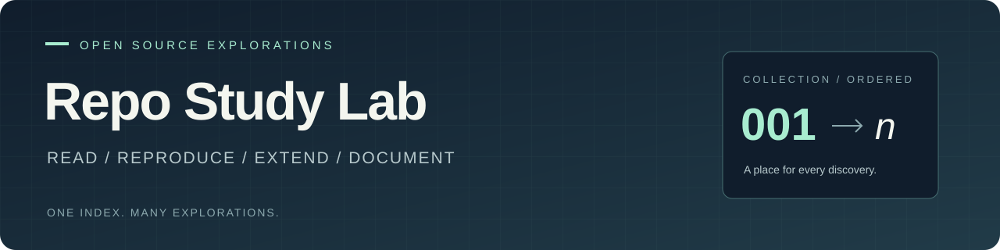

# GitHub 研究总库

记录日常在 GitHub、X 等渠道遇到的优秀开源项目：了解它解决的问题，复现关键能力，再沉淀自己的实践与结论。

这里是研究入口。每个子项目都有固定编号、独立说明、研究记录与图片，也可以拥有自己的 Web 演示。

[在线总入口与项目关联](https://yydshly.github.io/1025_codex_project/) · [项目索引](#项目索引) · [项目速览](#项目速览) · [新增项目](#新增一个研究项目) · [目录与编号约定](docs/CONVENTIONS.md) · [Web 部署约定](docs/DEPLOYMENT.md)

<!-- PROJECTS:START -->

## 项目索引

已收录 **15** 个项目 · 按固定编号升序排列

| 编号 | 项目 | 源库 | 简介 / 研究重点 | 阶段 | 演示 |
| --- | --- | --- | --- | --- | --- |
| 001 | [早期方向档案](projects/001-early-directions-atlas/README.md) | [本库原创档案（无上游源库）](<https://github.com/yydshly/1025_codex_project>) | 把早期的 12 个产品、工具与创作方向整理成一张地图。可查每个想法做到哪一步、为何继续或暂停，以及接下来要验证什么。 | 已总结 | [在线访问](<https://yydshly.github.io/1025_codex_project/001-early-directions-atlas/>) |
| 002 | [未完 · 水墨叙事](projects/002-ink-rain-alley/README.md) | [Bee 原演示（未取得源库）](<https://x.com/thtbee_/status/2114030630887641448>) | 参考 Bee 的录屏独立实现九段滚动水墨叙事。看雨巷、四季湖景与莲花如何用画幅、遮罩、微动和声音串起来。公开演示收在 005「纸间」。 | 已总结 | [在线访问](<https://yydshly.github.io/1025_codex_project/005-paper-poetics-lab/original.html>) |
| 003 | [连续主题体验设计](projects/003-unified-learning-design/README.md) | [every&#45;joule&#45;lesson1](<https://github.com/iamtechartist/every-joule-lesson1>) | 体验三课可翻页、可调参的三维物理书。实验状态同时驱动模型、数值、镜头和 MiniMax 导览，适合参考互动教材怎样组织内容和反馈。 | 已总结 | [在线访问](<https://yydshly.github.io/1025_codex_project/003-unified-learning-design/>) |
| 004 | [BaoCut · 能力、原理与效果研究](projects/004-baocut-effects-atlas/README.md) | [baocut](<https://github.com/JimLiu/baocut>) | 从 20 段预览和 24 个方向看 BaoCut 怎样把代码动效、AI 静图运镜和素材剪辑组合成可编辑的视频。记录了人工接手的位置，效率收益待实测。 | 研究中 | [在线访问](<https://yydshly.github.io/1025_codex_project/004-baocut-effects-atlas/>) |
| 005 | [纸间 · 诗性风格实验室](projects/005-paper-poetics-lab/README.md) | [Bee 原演示（未取得源库）](<https://x.com/thtbee_/status/2114030630887641448>) | 用水墨重写、实时茶庭和 AI 雨窗样片比较三种氛围表达方式。图解说明何时选网页交互、实时场景或生成视频，并记录各自的制作条件。 | 研究中 | [在线访问](<https://yydshly.github.io/1025_codex_project/005-paper-poetics-lab/>) |
| 006 | [PromptHub · AI 工作资产与复用](projects/006-prompthub-ai-assets/README.md) | [PromptHub](<https://github.com/legeling/PromptHub>) | 研究 PromptHub 如何管理提示词、Skills、MCP、插件与规则。档案记录把反复验证的工作经验整理成可复用资产的方法，笔记提炼与回写待接入。 | 已总结 | — |
| 007 | [鹈鹕的单车日和](projects/007-pelican-bicycle/README.md) | [本库原创（无上游源库）](<https://github.com/yydshly/1025_codex_project>) | 体验一只在海边骑车的鹈鹕。SVG 画角色与景物，CSS 做轮转和微动，可暂停、调速，支持减少动态效果设置。适合参考轻量网页动画的实现。 | 实践中 | [在线访问](<https://yydshly.github.io/1025_codex_project/007-pelican-bicycle/>) |
| 008 | [奥特曼卡片抽卡器](projects/008-ultraman-card-draw/README.md) | [本库原创（无上游源库）](<https://github.com/yydshly/1025_codex_project>) | 从 874 条人物与形态资料中抽卡，结合招式光效与设备讲解做亲子探索。研究记录了人物素材、演出配置和卡片舞台如何分层。 | 实践中 | [在线访问](<https://yydshly.github.io/1025_codex_project/008-ultraman-card-draw/>) |
| 009 | [资料理解与检索研究](projects/009-knowledge-processing-atlas/README.md) | [DeepTutor](<https://github.com/HKUDS/DeepTutor>) | 比较 26 个资料处理工具或方案，拆解文档解析、分块、检索与时间关系。可查看同题样例和选型协议，研究目标是能带出处读资料和跨日回顾。 | 研究中 | [在线访问](<https://yydshly.github.io/1025_codex_project/009-knowledge-processing-atlas/>) |
| 010 | [Agent Skills · 全景理解与实践](projects/010-agent-skills-engineering-lab/README.md) | [agent&#45;skills](<https://github.com/addyosmani/agent-skills>) | 把上游的 25 项工程 Skills 按需求、计划、实现、验证、审查和交付等环节整理成地图。可对照应用场景、产物和检查项，并查看本库的研究回查实测。 | 研究中 | [在线访问](<https://yydshly.github.io/1025_codex_project/010-agent-skills-engineering-lab/>) |
| 011 | [姿势与衣装参考 · 能力、作用与产品探索](projects/011-pose-look-creation-atlas/README.md) | [POSE&#45;DB&#45;01姿势图库与COSTUME&#45;DB&#45;01衣装图库](<https://x.com/leo_xiaolei/status/2114971707962536302>) | 用姿势与衣装两个图库研究多参考生图。公开九格组合实测和六张写真候选，可看同一虚构人物怎样更换动作与衣装，以及哪些细节容易偏离。 | 研究中 | [在线访问](<https://yydshly.github.io/1025_codex_project/011-pose-look-creation-atlas/>) |
| 012 | [学术研究 Skill · 能力与水生毒理学实测](projects/012-aquatic-toxicology-skill-lab/README.md) | [academic&#45;research&#45;skills](<https://github.com/Imbad0202/academic-research-skills>) | 以水生毒理学试题走一遍拆题、检索、文献筛选和证据分析，比较五种学术研究流程。公开报告、筛选表和核验记录，检索查全率与实际增益待验证。 | 研究中 | [在线访问](<https://yydshly.github.io/1025_codex_project/012-aquatic-toxicology-skill-lab/>) |
| 013 | [景观奇旅 · AI影像创作实验室](projects/013-scenic-motion-lab/README.md) | [Personality 原参考视频（非源码仓库）](<https://x.com/hi_personality/status/2115567493565825244>) | 观看 11&#46;04 秒海湾骑行试片和两段原片，追踪首图、角色动作、运镜、环境响应与接缝。总结了可复用的导演方法，长片连续性待验证。 | 研究中 | [在线访问](<https://yydshly.github.io/1025_codex_project/013-scenic-motion-lab/>) |
| 014 | [50 个网站的产品能力与实现参考库](projects/014-web-product-reference-library/README.md) | [小樱 50 个网站清单与各站官方资料](<https://x.com/xiaoying_eth/status/2116389253060190271>) | 按原帖编号浏览 50 个网站和八类能力。每站都给出实际效果、具体原站入口、可借鉴机制与实现条件。可按类别与关键词查找，并对照其中的设计方法怎样延伸到 015「观象」。 | 研究中 | — |
| 015 | [观象 · 地球过程与真实事件](projects/015-process-visualization-lab/README.md) | [研究起点 · 50 站清单与地月配视频](<https://x.com/xiaoying_eth/status/2116389253060190271>) | 用同一时间轴联动原理、真实资料、画面、曲线和中文讲解。公开八个地球历史案例及 NASA B0005 放电实验，可追溯关键时刻的观测来源。 | 实践中 | [在线访问](<https://yydshly.github.io/1025_codex_project/015-process-visualization-lab/>) |

## 项目速览

### 001 · 早期方向档案

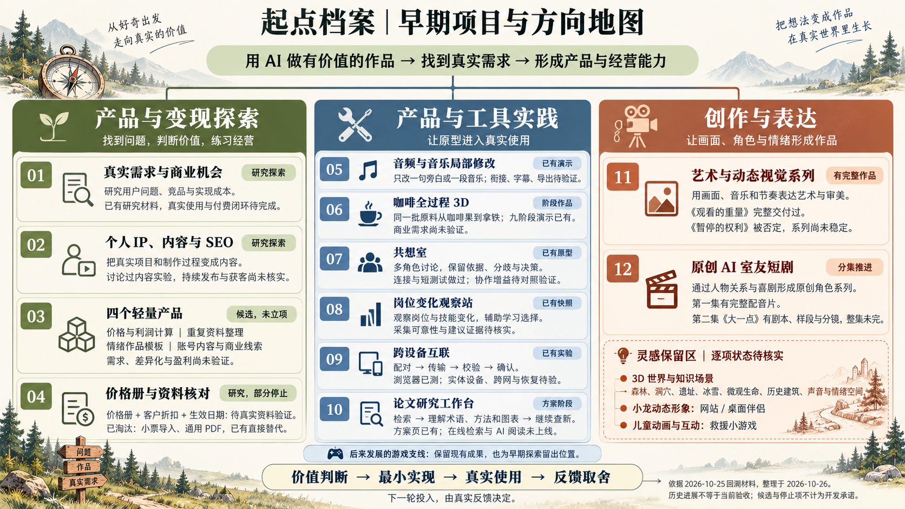

把早期的 12 个产品、工具与创作方向整理成一张地图。可查每个想法做到哪一步、为何继续或暂停，以及接下来要验证什么。

[研究说明](projects/001-early-directions-atlas/README.md) · 源库：[本库原创档案（无上游源库）](<https://github.com/yydshly/1025_codex_project>) · [在线演示](<https://yydshly.github.io/1025_codex_project/001-early-directions-atlas/>)

**阶段：** 已总结 · **标签：** 早期思考 / 遗留方向 / AI产品 / 创作 / 历史回溯

### 002 · 未完 · 水墨叙事

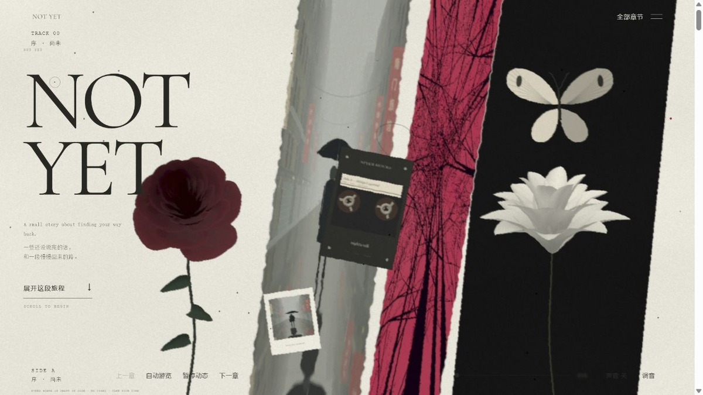

参考 Bee 的录屏独立实现九段滚动水墨叙事。看雨巷、四季湖景与莲花如何用画幅、遮罩、微动和声音串起来。公开演示收在 005「纸间」。

[研究说明](projects/002-ink-rain-alley/README.md) · 源库：[Bee 原演示（未取得源库）](<https://x.com/thtbee_/status/2114030630887641448>) · [在线演示](<https://yydshly.github.io/1025_codex_project/005-paper-poetics-lab/original.html>)

**阶段：** 已总结 · **标签：** Three&#46;js / WebGL / 水墨叙事 / 程序生成 / 交互动画

### 003 · 连续主题体验设计

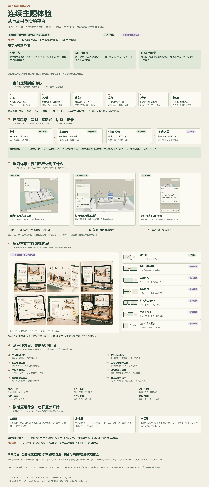

体验三课可翻页、可调参的三维物理书。实验状态同时驱动模型、数值、镜头和 MiniMax 导览，适合参考互动教材怎样组织内容和反馈。

[研究说明](projects/003-unified-learning-design/README.md) · 源库：[every&#45;joule&#45;lesson1](<https://github.com/iamtechartist/every-joule-lesson1>) · [在线演示](<https://yydshly.github.io/1025_codex_project/003-unified-learning-design/>)

**阶段：** 已总结 · **标签：** Three&#46;js / 3D书籍 / 效果复刻 / 交互学习 / 方法论

### 004 · BaoCut · 能力、原理与效果研究

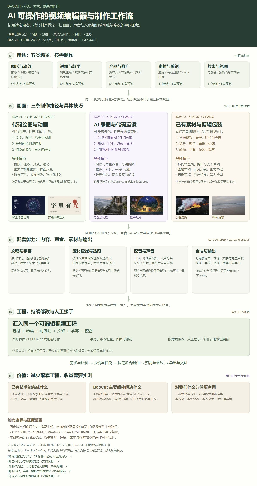

从 20 段预览和 24 个方向看 BaoCut 怎样把代码动效、AI 静图运镜和素材剪辑组合成可编辑的视频。记录了人工接手的位置，效率收益待实测。

[研究说明](projects/004-baocut-effects-atlas/README.md) · 源库：[baocut](<https://github.com/JimLiu/baocut>) · [在线演示](<https://yydshly.github.io/1025_codex_project/004-baocut-effects-atlas/>)

**阶段：** 研究中 · **标签：** BaoCut / 视频制作 / 代码动画 / 素材剪辑 / 工作流研究

### 005 · 纸间 · 诗性风格实验室

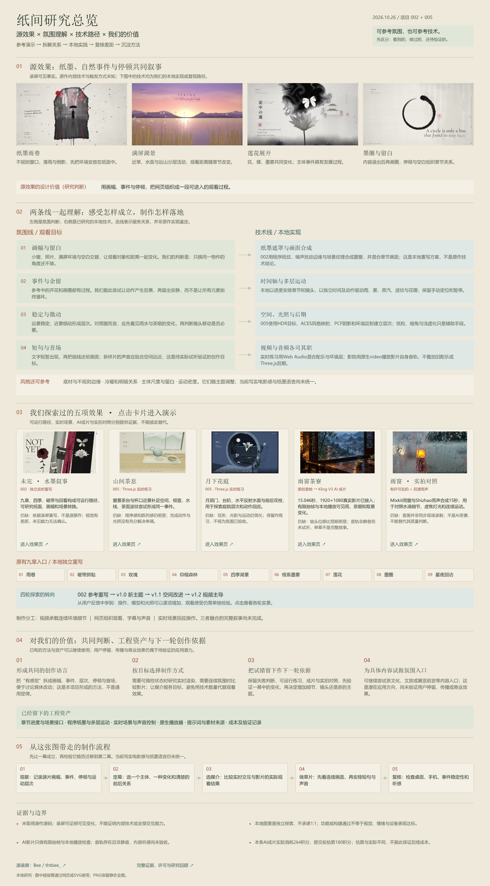

用水墨重写、实时茶庭和 AI 雨窗样片比较三种氛围表达方式。图解说明何时选网页交互、实时场景或生成视频，并记录各自的制作条件。

[研究说明](projects/005-paper-poetics-lab/README.md) · 源库：[Bee 原演示（未取得源库）](<https://x.com/thtbee_/status/2114030630887641448>) · [在线演示](<https://yydshly.github.io/1025_codex_project/005-paper-poetics-lab/>)

**阶段：** 研究中 · **标签：** 视频氛围 / AI视频 / Three&#46;js / 风格研究 / 交互叙事

### 006 · PromptHub · AI 工作资产与复用

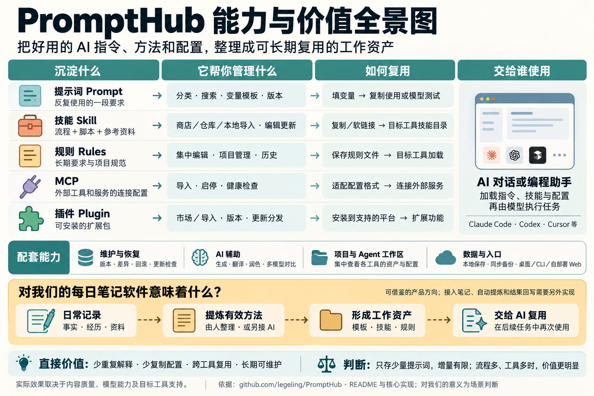

研究 PromptHub 如何管理提示词、Skills、MCP、插件与规则。档案记录把反复验证的工作经验整理成可复用资产的方法，笔记提炼与回写待接入。

[研究说明](projects/006-prompthub-ai-assets/README.md) · 源库：[PromptHub](<https://github.com/legeling/PromptHub>)

**阶段：** 已总结 · **标签：** PromptHub / AI工作流 / Skill / 提示词管理 / 笔记到工具

### 007 · 鹈鹕的单车日和

体验一只在海边骑车的鹈鹕。SVG 画角色与景物，CSS 做轮转和微动，可暂停、调速，支持减少动态效果设置。适合参考轻量网页动画的实现。

[研究说明](projects/007-pelican-bicycle/README.md) · 源库：[本库原创（无上游源库）](<https://github.com/yydshly/1025_codex_project>) · [在线演示](<https://yydshly.github.io/1025_codex_project/007-pelican-bicycle/>)

**阶段：** 实践中 · **标签：** 网页动画 / 插画 / 交互

### 008 · 奥特曼卡片抽卡器

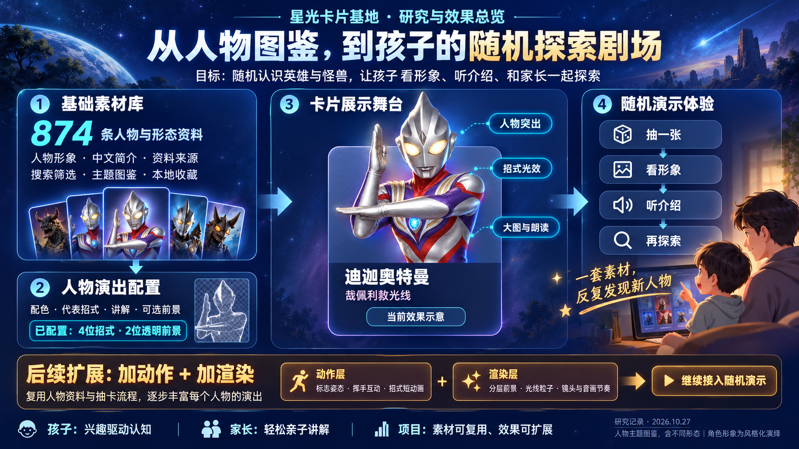

从 874 条人物与形态资料中抽卡，结合招式光效与设备讲解做亲子探索。研究记录了人物素材、演出配置和卡片舞台如何分层。

[研究说明](projects/008-ultraman-card-draw/README.md) · 源库：[本库原创（无上游源库）](<https://github.com/yydshly/1025_codex_project>) · [在线演示](<https://yydshly.github.io/1025_codex_project/008-ultraman-card-draw/>)

**阶段：** 实践中 · **标签：** 卡片收藏 / 抽卡 / 亲子

### 009 · 资料理解与检索研究

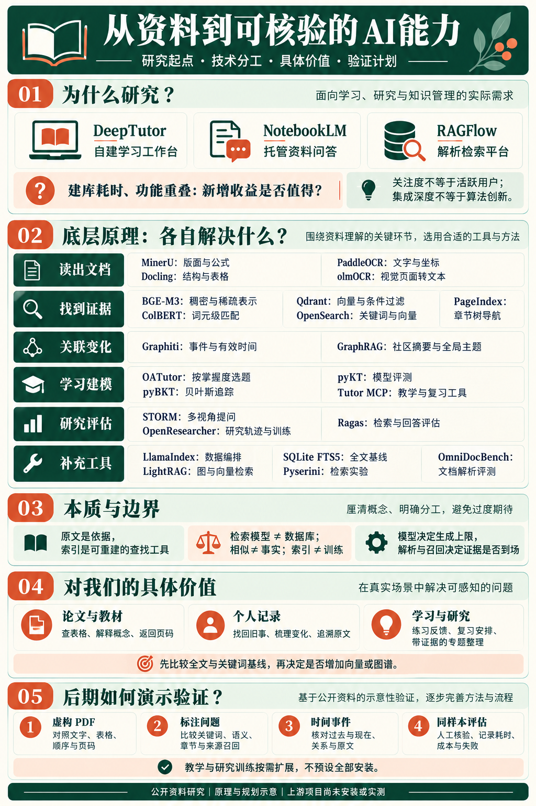

比较 26 个资料处理工具或方案，拆解文档解析、分块、检索与时间关系。可查看同题样例和选型协议，研究目标是能带出处读资料和跨日回顾。

[研究说明](projects/009-knowledge-processing-atlas/README.md) · 源库：[DeepTutor](<https://github.com/HKUDS/DeepTutor>) · [在线演示](<https://yydshly.github.io/1025_codex_project/009-knowledge-processing-atlas/>)

**阶段：** 研究中 · **标签：** 文档解析 / 知识检索 / RAG / 时间关系 / 研究对比

### 010 · Agent Skills · 全景理解与实践

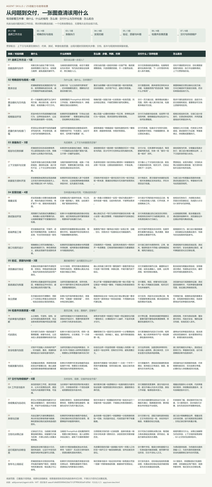

把上游的 25 项工程 Skills 按需求、计划、实现、验证、审查和交付等环节整理成地图。可对照应用场景、产物和检查项，并查看本库的研究回查实测。

[研究说明](projects/010-agent-skills-engineering-lab/README.md) · 源库：[agent&#45;skills](<https://github.com/addyosmani/agent-skills>) · [在线演示](<https://yydshly.github.io/1025_codex_project/010-agent-skills-engineering-lab/>)

**阶段：** 研究中 · **标签：** Agent Skills / AI编程 / 工程流程 / 实验验证

### 011 · 姿势与衣装参考 · 能力、作用与产品探索

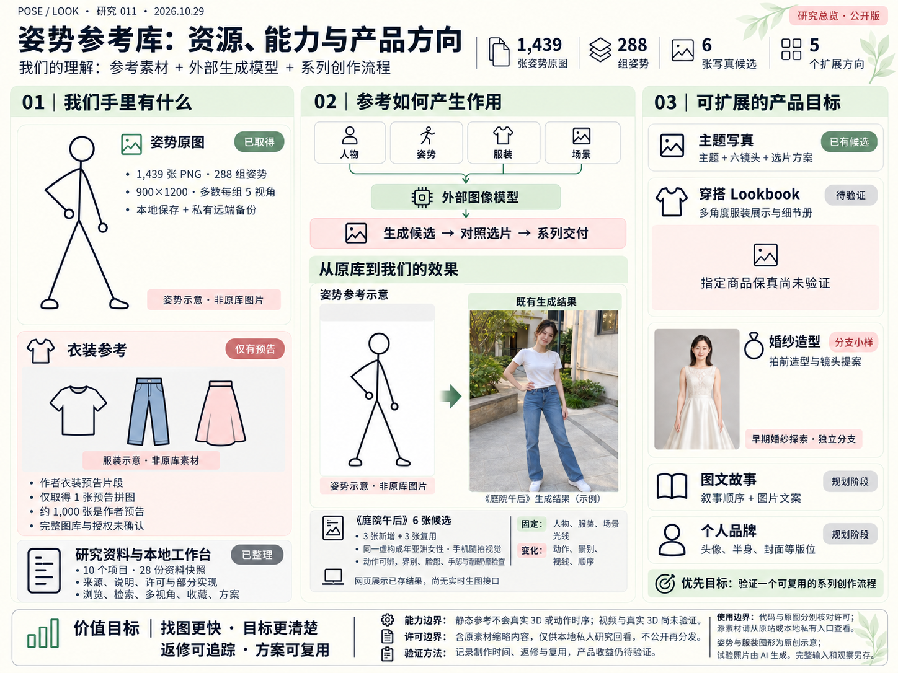

用姿势与衣装两个图库研究多参考生图。公开九格组合实测和六张写真候选，可看同一虚构人物怎样更换动作与衣装，以及哪些细节容易偏离。

[研究说明](projects/011-pose-look-creation-atlas/README.md) · 源库：[POSE&#45;DB&#45;01姿势图库与COSTUME&#45;DB&#45;01衣装图库](<https://x.com/leo_xiaolei/status/2114971707962536302>) · [在线演示](<https://yydshly.github.io/1025_codex_project/011-pose-look-creation-atlas/>)

**阶段：** 研究中 · **标签：** 姿势参考 / 衣装参考 / 多参考生图 / 系列写真 / 产品研究

### 012 · 学术研究 Skill · 能力与水生毒理学实测

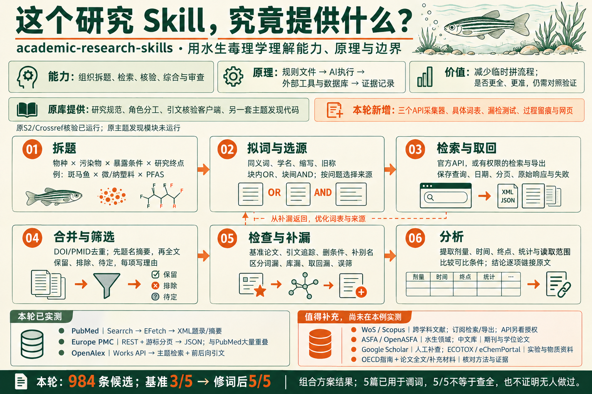

以水生毒理学试题走一遍拆题、检索、文献筛选和证据分析，比较五种学术研究流程。公开报告、筛选表和核验记录，检索查全率与实际增益待验证。

[研究说明](projects/012-aquatic-toxicology-skill-lab/README.md) · 源库：[academic&#45;research&#45;skills](<https://github.com/Imbad0202/academic-research-skills>) · [在线演示](<https://yydshly.github.io/1025_codex_project/012-aquatic-toxicology-skill-lab/>)

**阶段：** 研究中 · **标签：** 水生毒理学 / 学术研究 / Skill实测 / 证据综合

### 013 · 景观奇旅 · AI影像创作实验室

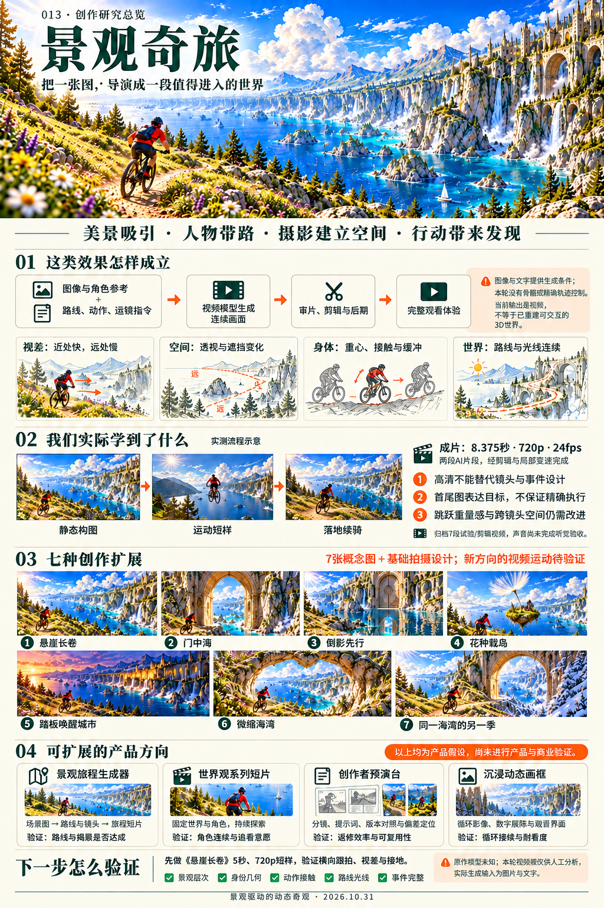

观看 11&#46;04 秒海湾骑行试片和两段原片，追踪首图、角色动作、运镜、环境响应与接缝。总结了可复用的导演方法，长片连续性待验证。

[研究说明](projects/013-scenic-motion-lab/README.md) · 源库：[Personality 原参考视频（非源码仓库）](<https://x.com/hi_personality/status/2115567493565825244>) · [在线演示](<https://yydshly.github.io/1025_codex_project/013-scenic-motion-lab/>)

**阶段：** 研究中 · **标签：** AI影像 / 景观叙事 / 图生视频 / 运镜设计 / 创作实验

### 014 · 50 个网站的产品能力与实现参考库

按原帖编号浏览 50 个网站和八类能力。每站都给出实际效果、具体原站入口、可借鉴机制与实现条件。可按类别与关键词查找，并对照其中的设计方法怎样延伸到 015「观象」。

[研究说明](projects/014-web-product-reference-library/README.md) · 源库：[小樱 50 个网站清单与各站官方资料](<https://x.com/xiaoying_eth/status/2116389253060190271>)

**阶段：** 研究中 · **标签：** 产品研究 / 能力分类 / 交互机制 / 数据接口 / 实现条件

### 015 · 观象 · 地球过程与真实事件

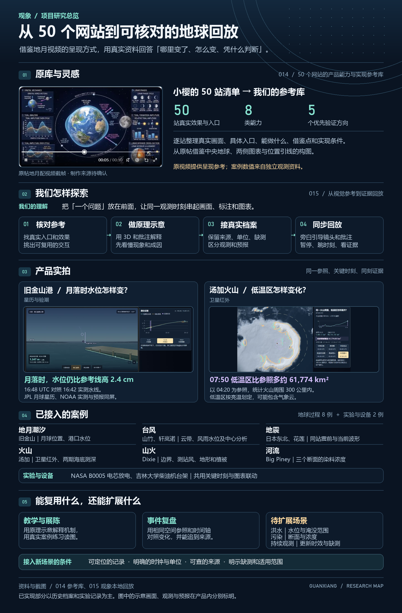

用同一时间轴联动原理、真实资料、画面、曲线和中文讲解。公开八个地球历史案例及 NASA B0005 放电实验，可追溯关键时刻的观测来源。

[研究说明](projects/015-process-visualization-lab/README.md) · 源库：[研究起点 · 50 站清单与地月配视频](<https://x.com/xiaoying_eth/status/2116389253060190271>) · [在线演示](<https://yydshly.github.io/1025_codex_project/015-process-visualization-lab/>)

**阶段：** 实践中 · **标签：** 交互地球 / 过程可视化 / 真实事件 / 资料溯源

<!-- PROJECTS:END -->

## 新增一个研究项目

需要 Node.js 22 或更高版本。根目录工具无第三方依赖，可直接运行，无需安装依赖。

```powershell
npm run project:new -- --slug repo-name --name "项目名称" --source "https://github.com/owner/repo" --summary "一句话介绍项目能力与研究目标"
```

命令会分配下一个编号、复制模板、登记项目，并更新本页索引。首次创建得到 `projects/001-repo-name/`；上面的名称与链接仅为命令示例。

1. 在子项目 `README.md` 中补充研究目标、原仓库版本与运行方法。
2. 在 `research/notes.md` 中记录复现过程和结论；代码放入 `app/`，按项目需要自行选择技术栈。
3. 将截图放入子项目 `assets/images/`，在 `projects.json` 的 `cover` 中填写相对路径，即可在本页展示。
4. 修改项目摘要、标签、进度或演示地址后，执行以下命令同步并检查索引。

```powershell
npm run index:update
npm run check
```

## 仓库结构

```text
.
├── README.md                 # 总索引、引导与项目图文速览
├── projects.json             # 编号、摘要、状态、配图和演示地址
├── projects/                 # 001-name、002-name……独立研究目录
├── templates/project/        # 子项目模板
├── docs/                     # 组织规则与部署约定
├── assets/images/            # 仓库级图片
├── scripts/                  # 新建项目、索引同步与校验工具
└── .github/workflows/        # 自动校验
```

## 研究方式

**发现 → 阅读 → 复现 → 扩展 → 总结**。先写清楚为什么研究，再记录可重复的操作、验证结果及适用边界。外层 README 保留摘要，详细内容放在各子项目中。

项目按编号升序展示。编号按收录顺序分配，分配后保持不变；归档项目保留编号，避免历史引用与演示链接失效。

## 来源与授权

子项目应注明原仓库、研究时的 commit/tag 和许可证。引入上游代码或素材时，保留原有授权与署名；当前总库尚未选择统一开源许可证，上游内容继续遵循其自身许可证。
