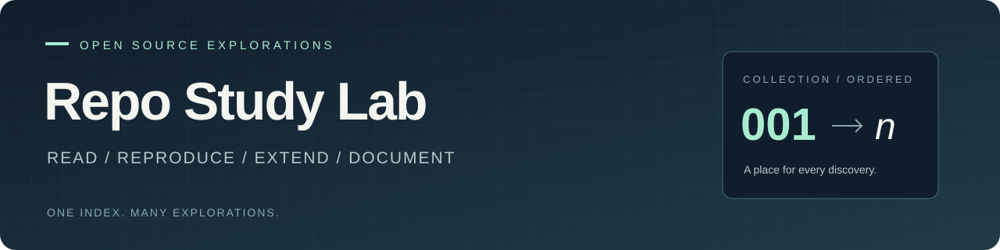

# GitHub 研究总库

记录日常在 GitHub、X 等渠道遇到的优秀开源项目：了解它解决的问题，复现关键能力，再沉淀自己的实践与结论。

这里是研究入口。每个子项目都有固定编号、独立说明、研究记录与图片，也可以拥有自己的 Web 演示。

[项目索引](#项目索引) · [项目速览](#项目速览) · [新增项目](#新增一个研究项目) · [目录与编号约定](docs/CONVENTIONS.md) · [Web 部署约定](docs/DEPLOYMENT.md)

<!-- PROJECTS:START -->

## 项目索引

已收录 **10** 个项目 · 按固定编号升序排列

| 编号 | 项目 | 源库 | 简介 / 研究重点 | 阶段 | 演示 |
| --- | --- | --- | --- | --- | --- |
| 001 | [早期方向档案](projects/001-early-directions-atlas/README.md) | [本库原创档案（无上游源库）](<https://github.com/yydshly/1025_codex_project>) | 我们早期思考与尝试留下的十二个方向：需求与变现、内容获客、轻量产品、价格册、音频局部修改、3D咖啡、共想室、岗位观察、跨设备、论文、艺术短片与AI室友。按候选、方案、原型、阶段作品及停止项保存进展、依据和待验证问题。 | 已总结 | [在线访问](<https://yydshly.github.io/1025_codex_project/001-early-directions-atlas/>) |
| 002 | [未完 · 水墨叙事](projects/002-ink-rain-alley/README.md) | [Bee 原演示（未取得源库）](<https://x.com/thtbee_/status/2114030630887641448>) | 依据Bee录屏独立重写纸墨九章叙事：雨巷、拼贴、森林、四季湖景、莲花与墨圈，以滚动、画幅变化和自然微动组织观看。沉淀场景进度、遮罩与声音实现；未取得原作源码，视觉仍有差异。 | 已总结 | [在线访问](<https://yydshly.github.io/1025_codex_project/005-paper-poetics-lab/original.html>) |
| 003 | [连续主题体验设计](projects/003-unified-learning-design/README.md) | [every&#45;joule&#45;lesson1](<https://github.com/iamtechartist/every-joule-lesson1>) | 以 Every Joule 为参照独立实现三课三维物理书：翻页、立体器材与能量变化同屏呈现，支持调参实验、预测反馈、MiniMax逐句导览、文字放大和连续阅读。通过共享实验状态联动模型、数值、镜头与讲解，阅读后恢复原上下文。沉淀内容、展示、操作和解释统一设计的方法，供互动教材、原理说明与实验平台复用；扩展布局仍为设想。 | 已总结 | [在线访问](<https://yydshly.github.io/1025_codex_project/003-unified-learning-design/>) |
| 004 | [BaoCut · 能力、原理与效果研究](projects/004-baocut-effects-atlas/README.md) | [baocut](<https://github.com/JimLiu/baocut>) | BaoCut 是 AI 可操作的视频编辑器与制作工作流。效果覆盖动效、讲解、产品片、混剪和故事；以代码动画、AI 静图运镜、已有素材剪辑组合成片，支持字幕、配音、检索与可编辑工程。价值主要在工具集成、反复修改和人工接手；附 24 个方向、20 段预览及原理说明，效率收益未实测。 | 研究中 | [在线访问](<https://yydshly.github.io/1025_codex_project/004-baocut-effects-atlas/>) |
| 005 | [纸间 · 诗性风格实验室](projects/005-paper-poetics-lab/README.md) | [Bee 原演示（未取得源库）](<https://x.com/thtbee_/status/2114030630887641448>) | 原参考以纸墨、画幅转换和自然微事件串起多场景诗性叙事。本研究用独立重写、实时茶庭与AI雨窗样片，沉淀氛围组织、载体选型和可复用工程方法；可扩展声画事件、纸墨与写实融合及文化展陈入口，仍需验证。 | 研究中 | [在线访问](<https://yydshly.github.io/1025_codex_project/005-paper-poetics-lab/>) |
| 006 | [PromptHub · AI 工作资产与复用](projects/006-prompthub-ai-assets/README.md) | [PromptHub](<https://github.com/legeling/PromptHub>) | 集中管理提示词、Skills、MCP、插件与规则，通过模板、技能分发和配置适配供 AI 复用。对我的价值是借鉴其方法，把每日笔记中验证有效的经验沉淀为工作资产，减少重复说明与跨工具配置；笔记自动提炼和结果回写需另接入。 | 已总结 | — |
| 008 | [奥特曼卡片抽卡器](projects/008-ultraman-card-draw/README.md) | [本库原创（无上游源库）](<https://github.com/yydshly/1025_codex_project>) | 以874条人物与形态资料为基础，随机展示奥特曼与怪兽，结合人物突出、招式光效和设备讲解开展亲子探索。沉淀素材、演出配置与卡片舞台分层，后续可增加人物动作和渲染，复用随机演示流程。 | 实践中 | [在线访问](<https://yydshly.github.io/1025_codex_project/008-ultraman-card-draw/>) |
| 009 | [资料理解与检索研究](projects/009-knowledge-processing-atlas/README.md) | [DeepTutor](<https://github.com/HKUDS/DeepTutor>) | 从 DeepTutor 与 NotebookLM 的教材问答和资料整理场景出发，比较 MinerU、Docling、BGE&#45;M3、Qdrant、Graphiti 等26个对象。拆解结构解析、分块、检索与时间关系的本质，规划带出处阅读、跨日回顾、经验复用和自适应复习；附同题样例、场景选型、并排对比和实验协议，上游效果待验证。 | 研究中 | [在线访问](<https://yydshly.github.io/1025_codex_project/009-knowledge-processing-atlas/>) |
| 010 | [Agent Skills · 全景理解与实践](projects/010-agent-skills-engineering-lab/README.md) | [agent&#45;skills](<https://github.com/addyosmani/agent-skills>) | 研究 addyosmani/agent&#45;skills 的25项工程规程：覆盖需求、规划、实现、验证、审查与交付维护，以七类工作和五问总图说明用途、场景、步骤、产物及协作。价值在于把工程经验变成AI可执行、结果可核对的流程；我们据此按真实需求选用，学习用约束、证据与检查控制落地，保留研究回查案例和自建Skill；全量讲解已完成，逐项实测待按需开展。 | 研究中 | [在线访问](<https://yydshly.github.io/1025_codex_project/010-agent-skills-engineering-lab/>) |
| 011 | [姿势与服装参考库 · 来源与能力研究](projects/011-pose-look-creation-atlas/README.md) | [姿势与服装参考图库原帖及相关源库](<https://x.com/leo_xiaolei/status/2114971707962536302>) | 研究原始姿势与服装参考库的来源、作者演示、能力与许可；说明已备份1,439张原图的保存位置，盘点288组姿势与视角覆盖，分析本地图册、对照评测、控制图、构图、视频及3D等七个方向的证据与验收。换装/婚纱生图实验保留为独立分支，不作为原库效果验证。 | 研究中 | [在线访问](<https://yydshly.github.io/1025_codex_project/011-pose-look-creation-atlas/>) |

## 项目速览

### 001 · 早期方向档案

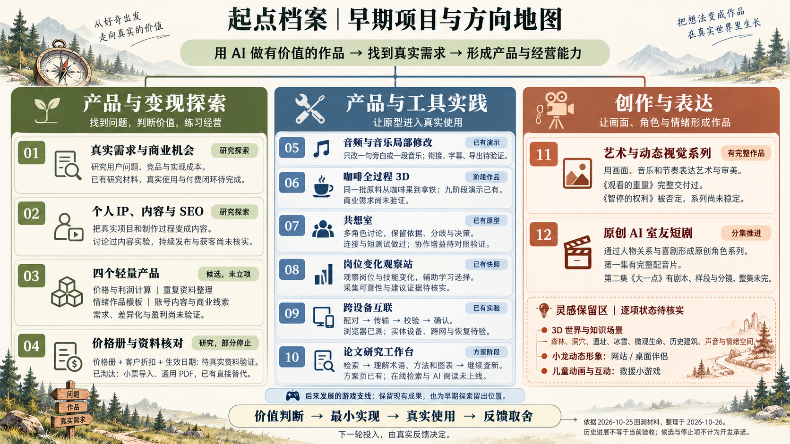

我们早期思考与尝试留下的十二个方向：需求与变现、内容获客、轻量产品、价格册、音频局部修改、3D咖啡、共想室、岗位观察、跨设备、论文、艺术短片与AI室友。按候选、方案、原型、阶段作品及停止项保存进展、依据和待验证问题。

[研究说明](projects/001-early-directions-atlas/README.md) · 源库：[本库原创档案（无上游源库）](<https://github.com/yydshly/1025_codex_project>) · [在线演示](<https://yydshly.github.io/1025_codex_project/001-early-directions-atlas/>)

**阶段：** 已总结 · **标签：** 早期思考 / 遗留方向 / AI产品 / 创作 / 历史回溯

### 002 · 未完 · 水墨叙事

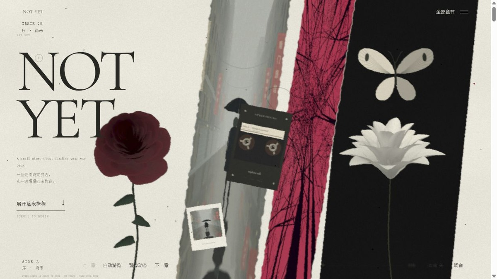

依据Bee录屏独立重写纸墨九章叙事：雨巷、拼贴、森林、四季湖景、莲花与墨圈，以滚动、画幅变化和自然微动组织观看。沉淀场景进度、遮罩与声音实现；未取得原作源码，视觉仍有差异。

[研究说明](projects/002-ink-rain-alley/README.md) · 源库：[Bee 原演示（未取得源库）](<https://x.com/thtbee_/status/2114030630887641448>) · [在线演示](<https://yydshly.github.io/1025_codex_project/005-paper-poetics-lab/original.html>)

**阶段：** 已总结 · **标签：** Three&#46;js / WebGL / 水墨叙事 / 程序生成 / 交互动画

### 003 · 连续主题体验设计

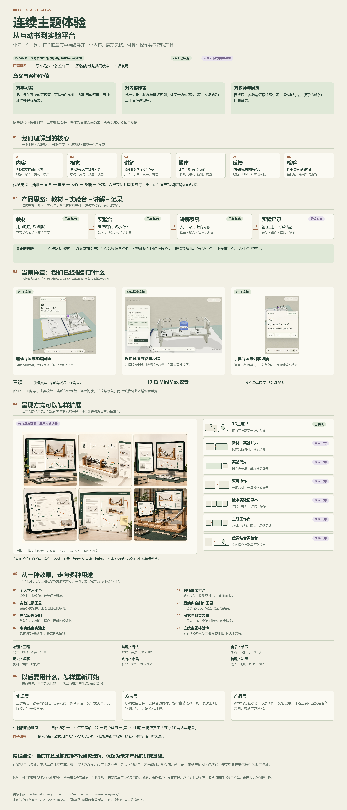

以 Every Joule 为参照独立实现三课三维物理书：翻页、立体器材与能量变化同屏呈现，支持调参实验、预测反馈、MiniMax逐句导览、文字放大和连续阅读。通过共享实验状态联动模型、数值、镜头与讲解，阅读后恢复原上下文。沉淀内容、展示、操作和解释统一设计的方法，供互动教材、原理说明与实验平台复用；扩展布局仍为设想。

[研究说明](projects/003-unified-learning-design/README.md) · 源库：[every&#45;joule&#45;lesson1](<https://github.com/iamtechartist/every-joule-lesson1>) · [在线演示](<https://yydshly.github.io/1025_codex_project/003-unified-learning-design/>)

**阶段：** 已总结 · **标签：** Three&#46;js / 3D书籍 / 效果复刻 / 交互学习 / 方法论

### 004 · BaoCut · 能力、原理与效果研究

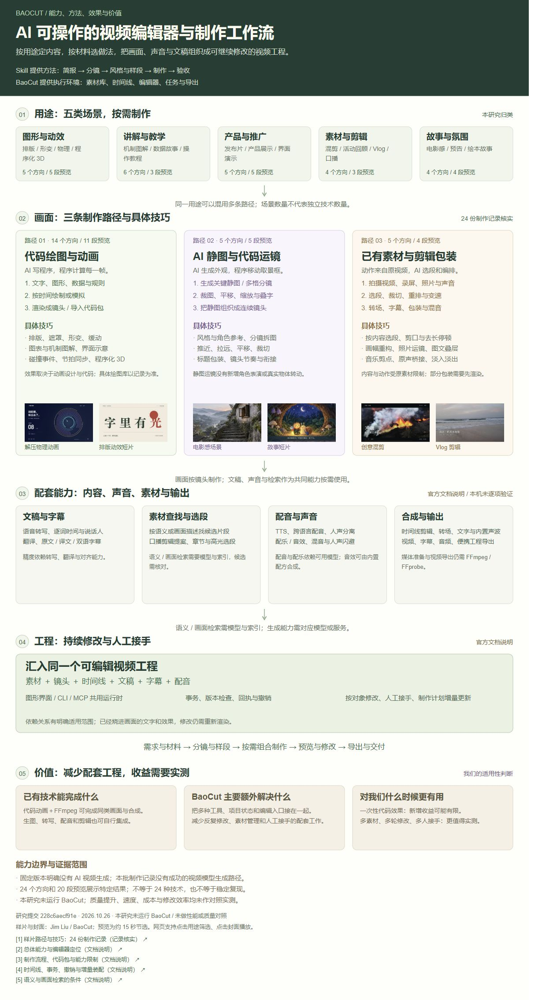

BaoCut 是 AI 可操作的视频编辑器与制作工作流。效果覆盖动效、讲解、产品片、混剪和故事；以代码动画、AI 静图运镜、已有素材剪辑组合成片，支持字幕、配音、检索与可编辑工程。价值主要在工具集成、反复修改和人工接手；附 24 个方向、20 段预览及原理说明，效率收益未实测。

[研究说明](projects/004-baocut-effects-atlas/README.md) · 源库：[baocut](<https://github.com/JimLiu/baocut>) · [在线演示](<https://yydshly.github.io/1025_codex_project/004-baocut-effects-atlas/>)

**阶段：** 研究中 · **标签：** BaoCut / 视频制作 / 代码动画 / 素材剪辑 / 工作流研究

### 005 · 纸间 · 诗性风格实验室

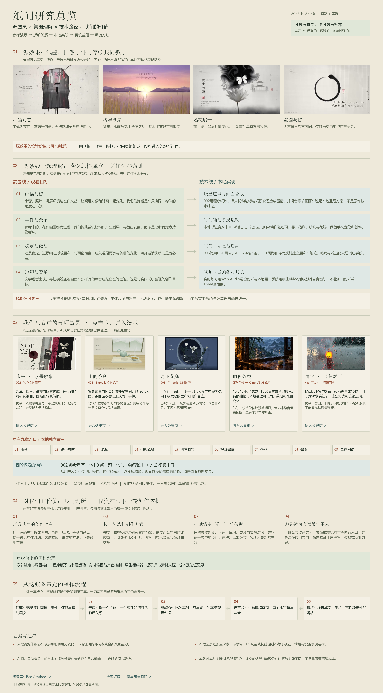

原参考以纸墨、画幅转换和自然微事件串起多场景诗性叙事。本研究用独立重写、实时茶庭与AI雨窗样片，沉淀氛围组织、载体选型和可复用工程方法；可扩展声画事件、纸墨与写实融合及文化展陈入口，仍需验证。

[研究说明](projects/005-paper-poetics-lab/README.md) · 源库：[Bee 原演示（未取得源库）](<https://x.com/thtbee_/status/2114030630887641448>) · [在线演示](<https://yydshly.github.io/1025_codex_project/005-paper-poetics-lab/>)

**阶段：** 研究中 · **标签：** 视频氛围 / AI视频 / Three&#46;js / 风格研究 / 交互叙事

### 006 · PromptHub · AI 工作资产与复用

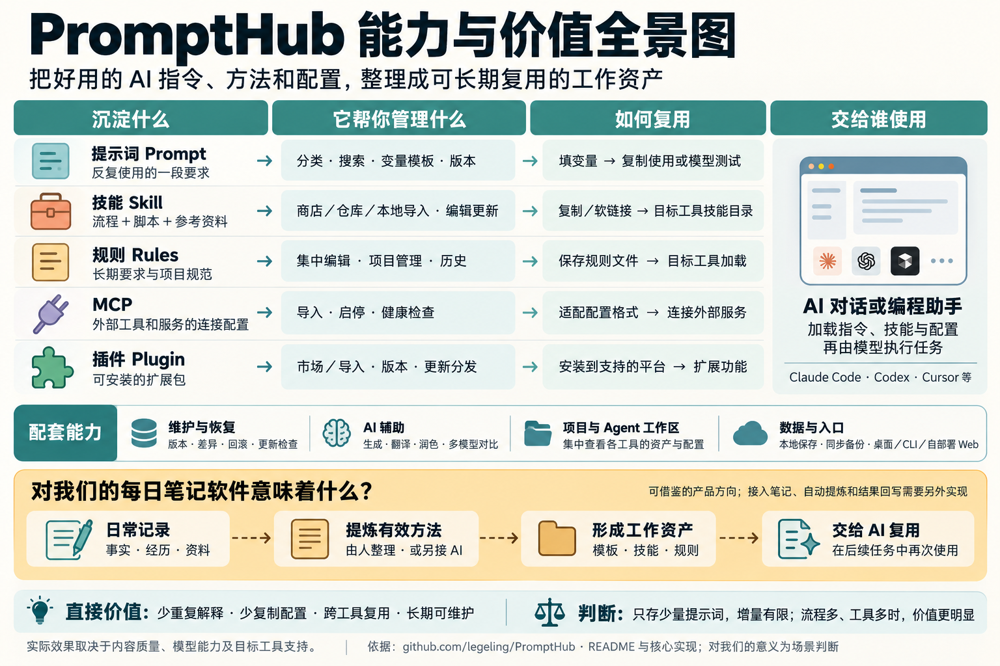

集中管理提示词、Skills、MCP、插件与规则，通过模板、技能分发和配置适配供 AI 复用。对我的价值是借鉴其方法，把每日笔记中验证有效的经验沉淀为工作资产，减少重复说明与跨工具配置；笔记自动提炼和结果回写需另接入。

[研究说明](projects/006-prompthub-ai-assets/README.md) · 源库：[PromptHub](<https://github.com/legeling/PromptHub>)

**阶段：** 已总结 · **标签：** PromptHub / AI工作流 / Skill / 提示词管理 / 笔记到工具

### 008 · 奥特曼卡片抽卡器

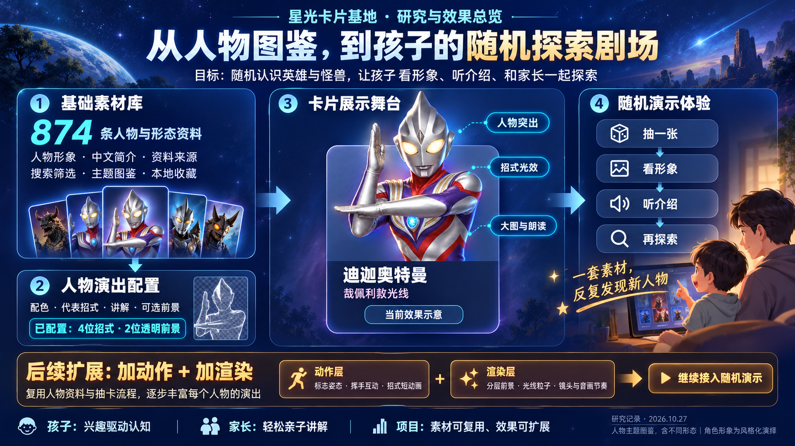

以874条人物与形态资料为基础，随机展示奥特曼与怪兽，结合人物突出、招式光效和设备讲解开展亲子探索。沉淀素材、演出配置与卡片舞台分层，后续可增加人物动作和渲染，复用随机演示流程。

[研究说明](projects/008-ultraman-card-draw/README.md) · 源库：[本库原创（无上游源库）](<https://github.com/yydshly/1025_codex_project>) · [在线演示](<https://yydshly.github.io/1025_codex_project/008-ultraman-card-draw/>)

**阶段：** 实践中 · **标签：** 卡片收藏 / 抽卡 / 亲子

### 009 · 资料理解与检索研究

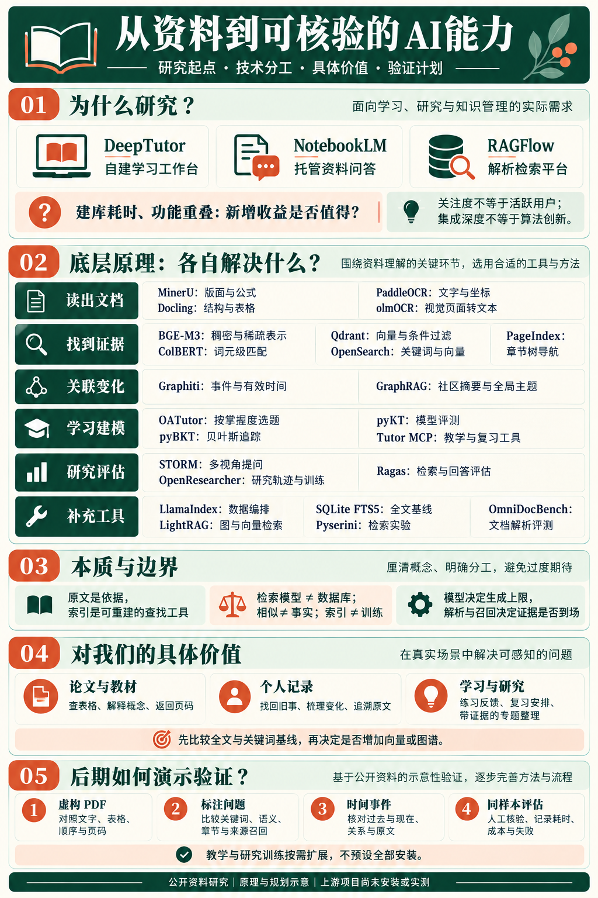

从 DeepTutor 与 NotebookLM 的教材问答和资料整理场景出发，比较 MinerU、Docling、BGE&#45;M3、Qdrant、Graphiti 等26个对象。拆解结构解析、分块、检索与时间关系的本质，规划带出处阅读、跨日回顾、经验复用和自适应复习；附同题样例、场景选型、并排对比和实验协议，上游效果待验证。

[研究说明](projects/009-knowledge-processing-atlas/README.md) · 源库：[DeepTutor](<https://github.com/HKUDS/DeepTutor>) · [在线演示](<https://yydshly.github.io/1025_codex_project/009-knowledge-processing-atlas/>)

**阶段：** 研究中 · **标签：** 文档解析 / 知识检索 / RAG / 时间关系 / 研究对比

### 010 · Agent Skills · 全景理解与实践

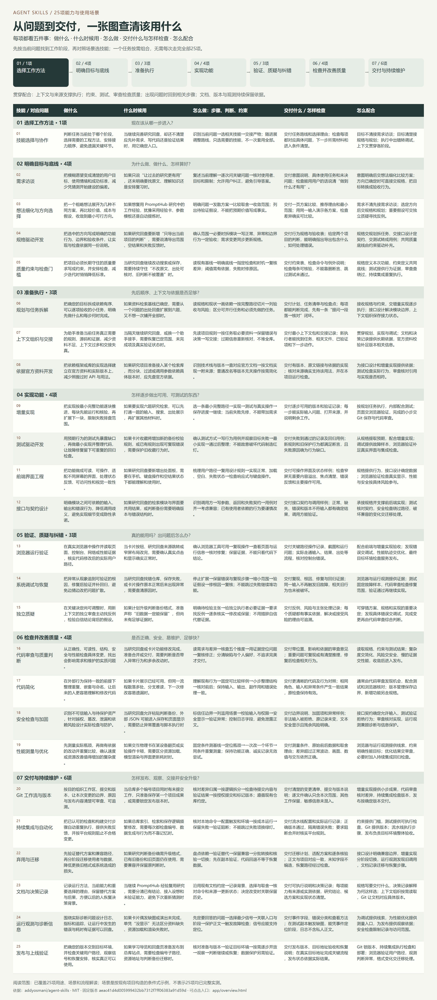

研究 addyosmani/agent&#45;skills 的25项工程规程：覆盖需求、规划、实现、验证、审查与交付维护，以七类工作和五问总图说明用途、场景、步骤、产物及协作。价值在于把工程经验变成AI可执行、结果可核对的流程；我们据此按真实需求选用，学习用约束、证据与检查控制落地，保留研究回查案例和自建Skill；全量讲解已完成，逐项实测待按需开展。

[研究说明](projects/010-agent-skills-engineering-lab/README.md) · 源库：[agent&#45;skills](<https://github.com/addyosmani/agent-skills>) · [在线演示](<https://yydshly.github.io/1025_codex_project/010-agent-skills-engineering-lab/>)

**阶段：** 研究中 · **标签：** Agent Skills / AI编程 / 工程流程 / 实验验证

### 011 · 姿势与服装参考库 · 来源与能力研究

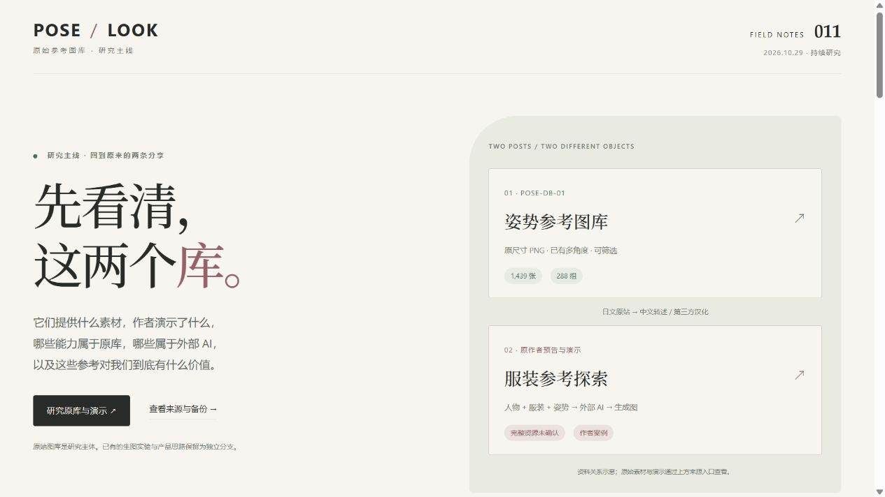

研究原始姿势与服装参考库的来源、作者演示、能力与许可；说明已备份1,439张原图的保存位置，盘点288组姿势与视角覆盖，分析本地图册、对照评测、控制图、构图、视频及3D等七个方向的证据与验收。换装/婚纱生图实验保留为独立分支，不作为原库效果验证。

[研究说明](projects/011-pose-look-creation-atlas/README.md) · 源库：[姿势与服装参考图库原帖及相关源库](<https://x.com/leo_xiaolei/status/2114971707962536302>) · [在线演示](<https://yydshly.github.io/1025_codex_project/011-pose-look-creation-atlas/>)

**阶段：** 研究中 · **标签：** 参考生图 / 换装 / 婚纱 / 能力研究 / 资料备份

<!-- PROJECTS:END -->

## 新增一个研究项目

需要 Node.js 22 或更高版本。根目录工具无第三方依赖，可直接运行，无需安装依赖。

```powershell
npm run project:new -- --slug repo-name --name "项目名称" --source "https://github.com/owner/repo" --summary "一句话介绍项目能力与研究目标"
```

命令会分配下一个编号、复制模板、登记项目，并更新本页索引。首次创建得到 `projects/001-repo-name/`；上面的名称与链接仅为命令示例。

1. 在子项目 `README.md` 中补充研究目标、原仓库版本与运行方法。
2. 在 `research/notes.md` 中记录复现过程和结论；代码放入 `app/`，按项目需要自行选择技术栈。
3. 将截图放入子项目 `assets/images/`，在 `projects.json` 的 `cover` 中填写相对路径，即可在本页展示。
4. 修改项目摘要、标签、进度或演示地址后，执行以下命令同步并检查索引。

```powershell
npm run index:update
npm run check
```

## 仓库结构

```text
.
├── README.md                 # 总索引、引导与项目图文速览
├── projects.json             # 编号、摘要、状态、配图和演示地址
├── projects/                 # 001-name、002-name……独立研究目录
├── templates/project/        # 子项目模板
├── docs/                     # 组织规则与部署约定
├── assets/images/            # 仓库级图片
├── scripts/                  # 新建项目、索引同步与校验工具
└── .github/workflows/        # 自动校验
```

## 研究方式

**发现 → 阅读 → 复现 → 扩展 → 总结**。先写清楚为什么研究，再记录可重复的操作、验证结果及适用边界。外层 README 保留摘要，详细内容放在各子项目中。

项目按编号升序展示。编号按收录顺序分配，分配后保持不变；归档项目保留编号，避免历史引用与演示链接失效。

## 来源与授权

子项目应注明原仓库、研究时的 commit/tag 和许可证。引入上游代码或素材时，保留原有授权与署名；当前总库尚未选择统一开源许可证，上游内容继续遵循其自身许可证。
