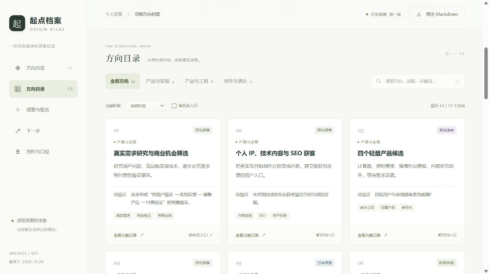

# 001 · 早期方向档案

> 用 AI 做有价值的作品，找到真实需求，逐步形成产品和经营能力。

这是我们早期思考、讨论和尝试留下的十二个方向。遗留包含候选、方案与原型、阶段作品，以及研究后主动停止的选择；逐项保存想法、进展与待验证问题，供下一轮取舍参考。

[在线阅读](https://yydshly.github.io/1025_codex_project/001-early-directions-atlas/) · [返回总索引](../../README.md#项目索引) · [网页文件](app/index.html) · [一图总览](assets/images/directions-map-v1.png) · [完整文字快照](research/archive-snapshot.md) · [整理与验证记录](research/notes.md)


图：我们在 2026-10-26 生成的方向总图，现作为网页与总索引的引导图。先看三条探索脉络，再通过网页目录查看十二个方向的原始想法、历史进展与验证问题。历史进展不代表当前验收。

## 这是什么

把本次对话中找回的早期方向整理成可浏览的档案。保留目标、历史进展、待验证问题、停止理由和原始入口，同时区分历史事实与后续建议。

| 项目 | 内容 |
| --- | --- |
| 编号 | `001` |
| 整理日期 | 2026-10-26，北京时间 |
| 历史状态口径 | 用户在 2026-10-25 对话中提供的回溯材料 |
| 资料来源 | 本次对话，未重新读取完整历史对话 |
| 源码位置 | 本研究总库原创子项目，无独立上游代码仓库 |
| 所属仓库 | https://github.com/yydshly/1025_codex_project |
| 当前状态 | 档案整理与网页已完成；不代表十二个方向全部完成 |
| 公开部署 | [GitHub Pages 在线网页](https://yydshly.github.io/1025_codex_project/001-early-directions-atlas/)，2026-10-27 已验证 |
| 依赖 | 无第三方依赖；可选本地服务需要 Node.js 22+ |

## 一图理解想法与方向

完整图已放在本文与网页开头，作为阅读引导。产品与变现四项、工具实践六项、创作表达两项，都按各自阶段记录。

图：2026-10-26 使用内置 ImageGen 生成，依据本页内容数据整理。三个分支表示探索脉络，不表示项目依赖或开发先后。底部是共同的验证循环，历史进展不代表当前验收。可[查看原图](assets/images/directions-map-v1.png)或[完整生成提示词](research/project-map-prompt.txt)。

## 收录内容

共十二个主要方向、三类探索脉络、九个历史入口。

| 分类 | 方向 |
| --- | --- |
| 产品与变现（4） | 真实需求研究与商业机会筛选；个人 IP、技术内容与 SEO；四个轻量产品候选；小票、PDF 与供应商价格册 |
| 产品与工具（6） | 音频与音乐局部修改；咖啡全过程 3D；共想室；岗位变化观察站；跨设备互联；论文研究工作台 |
| 创作与表达（2） | 艺术、审美与动态视觉系列；原创 AI 室友短剧 |

补充保留 3D 场景、小龙动态形象、儿童内容与互动的探索线索，以及游戏支线的历史登记口径。四个轻量候选、价格资料方向的停止项、两部艺术作品和短剧各集在详情中分别记录。

## 网页功能

- 按分类、阶段、有无历史入口组合筛选，支持跨目标、进展、分项内容的关键词搜索。
- 每个方向提供已知进展、尚未验证、分项取舍、下一份证据与来源说明。
- 方向详情支持 hash 地址，例如 `#direction/paper-workbench`；关闭弹窗保留原筛选状态。
- 支持完整 Markdown、结构化 JSON 导出，以及单条记录复制；剪贴板不可用时改为下载单条 Markdown。
- 桌面、平板、手机自适应；提供键盘焦点、跳转链接、Esc 关闭和减少动态效果支持。

## 本地运行

`app/` 为纯静态 HTML、CSS、JavaScript，资源均使用相对路径，不需要 API 密钥、登录或安装依赖。可用浏览器打开 `app/index.html`；本次内置浏览器仅允许 HTTP/HTTPS，因此实际交互验收通过下面的本地服务完成，未验证 `file://` 模式。

推荐在当前子项目目录运行：

```powershell
cd E:\codex_project\1025_codex_project\projects\001-early-directions-atlas
npm.cmd run dev
```

启动后访问 http://127.0.0.1:4317/ 。服务仅监听本机，用 Ctrl+C 停止。端口被占用时可在本次终端中设置 `$env:PORT = '4318'` 后重试。

检查命令：

```powershell
npm.cmd run check
```

仓库根目录另执行 `npm.cmd run check`，验证项目登记与总索引一致。

## 资料与维护

```text
app/
  index.html           页面结构
  data.js              十二个方向、来源与建议的内容数据
  app.js               筛选、详情、深链接和导出
  styles.css           响应式样式
  favicon.svg          原创站点标识
serve.mjs              仅用于本地预览的静态服务
research/
  notes.md             整理原则、验证记录与限制
  archive-snapshot.md  浏览器实际导出的完整文字快照
assets/images/
  cover.jpg            桌面首屏
  catalog.jpg          方向目录
  mobile-detail.jpg    手机详情
```

以后增补内容以 `app/data.js` 为准。修改方向数量或分类后，同时检查页面静态文案、目录导航计数和 README；重新导出并更新文字快照。候选是否立项、作品是否验收、建议是否接受，分别依据新增证据更新，不能由整理日期自动推断。

部署按根目录 [Web 部署约定](../../docs/DEPLOYMENT.md) 执行：`pages.config.json` 声明公开项目，构建时仅复制 `app/` 和指定的引导图，GitHub Actions 将它们挂载到编号子路径。研究笔记、提示词和其他截图不会进入网站产物。

## 边界与来源

- 所有项目进展依据用户提供的回溯材料，不将资料页、方案页或短测试描述为完整产品。
- 岗位站的 403、最后成功采集日期与游戏 45 款／99 入口均保留历史日期，未作为当前运行状态重新确认。
- 页面中的“下一份证据”和“下一步”是本次整理及上一轮讨论建议，尚未确认立项。
- 本页面未复制上游代码或外部媒体。主引导图使用内置 ImageGen 生成，站点标识由本项目 SVG 绘制，截图来自本项目预览。
- 总库尚未选择统一开源许可证；历史入口指向的作品、仓库与素材沿用各自权利和授权，不因被本页收录而改变。



图：分类、阶段筛选与历史进展卡片。更多验证记录见 [research/notes.md](research/notes.md)。
