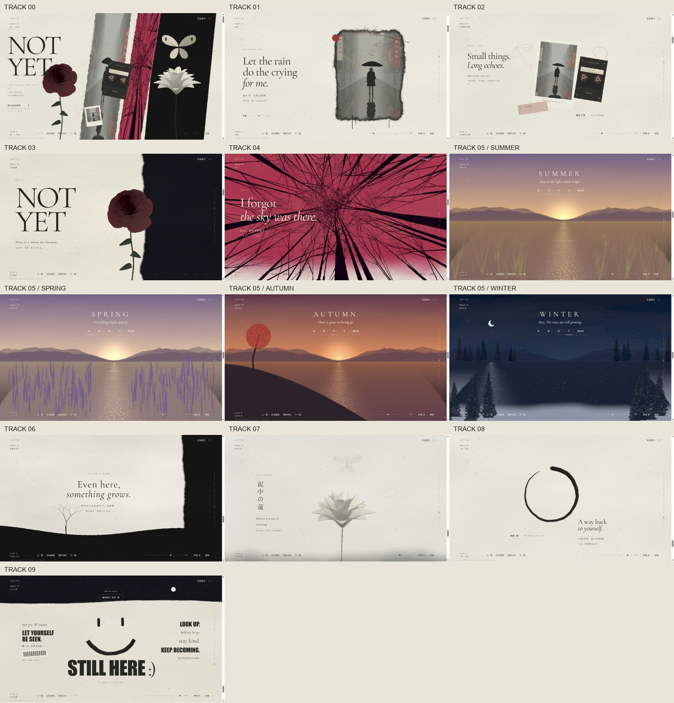

# 002 · 未完 · 水墨叙事（NOT YET）

> 拼贴封面与九章动态故事，由 Three.js、Canvas 与着色器绘制，支持滚动叙事、自动游览、四季切换、磁带翻面和合成环境音。2.2.0 精修夏景、冬景与莲花，加入原创氛围配乐、独立混音和更清楚的操作控件。

[返回总索引](../../README.md#项目索引) · [研究笔记](research/notes.md) · [视觉与交互验证](design-qa.md)



图：2.2.0 实际浏览器截图，包含封面、九章与四季中的多个状态。

[本轮夏景／冬景／莲花前后对照](assets/images/v2.2-before-after.jpg)。

功能齐全不等于视觉已经贴合原作。本项目依据录屏独立重写，尚未取得原演示源码；花瓣轮廓、镜头运动和墨迹流动仍有差异。可查看[参考与当前实现对照](assets/images/story-comparison.jpg)判断画面，而不把章节数量或交互通过作为视觉一致的证明。


[纸间 · 风格入口与两个新主题](../005-paper-poetics-lab/README.md) 将本演示作为参考练习关联，并整理共同方法。

## 2.1.0 视觉调整

- 玫瑰改用连续螺旋曲面形成卷曲叠瓣；莲花使用分层曲面与柔光着色，减轻硬边和深色背面。
- 森林改为向上收束的密集黑色枝干，保留深红天空和下方纸白过渡。
- 湖景调整为暖色山谷、日落与集中在太阳下方的金色倒影；弯曲草叶、蒲公英、春季薰衣草、秋日红色山坡和冬季雪松分别构成前景。雪松纹理由 Canvas 绘制。
- 墨圈与笑脸采用更厚的浓墨轮廓、粗糙边缘和干笔留白；纸面颗粒、撕纸纤维与缝线更明显，底部控件减少对画面的遮挡。

这些调整仍是程序化近似。运行时没有使用外部照片、参考视频或预先渲染的场景图片。

## 2.2.0 · 画面与声音

- 夏景改为不规则草丛、孤立茎叶和少量蒲公英，保留更大的水面空隙。
- 冬景改用 6 种具有深色树冠与零碎积雪的程序松树纹理，远近树群分开布局。
- 莲花由竖直花苞渐变为三层杯形花瓣；低雾移到花朵下方，保留花瓣正反面的明暗。
- 四季和全局控件增加字号及操作面积，窄屏页脚分成两行。
- 新增《纸上归途》原创程序配乐：54 BPM、约 71 秒循环，柔和钢琴音色与长音，无鼓点、无人声。音色不是实际钢琴录音，旋律和合成过程可追溯。

先点击“声音 关”开启，或打开“调音”。可选“配乐与环境”或“只听环境”，总音量、配乐和环境三个音量独立调整。配乐保持连续，风、雨、水声随章节淡入淡出；暂停动态或切到后台时，声音一起淡出并暂停，继续后恢复。

[36 秒配乐试听](assets/audio/paper-home-preview.mp3) · [音符、来源与重生成方法](assets/audio/README.md)。实际运行只在用户开启后加载约 370 KB 的本地 OGG 音轨，试听与 WAV 母带不参与网页加载。运行时没有音乐生成服务或外部音频请求。

常规动画绘制限制到约 60 FPS；增加 `?inspect=1` 可显示当前浏览器的 FPS、p95 帧间隔和 CPU 提交时间，例如 `http://127.0.0.1:4174/?inspect=1#seasons`。它是本机观察窗口，不代表 GPU 耗时或实体手机性能保证，普通浏览不显示。

## 本地运行

需要 Node.js 22.12 或更新版本，以及支持 WebGL 2 的浏览器。

```powershell
cd E:\codex_project\1025_codex_project\projects\002-ink-rain-alley
npm ci
npm run dev
```

打开 [http://127.0.0.1:4174/](http://127.0.0.1:4174/)。也可双击 `start-local.cmd`。

当前交付预览已经在后台使用 **4174** 端口运行，直接打开链接即可。若同时启动开发环境，请使用另一个端口：

```powershell
npm.cmd run dev -- --port=4175
```

安装依赖后，渲染引擎、字体和全部场景都从本机加载，不需要 API Key、模型服务或远程图片/视频。请通过本地服务器访问，直接双击 HTML 文件不能加载模块。

## 场景与交互

| 章节 | 动态内容 | 可以操作什么 |
| --- | --- | --- |
| 00 序 · 尚未 | 撕纸拼贴、实时雨巷与森林画幅、玫瑰、磁带、拍立得、莲花和蝴蝶 | 展开旅程；点击画面中的雨巷、森林、玫瑰、磁带或莲花进入对应章节 |
| 01 雨巷 | 街道纵深、撑伞人影、雨线、涟漪、湿地倒影与墨迹边框 | 雨量 0–100；鼠标视差 |
| 02 口袋里的回声 | 拍立得、车票、伞线稿、磁带卷轴与推进式近景 | 点击磁带或按钮翻转 A/B 面 |
| 03 尚未盛开 | 连续螺旋玫瑰曲面、弯曲花茎、叶片、纸墨分界 | 随浏览进度变化的花朵与视角 |
| 04 抬头 | 密集程序分叉树、深红天空、纸白过渡与仰视镜头 | 滚动推进仰视视角；B 面使用另一种天空色调 |
| 05 四季来信 | 远山、日落、波光、风动草叶、蒲公英、秋树、雪松与雪粒 | 春夏秋冬连续演变；可手动锁定季节，再选择“随故事”恢复 |
| 06 在暗处生长 | 黑色山坡、孤树、地下根系、流动墨雾 | 随进度生长、平移与轻微摇摆 |
| 07 泥中之莲 | 多层莲花开合、蝴蝶振翅、墨雾、远处亭塔与近处薄雾 | 浏览进度控制开花；鼠标影响轻微视角与蝴蝶位置 |
| 08 一笔，归来 | 浓墨轮廓、干笔留白与不规则笔丝逐步画出的墨圈 | “再画一圈”可重播笔触 |
| 09 仍在这里 | 星夜、月亮、墨迹笑脸与海报文字 | 翻带转场回到雨巷，进入另一面；或从封面重新开始 |

全局操作：

- 滚轮 / 触摸滚动推进故事；右侧节点和“全部章节”目录可跳转。
- “自动游览”按章节节奏推进；手动滚动会接管并停止自动游览。
- “暂停动态”冻结场景；“继续动态”恢复。暂停期间仍可跳转章节。
- 底部进度条可直接定位整个故事；“上一章 / 下一章”切换章节。
- 方向键与 Page Up / Page Down 切换章节，Home / End 到封面 / 终章，空格暂停动态（焦点不在输入框或按钮内时）。
- “声音 开 / 关”控制原创配乐和本地合成的雨、风、水声；“调音”内可切换纯环境模式及三个音量。默认静音，须主动点击。
- 系统偏好减少动态效果时默认暂停；浏览器切到后台时暂停绘制和音频。

B 面复用同一组场景，改变磁带面、雨巷色调、森林天空和四季顺序；它没有额外九章新内容。

## 构建与检查

```powershell
npm run check
npm run build
```

输出位于 `dist/`。若 4174 端口空闲，可运行 `npm run preview` 检查构建产物。当前交付使用构建产物预览，页面没有开发热更新连接。

## 实现结构

```text
app/
  main.js          时间轴、渲染调度、章节导航、转场与交互
  story-data.js    封面 / 九章的文案、时长和定位数据
  story-scenes.js  各章场景组织、森林、山坡、墨圈和终章
  botanicals.js    螺旋玫瑰、分层莲花、花瓣材质与花茎
  landscape.js     四季山谷、湖面倒影、草叶与程序植物纹理
  scene.js         雨巷、人物、雨线、涟漪及反射地面
  compositor.js    双场景合成、墨迹转场、纸纹与雨巷边框
  audio.js         用户点击后加载原创循环配乐，合成并混合场景环境音
  frame-stats.js   仅 ?inspect=1 启用的本机帧率与 CPU 观察窗口
  paper.js         固定种子随机数、纸纹和花枝
  shaders.js       雨线、涟漪与共享顶点着色器
  index.html       文案容器、目录、语义与控制项
  style.css        本地字体、章节排版和窄屏适配
```

普通播放只渲染当前场景，转场时渲染相邻两幕。封面和磁带拼贴中的小画幅使用低分辨率实时纹理。树枝、草叶与部分花草使用实例化绘制；冬季松针和积雪绘制为程序纹理。设备像素比和离屏尺寸设有上限。没有后端、账号或数据库。

## 参考与授权

- 视觉参考：[用户提供的转述帖](https://x.com/laopai1990/status/2114146772155294099)、[Bee 的原始演示](https://x.com/thtbee_/status/2114030630887641448)。按录屏中可见的场景与操作重新编写。
- 未取得原演示源码。场景几何、镜头、文案细节和合成声音为本项目实现，与原演示存在差异；声音没有使用原作录音；2.2.0 新增本项目原创的程序配乐，音符与渲染脚本见 assets/audio/。
- 玫瑰的连续曲面数学构造参考 Zhaoxu Liu / slandarer 的 [How To Draw A Rose Ball In MATLAB](https://www.mathworks.com/matlabcentral/discussions/tips/847771-how-to-draw-a-rose-ball-in-matlab)，在本项目中以 Three.js 网格重新实现，并调整比例、着色与动态；该来源不是原演示的花朵源码。
- `reference-rain-alley.png` 与 `reference-storyboard-*.jpg` 为研究用原视频截帧，版权归原作者；`story-comparison.jpg` 将参考截帧与实现并列用于检查。它们不参与运行时渲染。
- Three.js `0.186.1`：MIT；[引擎仓库](https://github.com/mrdoob/three.js)。总索引中的源仓库指向渲染引擎，不表示原演示源码仓库。
- Vite `8.3.5`：MIT。Cormorant Garamond，通过 `@fontsource/cormorant-garamond` `5.3.0` 本地加载：OFL-1.1。中文使用系统字体。
- 本总库尚未选择统一许可证；各依赖保留自身许可证。

版本：2.2.0。收录与验证日期：2026-10-26。
