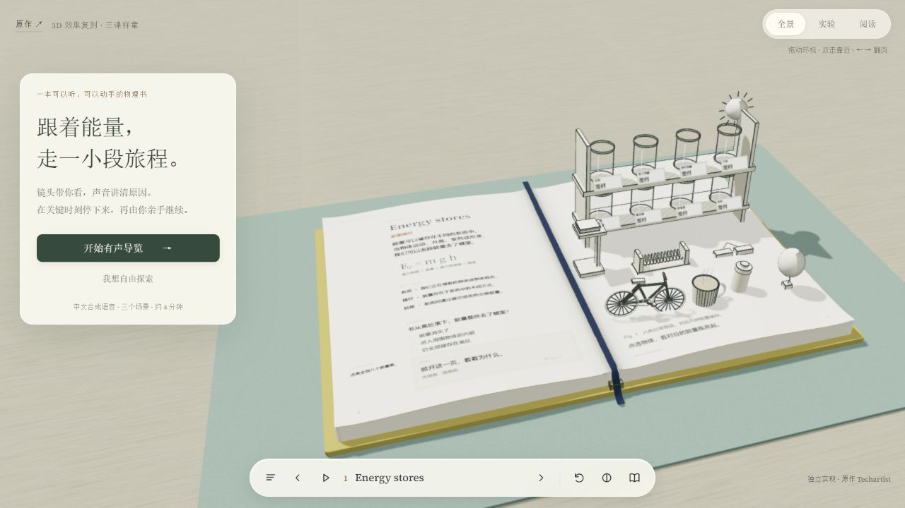
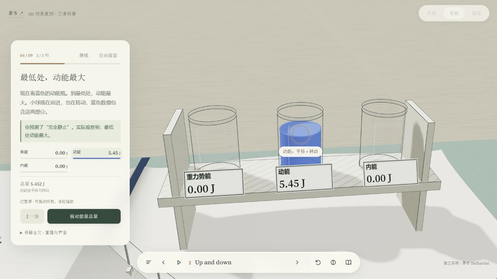
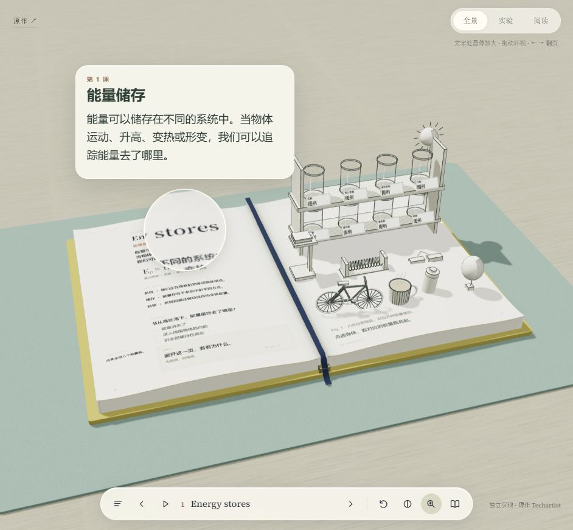

# 003 · 连续主题体验设计

**一个主题，一个合适的载体，相互关联的章节，持续一致的风格，每页都有新的发现。**

这是以 Every Joule 为参照的独立研究与三课可运行样章：把课文、立体实验、物理计算和中文有声讲解组织在同一本三维书里，并从中提炼连续主题体验的设计方法。本阶段研究已完成，成果保留为后续相关产品的理解与复用参考。

| 看什么 | 本项目具体提供什么 |
| --- | --- |
| **效果** | 可翻页、掀盖和环视的三维物理书；纸页、瓶架、轨道与弹簧装置处于同一场景，能量变化用液位、颜色和数值呈现。 |
| **能力** | 三课物理实验、参数操作、预测与结果反馈、MiniMax逐句导览、镜头取景和对象高亮、局部文字放大、七段连续阅读，以及暂停、回退和阅读前后状态恢复。 |
| **原理** | Three.js构建曲面纸页与立体器材；在明确假设下计算滚动、耗散、弹簧发射与接触；共享状态联动物体、数值、镜头、语音与解释，让阅读和实验保持上下文。 |
| **价值** | 提供可运行的交互样章与内容、展示、讲解、操作和反馈统一设计的方法，供互动教材、产品原理说明、主题展览及实验平台选题参考。实际学习效果仍需受众验证。 |

当前实现为三课独立样章。教材与实验并排、双屏协作、实验记录本、主题工作台及虚实实验台等均标为后续设想；现有样章尚未形成可直接换题的通用实验引擎。

[研究汇总网页](app/research-summary.html) · [一张图看全貌](assets/images/understanding-atlas.png) · [可编辑总览图](assets/images/understanding-atlas.svg) · [返回总索引](../../README.md#项目索引) · [3D 复刻样章](app/index.html) · [方法总览](app/handbook.html) · [书页关联图](experience-map.md) · [完整方法](method.md) · [扩展方向](expansion.md)

**在线访问：[研究总览](https://yydshly.github.io/1025_codex_project/003-unified-learning-design/) · [三维物理样章](https://yydshly.github.io/1025_codex_project/003-unified-learning-design/app/index.html)。** 已于2026-10-27通过GitHub Pages部署并核验；[发布记录与截图](research/deployment.md)。


引导图：本阶段生成的完整研究总览，点击可查看原图。真实效果截图均来自本项目独立样章；未来呈现画面为AI概念图，和已实现能力分别标注。[可编辑SVG](assets/images/understanding-atlas.svg) · [制作与提示词记录](research/summary-assets.json)。

## 本阶段汇总与后续复用

本阶段完成了从原作观察、独立样章实现到通用方法与产品方向的整理。现阶段成果用于理解、演示和后续项目参考；遇到具体产品时，再按真实用户、知识关系与使用场景选择载体和交互。

- [研究汇总网页](app/research-summary.html)：研究路径、核心认识、意义与预期价值、真实样章效果、六层协同与体验流程、教材／实验／讲解／记录的联动、七种呈现形态、八类产品方向、跨主题复用与边界。
- [完整总览长图 PNG](assets/images/understanding-atlas.png) · [可编辑 SVG](assets/images/understanding-atlas.svg)：同一张图汇总方法、当前成果、产品思路和未来扩展，可下载并放大查看。
- 未来呈现效果使用[概念图](assets/images/future-layout-concepts.png)说明，和真实样章截图分别标注。概念画面由内置ImageGen生成，提示词及素材来源保存在[制作记录](research/summary-assets.json)。
- 重建总览图：`python scripts/create-understanding-atlas.py`。当前实现模块、设计方法和未来产品设想分别保留，不把概念布局或预期价值当作已上线能力、通用引擎或已证实学习效果。

## 先复刻原站的 3D 核心效果

当前默认入口是基于 Three.js 独立实现的三课样章，以 Every Joule 的实际画面为参照。桌面、纸页、书芯、瓶架、轨道和发射装置都处于同一个三维场景中，支持拖动视角、靠近模型、纸张弯曲翻页和立体解释翻盖。



v4.4 在 **物理接触、逐句导演和预测反馈** 的基础上补齐连续阅读：可固定当前段落、按目录切段，并在阅读后回到原来的实验或讲解状态。当前13段讲解继续使用 MiniMax 配音。默认从斜侧方观察，能看见书页厚度和器材之间的距离。点击“开始有声导览”，会按 9 个段落走过三个场景：先指出观察对象，选出预测，再执行实验、停在关键点解释和对照判断，最后完成一个小挑战。

- 第一课：八件物品与能量类型关联。瓶子是图例，不再给未测量的物品填写任意焦耳数。
- 第二课：先选预测，再松手验证；镜头按“看小球 → 看动能／内能瓶 → 核对总量”逐句推进。回退重新恢复同样的初始条件，纸页预测与导览选择同步。
- 第三课：导槽、圆角槽口、球、底座与软垫共享几何参数。低压缩量可沿槽口返回，接触哪个表面就按该表面处理。势能以底座为参考，垫上停球保留少量势能；最后比较 0.18 m／0.36 m 压缩的弹性势能。
- 导演：自动取景、对象圈选、同步中文语音与字幕；在谷底、最高点、落地等真实状态停下。导览慢放 ×0.55，可暂停、重播、静音、回退和退出。暂停时可拖动环视、滚轮缩放，实验状态保持冻结；继续时恢复导演镜头。阅读进入导览自动收起阅读面板；翻页期间暂停和后台暂停均保留。
- 自由探索：全景／实验／阅读、拖动视角、双击靠近、参数滑块、翻页和阅读面板保留。页面中明确给出下一步按钮。



### 书页文字放大镜与连续阅读

桌面默认开启：把鼠标移到正文、公式、关键词、预测题、解释、挑战或图注上，会同时出现 **2.15×圆形局部画面放大** 和对应区块的 **大字阅读卡**。放大层使用本项目自己的画面与课文，书本和实验仍留在原位置。

- 按 **M** 或点击工具栏放大镜，会固定当前或最近查看的段落，进入时保持镜头位置。鼠标悬停放大默认可用，工具栏入口用于固定阅读。
- 固定卡提供 **正文 → 公式 → 关键词 → 预测 → 解释 → 挑战 → 图注** 七段目录，以及“上一段／下一段”。焦点在阅读卡内时，可用 **←／→** 或 **PageUp／PageDown** 切段；下拉目录保留原生键盘操作。解释盖板未揭开时，目录中的解释项仍只显示提示。
- 阅读期间暂停物理运动与 MiniMax 讲解，并收起导演面板、实验控件和手机阅读入口，为可滚动正文留出空间。按 **Esc** 或点卡片上的返回按钮退出：进入前在播放就继续原来的讲解或实验，进入前已暂停则保持暂停。切段不会覆盖首次进入时保存的状态。
- 自由探索时，拖动视角、滚轮缩放、翻页或恢复导演镜头会清理悬停放大层；被器材遮住的纸面不会穿透读取。
- 触摸／笔支持约 **460 ms长按**，保持按住后可滑动切换阅读区块；这条路径已实现，尚未在真实触屏或笔设备验证。



[桌面固定公式阅读](assets/images/reading-v4.4/02-fixed-formula.png) · [手机公式阅读](assets/images/reading-v4.4/04-mobile-formula.png)。v4.4 浏览器验证中，手机正文可滚动区域高度由约79.56 px增至196 px；进入阅读再返回，所比较的图书区域像素差为0。37项测试通过，详细记录见[验证记录](design-qa.md)。本次完善连续阅读、正文空间和阅读前后状态衔接；按段语音、更多物理功能与进度保存留待后续。

这是三课核心效果的独立复刻与教学交互迭代，**不是原站十课内容的完整复制或逐像素一致版本**。声音由 MiniMax speech-2.8-hd 的“温柔学姐”系统音色生成，未复制原作配音。音频预先生成并在本地播放，浏览器不读取密钥或调用语音API。物理采用明确的理想化模型，不含完整材料形变、空气阻力、刚体碰撞或持久存档。[模型与依据](research/physics-models.md) · [验证记录](design-qa.md)。

上一版“种子”主题书仍保存在 [seed-book.html](app/seed-book.html)，[方法总览](app/handbook.html)继续保留筛选实验、扩展方向和规划工具。

### 本地运行

```powershell
npm.cmd ci
npm.cmd run assets
npm.cmd run dev
```

打开 [本地预览](http://127.0.0.1:4183/app/)。已包含准备好的 `app/vendor/` 静态依赖，直接预览时也可双击 `start-local.cmd`。保持服务窗口开启，停止用 `Ctrl+C`；端口占用可用 `npm.cmd run dev -- --port=4184`。

需要 Node.js 22 或更新版本运行服务，浏览器需要 WebGL。运行不请求远程脚本、字体或原作素材；Three.js 和字体均在本地。无需框架构建。`npm run check` 检查应用与工具脚本语法，`npm test` 运行物理边界、导演状态、语音及阅读区域验证；`npm run voice` 通过 MiniMax 生成并缓存中文音频，默认读取外部 `F:/codex_project/.env.minimax`；其他位置使用 `npm run voice -- --env-file <路径>`。配置不复制进项目；已有相同文本与音色的音频会复用，`--force` 才重新生成。生成阶段需要网络和有效 MiniMax 配额，播放只读取本地音频。总库 `npm run check` 检查索引。

### 静态网页发布

线上地址与发布核验见 [research/deployment.md](research/deployment.md)。本项目按总库的[多项目部署约定](../../docs/DEPLOYMENT.md)接入GitHub Pages。

在子项目执行 `npm.cmd run prepare:pages` 准备派生发布目录 `public/`，再由总库发布工具按清单打包。`public/` 是生成结果，内容修改应回到 `app/`、明确公开的资源及原始文档；公开网页中的研究文档入口转到GitHub仓库。发布准备复用已经生成的本地配音文件，不调用MiniMax API，也不读取或打包外部配音凭据。

## 从这里开始

| 你要做什么 | 使用哪个文件 | 做完应得到什么 |
| --- | --- | --- |
| 对照原作的空间效果 | [3D 复刻样章](app/index.html) · [复刻记录](research/replica-notes.md) | 查看真实三维书本、立体实验与形变翻页 |
| 体验上一版主题关联 | [种子主题书](app/seed-book.html) · [书页关联图](experience-map.md) | 感受同一对象如何连接四个章节 |
| 理解方法 | [完整方法](method.md) | 知道怎样把一个主题组织成可探索的体验 |
| 浏览交互与扩展方向 | [方法总览](app/handbook.html) · [扩展说明](expansion.md) | 体验一次同步反馈，选择下一步实践方向 |
| 开始一个新主题 | [主题规划模板](templates/topic-brief.md) | 一份包含目标、风格、章节和交互的具体方案 |
| 参考实际写法 | [跨主题示例](examples.md) | 节奏、编程筛选和历史叙事三种迁移方式 |
| 让 AI 按此方法协作 | [AI 协作提示词](templates/ai-brief.md) | 可直接复制的任务说明 |
| 检查方案是否成立 | [验收清单](review-checklist.md) | 能指出哪段讲解、展示或操作没有接上 |

以后可以直接提出：**“按 003 方法，把某个主题做成一套统一的互动体验方案。”** 先填主题模板中的目标和一个场景，走通后再扩展章节。

## 方法的核心

每个场景都回答同一组问题：

| 层面 | 需要回答的问题 |
| --- | --- |
| 内容 | 用户要理解哪一个关系？ |
| 视觉 | 用什么对象和变化把这个关系表现出来？ |
| 讲解 | 此刻指着哪个对象，解释哪件事？ |
| 操作 | 用户改变什么条件，能帮助他理解？ |
| 反馈 | 结果如何变化，为什么会这样？ |
| 检验 | 换一个例子，用户还能判断吗？ |

例如讲编程中的筛选：展示一组卡片，让用户改变筛选条件，卡片的保留结果与条件判断同步变化，随后解释原因。所有表达都指向同一个概念。

## 项目状态和使用方式

- 编号：003；版本：v4.4；本次整理更新：2026-10-27。
- 本阶段研究完成，已有三课3D独立样章、完整研究网页与总览图；原先的连续主题书、方法总览、筛选示例及规划工具全部保留，后续按具体产品需求选择性复用。
- 本地网页与GitHub Pages正式站点均可访问；线上地址、部署结果与核验范围见[发布记录](research/deployment.md)。交互验证不等于教学效果验证，真实受众试用仍待进行。
- 在子项目运行 `npm run check` 检查脚本语法，`npm test` 检查物理、导演、语音与阅读区域；在总库根目录运行 `npm run check` 检查索引。

## 灵感来源和授权

灵感来自 Techartist 的 [Every Joule](https://iamtechartist.com/every-joule/) 及其[教师说明](https://iamtechartist.com/Apps/every-joule/teachers.html)。其中的物理课本把概念、立体图示、预测、操作和解释组织在一起；本项目据此提出跨主题的设计工作方法。

总索引的“源库”关联作者公开的 [every-joule-lesson1](https://github.com/iamtechartist/every-joule-lesson1) 发布仓库，便于回到原始研究对象；本项目的方法与三课样章在本研究总库中独立实现。截至 2026-10-26，该发布仓库没有声明开源许可证。本项目没有引入其发布代码或运行素材；`reference-*.png` 为仅用于视觉研究的原站截图，版权属于原作者。

运行依赖 Three.js 0.180.0 使用 MIT 许可证，Source Serif 4 与 Caveat 字体使用 OFL；许可文本随静态依赖保留在 `app/vendor/`。具体版本见 `package-lock.json`。方法文档与独立实现未额外声明统一开源许可证。
