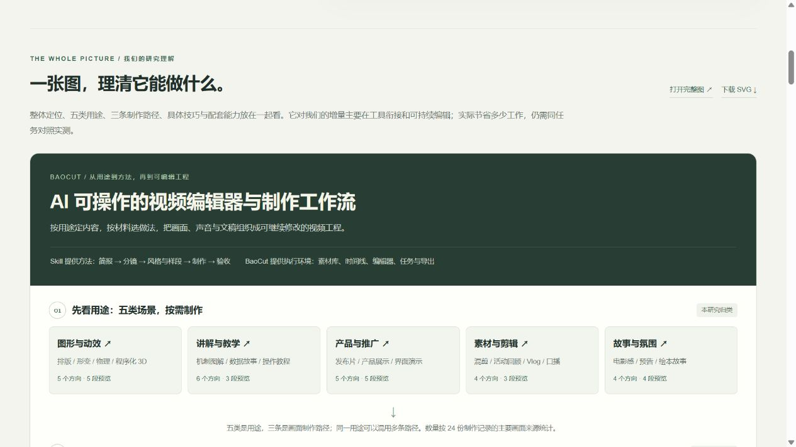
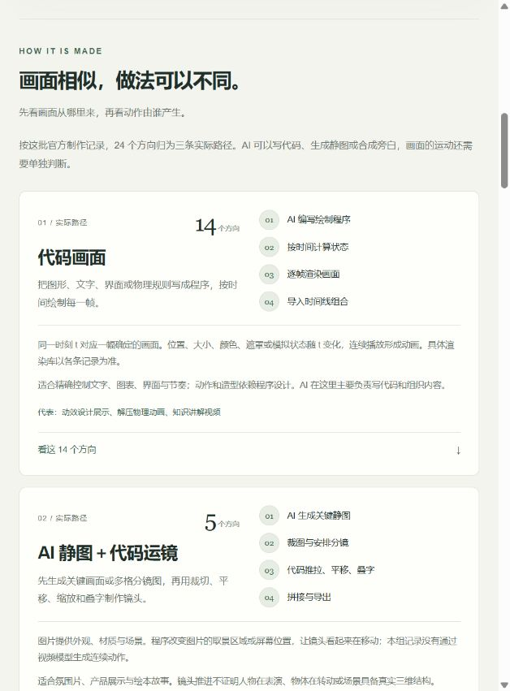
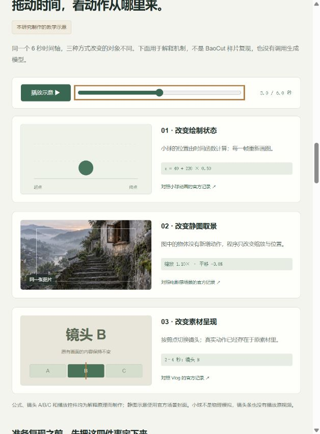

# 004 · BaoCut · 能力、原理与效果研究

> BaoCut 是 AI 可操作的视频编辑器与制作工作流。它以代码动画、AI 静图运镜和已有素材剪辑组合成片，支持字幕、配音、检索与可编辑工程；增量价值主要在工具集成、反复修改和人工接手。本研究用一张总览图、24 个场景方向与 20 段官方预览解释效果、能力、原理和价值，尚未对照实测效率收益。

**[在线网页](https://yydshly.github.io/1025_codex_project/004-baocut-effects-atlas/)** · **[在线一图总览](https://yydshly.github.io/1025_codex_project/004-baocut-effects-atlas/#overview)** · [本地网页](app/index.html) · **[SVG 完整图](assets/images/capability-map.svg)** · [总览文字与依据](research/overview.md) · **[实现原理与逐条分类](research/implementation.md)** · [修改与复现建议](research/guide.md) · [全部场景清单](research/scenes.md) · [上线验收](research/deployment.md) · [原始仓库 JimLiu/baocut](https://github.com/JimLiu/baocut) · [返回总索引](../../README.md#项目索引)


引导图由我们的讨论与固定版本资料整理；图中六张封面、视频与缩略图来自 Jim Liu / BaoCut 官方模板。**本研究尚未安装 BaoCut 或复现样片；页面展示和官方能力说明分别标注证据。**

## 四个问题说明白

| 问题 | 本研究的结论 |
| --- | --- |
| **效果是什么？** | 五类用途：图形动效、讲解教学、产品推广、素材剪辑、故事氛围。24 个方向、20 段约 15 秒的官方预览节选；五类用途可以混用制作方法。 |
| **能力是什么？** | 组织画面、声音和文稿，提供时间线剪辑、字幕、转写翻译、配音、素材检索与工程导出。转写、配音、语义与画面检索等能力需要对应模型、服务或索引。 |
| **原理是什么？** | 实际画面主要来自代码逐帧绘制、AI 静图配代码取景运动、已有素材裁切重排。AI 负责规划、写代码或调用模型，BaoCut 组织编辑项目与任务，FFmpeg / FFprobe 参与媒体准备和输出。固定研究版本没有 AI 视频生成。 |
| **价值是什么？** | 将已有制作技术接入同一可编辑工程，支持事务、撤销、版本检查、按对象修改与人工接手。对一次性代码效果，新增收益可能有限；多素材、多轮修改和交接场景更值得验证。没有实测质量、成本或效率优势。 |

Skill 的价值主要是简报、分镜、风格、样段和验收方法；BaoCut 软件的价值主要是执行环境、编辑器与持久化工程。继续研究的关键，是用同一任务对比多轮修改和交接成本，而非把更多模板数量当作新技术。

## 一图整理我们的理解

网页新增 `#overview`，把整体定位、五类用途、三条画面制作路径、具体技巧、配套能力、可编辑工程、价值与边界放在一张连续的图中。五类是用途，同一用途可以组合多条路径；24 个场景方向不代表 24 种独立技术。

- **方法与软件分开**：Skill 提供简报、分镜、风格、样段和验收方法；BaoCut 提供编辑器、时间线、任务与项目状态。
- **画面与配套分开**：代码动画、AI 静图运镜、已有素材剪辑是三条实际画面路径；转写、字幕、翻译、配音、检索和混音是共同能力，注明模型与索引条件。
- **技术能力与工程价值分开**：代码与 FFmpeg 可以完成同类效果。BaoCut 的增量主要在工具衔接、项目管理、反复修改与人工接手；尚未对照实测质量、成本或效率。
- **证据分开**：样片路径依据制作记录；通用能力依据固定版本官方文档；对我们的适用性为研究判断。没有将官方文档写成已在本机验证的功能。

图中的五类用途与三条路径可跳转至筛选结果，六个封面直接打开现有样片及做法说明。另提供可下载的 [SVG 完整图](assets/images/capability-map.svg)，内嵌六张官方封面，无外部图片依赖；网页图与 SVG 共享 `app/overview.json`，由 `node scripts/build-data.mjs` 同步生成数据、图片和[文字整理](research/overview.md)。

已核对五类用途、三条路径和六个样片入口，实际检查 643 / 1280 像素浏览器视口，无横向溢出；独立 SVG 的 127 段文字与 6 张图片没有交叠。[PNG 完整图](assets/images/capability-map.png)是 SVG 的浏览器实际渲染。[验收记录](research/overview-verification.json)区分页面、数据、隔离构建与本机未验证项。



## 先看哪些效果

| 场景 | 可以先看的样片 | 方向 / 有预览 |
| --- | --- | --- |
| 图形与动效 | 动效设计展示、排版动效、混沌归于秩序、小球物理动画、节奏舞蹈 | 5 / 5 |
| 讲解与教学 | 月相知识讲解、数据故事、分步教程；另有热点趣闻、AI 快评、技术简史模板 | 6 / 3 |
| 产品与推广 | 新品发布、产品展示、软件演示、推广短片、白色界面风格发布 | 5 / 5 |
| 素材与剪辑 | 创意混剪、活动回顾、Vlog；另有口播精华模板 | 4 / 3 |
| 故事与氛围 | 电影感场景、史诗氛围、原创游戏预告、故事短片 | 4 / 4 |

首屏提供六种代表效果切换；下方可分类、搜索、打开样片详情。详情显示视频、效果方向、需要的输入、默认画幅与时长、制作提示、官方验证记录。

## 效果具体怎样实现

网页已加入三条制作路径的原理、按实际做法筛选、每个场景的画面来源、动作机制、AI 分工、声音与拼接方式，并列出模板要求与实际实现的差异。依据是各条官方制作记录，不只看标题或提示词。

| 按画面主要来源分类 | 方向数 | 代表做法 |
| --- | --- | --- |
| 代码画面 | 14 | 排版、图表、机制图、虚构 UI、物理模拟；AI 写代码，程序计算并渲染画面 |
| AI 静图＋代码运镜 | 5 | 电影感、产品片、故事片；AI 先生成图，代码再裁切、推拉、平移和叠字 |
| 已有素材＋剪辑包装 | 5 | Vlog、混剪、活动、照片广告、口播选段；重排原素材并添加包装 |
| 已记录的 AI 视频生成 | 0 | 节奏舞蹈模板虽然要求生成视频，实际降级为代码机器人 |

以上统计覆盖 24 份制作记录，其中 4 个方向没有公开视频。声音独立判断：知识讲解用了 Gemini TTS，小球碰撞音效由代码合成，混剪和 Vlog 使用已有音乐或现场声。具体记录中的绘图库、生图模型或物理引擎名称没有给出时，保留未知，不根据视觉猜测。

旧样片有大量“本机脚本先渲染、再导入”的做法，部分字幕与包装已烘焙进视频。固定版本制作说明另外提供代码包实时预览、确认后烘焙的流程；网页分别说明，未将旧样片写成已经采用新流程。



24 条分类均核对了对应制作记录的原文摘录；三类筛选、组合筛选、清空筛选和代表场景详情已在浏览器验证。见[本轮核验记录](research/implementation-verification.json)。

20 段预览都是约 15 秒的节选，不能当作完整成片。16 个预览文件没有音轨，4 个含音轨；页面逐条标明。官方模板记录中有 6 项标记为 `pass`、18 项为 `partial`；部分样片仍有素材、声音或内容准确性等缺项，原记录在详情中保留。模板方向、公开预览和稳定复现是不同层面的证据。

## 本地打开

本研究网页已于 **2026-10-27** 发布到 GitHub Pages。正式地址、发布范围、工作流与验收记录见[上线说明](research/deployment.md)。部署的是研究展示页，BaoCut 软件和模型服务没有在网页中运行。

展示页不需要 API 密钥、模型或 BaoCut。视频、图片、目录、原始提示与研究注释都保存在子项目中；`app/data.js` 打包了 24 个场景的数据，浏览时不再依赖 JSON 网络请求。

在本项目目录执行：

```powershell
node scripts/serve.mjs
```

打开 `http://127.0.0.1:8054/app/`。本地 HTTP 预览需 Node.js 22+，不需要安装第三方依赖。筛选条件、具体样片与详情页签会写入地址，可刷新恢复；例如 `?scene=knowledge-explainer&tab=guide`。

也已采用普通脚本和打包数据准备直接打开 `app/index.html` 的离线方式，素材仍使用相对路径。**内置浏览器安全策略仅允许 HTTP / HTTPS，阻止了本轮 `file:` 验收**；因此本轮只确认 HTTP 访问可用，直接双击的兼容性尚未完成浏览器验证。

## 继续补全：从看效果到准备试做

- **动手理解**：共用一个 6 秒滑块，对比代码绘图、静图取景与已有镜头切换，能播放、暂停，也能用键盘调节。明确标为本研究的教学示意，不是官方样片复现。
- **分层阅读**：详情分成“效果与做法 / 修改与复现 / 原始记录”，保留视频，并支持上一条、下一条和键盘切换页签。
- **24 条复现建议**：逐条说明先注意什么，按路径列可修改内容、修改位置、准备材料、小样步骤和验收点。建议与官方记录分开标明，没有声称已经试做成功。
- **按预览条件选择**：除了场景与实现方式，还能筛选有视频、含音轨和仅有记录的方向；卡片标明是否含音轨。
- **原始提示页内阅读**：24 份官方提示可直接展开，来源链接与原始文件均保留。
- **入口恢复**：刷新后保留筛选、样片和详情页签；“复制当前入口”保留对应场景。本地服务链接仅限本机，正式站点链接可分享。

更新数据后运行 `node scripts/build-data.mjs` 重新打包。下载同步脚本也会执行此步骤；提交版本、24 条原文证据和指导数据覆盖不一致时会拒绝打包。未新增任何外部服务或模型调用。



本轮检查见 [learning-verification.json](research/learning-verification.json)：24 个场景、24 份原始提示与 24 条指导均完整打包；播放、暂停、键盘调节、页签、连续浏览、筛选与刷新恢复已检查，未自动改动剪贴板。

## 本次范围与验证

- 已完成：效果网页、五类场景筛选、搜索与空结果提示、播放与进度跳转、模板说明和官方验收记录、总库登记。
- 原始素材：固定版本下载 89 个文件，逐个核对 Git blob SHA 与文件大小，另记录 SHA-256；20 个 MP4 全部通过 FFmpeg 完整解码。
- 浏览器：实际检查首屏、分类、搜索、无预览提示、代表样片播放与进度跳转，详见 [verification.json](research/verification.json)。
- 未做：运行 BaoCut、调用模型、生产新成片、同素材效果对照。小屏有响应式样式，没有手机实机验收。

## 来源与保留文件

研究日期：2026-10-26（北京时间）。固定上游提交：[`228c6aecf91ee2e3235b72a93223b0dd7cbb92fa`](https://github.com/JimLiu/baocut/commit/228c6aecf91ee2e3235b72a93223b0dd7cbb92fa)。

- [官方效果页](https://baocut.com/zh-hans/)；[固定模板目录](https://github.com/JimLiu/baocut/tree/228c6aecf91ee2e3235b72a93223b0dd7cbb92fa/templates)。
- `assets/official/`：20 组上游原始预览与封面，合计约 7.3 MiB；没有改变视频内容。
- `research/upstream/templates/`：24 份原始 `template.json` 和 `prompt.md`，保持原始字节。
- [原许可证](research/upstream/LICENSE.txt)：BaoCut Community License 1.0；[引用与修改说明](NOTICE.md)。
- [制作说明文本快照](research/upstream/video-production-SKILL.md)和[原始链接](https://github.com/JimLiu/baocut/blob/228c6aecf91ee2e3235b72a93223b0dd7cbb92fa/skills/baocut/built-in-skills/video-production/SKILL.md)补充说明代码包与生成能力；逐条研究注释独立保存在 `app/implementation.json`，原始模板不改动。
- [来源清单](research/upstream-manifest.json)、[完整性记录](research/asset-integrity.json)、[媒体解码记录](research/media-verification.json)。这是所选研究材料快照，不是 BaoCut 全仓备份。

重新获取同一版本并校验：安装 Python 3.10+ 与 FFprobe 后运行 `python scripts/sync_upstream.py`。只读取固定清单中的公开文件，不运行上游代码，不删除既有文件。
