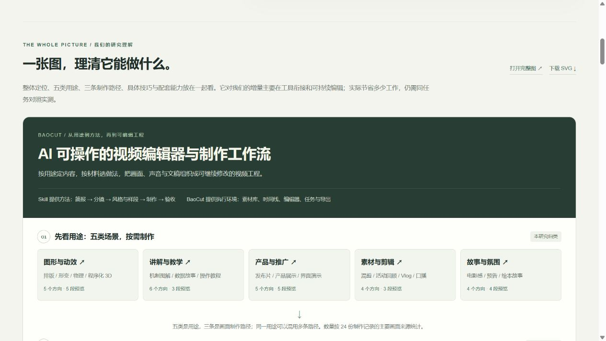

# BaoCut 研究页 · 2026-10-27 上线记录

已发布并实际访问验证：

- [站点总入口](https://yydshly.github.io/1025_codex_project/)
- [004 · BaoCut 能力、原理与效果研究](https://yydshly.github.io/1025_codex_project/004-baocut-effects-atlas/)
- [能力与价值一图总览](https://yydshly.github.io/1025_codex_project/004-baocut-effects-atlas/#overview)
- [原尺寸 PNG 引导图](https://yydshly.github.io/1025_codex_project/004-baocut-effects-atlas/assets/images/capability-map.png)
- [独立 SVG 总览](https://yydshly.github.io/1025_codex_project/004-baocut-effects-atlas/assets/images/capability-map.svg)

首次部署提交：[bfc5452e6160ef1ef6c858c03687788e01689542](https://github.com/yydshly/1025_codex_project/commit/bfc5452e6160ef1ef6c858c03687788e01689542)。[GitHub Pages 工作流](https://github.com/yydshly/1025_codex_project/actions/runs/40368092712)的构建与部署作业均成功。详细 HTTP 与页面核对见 [publication-verification.json](publication-verification.json)。

## 内容与引导

摘要、README 与网页首屏共同说明四点：

1. **效果**：动效、讲解、产品片、混剪和故事五类用途，提供 24 个方向与 20 段官方预览。
2. **能力**：字幕、转写翻译、配音、素材检索、时间线与可编辑工程；依赖模型和索引的能力写明条件。
3. **原理**：代码动画、AI 静图运镜、已有素材剪辑三条路径按需组合；固定研究版本没有 AI 视频生成。
4. **价值**：工具集成、项目状态、反复修改与人工接手；对一次性代码效果的增量可能有限，效率收益尚未实测。

总库封面与项目 README 统一使用我们整理的 `assets/images/capability-map.png`。网页中的交互总览延续同一图解，并可打开或下载 SVG。图中官方封面、预览及原始记录注明 Jim Liu / BaoCut 来源。

## 构建与发布范围

```powershell
npm run check
npm run check:pages
npm --prefix projects/004-baocut-effects-atlas run build:site
npm run build:pages
```

004 的 `dist/site` 为公开静态目录，含 56 个文件：页面及数据、20 段视频和 20 张封面、PNG / SVG 总览、署名与许可证。发布过程调整媒体的相对路径，并将研究说明和原始提示文件入口指向 GitHub；24 份原始提示正文逐字保留。

源仓库提交保留完整研究注释、截图与固定版本证据。研究笔记、验收文件和构建脚本不复制进 Pages 产物。该次发布保留现有 001 站点，并明确接入 004；其他本地待整理项目没有随此次提交发布。

## 实际验证

- 隔离工作树中运行登记校验与发布边界测试，验证项目创建、编号递增和索引生成。
- 90 个原始资料与媒体文件在 Git 索引中逐字节核对；通过属性设置保留固定资料的原始字节。
- 本地发布产物检查三类代表视频，均可载入；筛选、详情页签和带场景参数的刷新恢复正常。
- 公网根入口、项目页及全部公开文件共 57 个唯一地址均返回 HTTP 200，其中包含 20 段 MP4。
- 公网 PNG 的 SHA-256 与已核对的本地图一致：`3d4b54a2a40190366324098b001b0076b2a4a763cb896bf4dcb680bab18456c7`。
- 公网页面显示 24 个场景和三条总览路径；生图路径筛选得到 5 个结果。详情刷新保留场景与指导页签，并保持视频暂停。
- 公网电影感场景视频载入到 `readyState=4`，播放进度到达全长 `14.966667` 秒，未观察到媒体错误；站点总入口的两张引导图均实际载入。
- 1280 像素浏览器视口未出现横向溢出，未观察到浏览器控制台错误。手机实机、BaoCut 本身、质量及效率对照均未验证。


