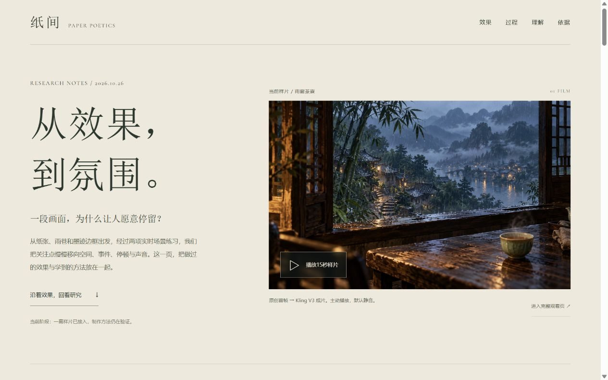

# 005 · 纸间 · 诗性风格实验室

> 一个研究诗性网页叙事的可运行项目。1.4.0 用可点击、可导出的研究总览图，连接源效果观察、氛围理解、本地实现、五项演示与证据边界。

- **源效果是什么**：据 [Bee 的演示录屏](https://x.com/thtbee_/status/2114030630887641448)，纸墨、多场景与画幅变化，结合雨水、开花等自然微事件、文字和留白，组成诗性叙事。未取得原作源码，无法确认其内部技术与全部交互。
- **我们做了什么、留下什么**：002 独立重写、两项原创实时练习、AI 单幕影片与有许可的实拍对照，共同形成可运行的比较材料。研究价值在于氛围组织方法、实时与影片载体的选型依据，以及场景、播放器、声音与验证记录等工程资产；不宣称与源作 1:1。
- **还可往哪里扩展**：继续验证声画事件的前后关系、纸墨与写实影像的融合及更多具体场景；也可试作展览或文化内容入口。这些是待检验的潜力，尚未证明商业效果。

## 线上访问 · 2026-10-27

[项目首页](https://yydshly.github.io/1025_codex_project/005-paper-poetics-lab/) · [可点击研究总览](https://yydshly.github.io/1025_codex_project/005-paper-poetics-lab/map.html) · [研究回顾](https://yydshly.github.io/1025_codex_project/005-paper-poetics-lab/research.html) · [AI雨窗茶寮](https://yydshly.github.io/1025_codex_project/005-paper-poetics-lab/cinema.html) · [原有九章](https://yydshly.github.io/1025_codex_project/005-paper-poetics-lab/original.html)

**002 是效果实现，005 是研究与扩展入口。** 总览图顶部的“002 · 原始效果实现”直接进入最初的002重写作品；旁边“原作录屏参考”链接作者的原演示，二者分别标注。图内卡片和九章直达入口继续保留，演示页可直接返回总览图。

002在WebGL无法创建、上下文中断或绘制失败时，自动进入真实运行截图浏览，提供十个章节及四季切换，明确标注非实时且默认无声。[直接进入兼容浏览](https://yydshly.github.io/1025_codex_project/005-paper-poetics-lab/original.html?preview=static#rain)；`original.html` 仅透传允许的 `preview=static` 和章节hash。详细边界见[002兼容处理记录](../002-ink-rain-alley/research/browser-compatibility-2026-10-27.md)。

已通过GitHub Actions发布并核对线上入口、指定引导图、图内链接、莲花章节和影片实际播放。部署过程与检查范围见[发布记录](research/deployment.md)。引导图使用用户确认的现有研究总览图，未重新生成。

[返回总索引](../../README.md#项目索引) · [研究笔记](research/notes.md) · [验证记录](design-qa.md) · [已有演示项目](../002-ink-rain-alley/README.md)


## 1.4.0 · 一图总览

[打开可交互研究总览图](http://127.0.0.1:4176/map.html)。首页主按钮旁及研究回顾顶部导航均可进入。

- 2400×4339图解：原参考四组实际抽帧 → 氛围／技术两线 → 五项本地实践及九章链接 → 可复用价值与工程资产 → 制作流程与证据边界。
- 技术均标为本地实现或复现路径，未取得原作源码，不将Three.js、WebGL或视频认定为原作内部方案。
- 原参考四帧注明作者与演示链接；我们的五项演示使用已有真实截图或首帧。完整来源见 `research/overview-map-sources.json`，整理文本见 `research/overview-map-content.json`。
- 网页内联SVG保留节点链接，支持缩放、滚动与鼠标拖动；SVG下载按当前网页地址保留完整链接，PNG为静态图。原演示容器现在可接受有效章节hash以直达相应章节。
- SVG与PNG原件同时保留在 `app/media/` 与 `assets/images/v1.4/`，没有新增AI生成或费用。

需要修改并重新导出图时，可选运行 `python tools/render-research-map.py`。工具使用Pillow、resvg-py与Windows系统中文字体；常规 `npm run build` 直接使用已有成品，不依赖Python。

公开版本保留运行用视频、图片、音频、准确提示词、来源和脱敏核验记录。未压缩母版、原始下载、账户余额及操作日志保留本地，不是网页构建依赖；浏览网页不会调用生成服务。

## 1.3.0 · 研究回顾

[打开研究回顾](http://127.0.0.1:4176/research.html)。首页导航与主按钮旁、两项影片页顶部和原演示容器均可进入，回顾页可直接返回各个演示。

- 按真实来源区分原参考录屏、002独立重写、两项实时主题、AI影片与实拍对照；五项本地演示可按载体筛选。
- 四轮探索与v1.0／v1.1茶息实际截图说明方向如何变化，不将功能检查通过等同于氛围成熟。
- 整理可延续的方法、制作分工、主题扩展问题和下一轮检验标准；研究判断、创作目标与已验证事实分别标注。
- 可主动播放现有AI样片，默认静音、不自动播放，不调用生成服务。影片来源、有限画面检查、待试听状态以及预估180／实际264积分在页面中保留。
- 网页使用既有真实截图，来源清单为 `app/media/research/SOURCES.json`，没有新增生成任务。信息来源为本项目研究笔记、生成记录和验证记录。



## 1.2.0 · 雨窗茶寮

本轮改为先做好一幕视频主导的氛围体验：从暖灯窗内望向雨中的远村，让檐雨、山雾、河面灯影与近处一盏茶共同构成连续镜头。影院页使用浏览器原生视频播放，不经过旧版 Three.js 后期，不把低频的模型位移当作影片运动，也不叠加旧电子配乐。

### 素材与当前状态

- 原创首帧由内置 imagegen 创建，保存为 `app/media/cinema/rain-window-tea.jpg`。
- 配套 AI 镜头已由 ChatArt 的 **Kling V3 任务1040462** 生成并接入本地影院。实际文件为 **15.046秒、1920×1080、24fps、H.264视频与AAC音轨**。
- 本次确认时的本地估算为 **180 credits**，实际消耗已确认为 **264 credits**，余额净变动与服务返回一致。估算与实际不能混用，差异原因尚未确认。详情见[生成记录](research/cinema/generation-record.json)。
- 首次 Seedance2.0 任务 **1040430** 服务端失败，未返回视频，查询到余额前后未变；历史记录见 [generation-record-seedance2.json](research/cinema/generation-record-seedance2.json)。Kling 任务经用户另行确认，不是自动重试。
- 失败或超时不会自动重新提交、切换模型或产生下一次生成费用。

当前 AI 影院已是 `ready` 状态，播放的是实际 MP4，不是首帧的缩放动画。生成前的 `pending` 首帧模式继续作为机制保留：没有影片时不请求 MP4，明确显示首帧预览并禁用播放操作。真正的文件加载失败仍显示失败状态与重试入口。

生成完成、媒体验证和本地构建已完成。当前人工检查只覆盖部分抽帧与浏览器播放；技术检查确认音轨存在且非静音，尚未试听内容，不声称画面、情绪或声音已全部验收。

相关记录：[首帧提示词](research/cinema/tea-keyframe-prompt.txt) · [视频提示词](research/cinema/tea-video-prompt.txt) · [源片运动与氛围分析](research/cinema/source-motion-notes.md)。网页短字幕独立于视频内容，并没有烧录进原片。

本轮取得的是一幕约 15 秒的连续镜头；它不等于完成了 30 秒或更长的完整故事。抽帧中可见雨水、茶烟和取景变化，杯、窗框与远村基本稳定；镜头位移比提示词要求的极小漂移更明显。风、竹叶与茶烟之间的完整因果、全片稳定性和听感仍需人工检查。

## 保留的实时练习

两个主题从物件陈列式构图改为具有前后关系的透视场景，镜头随三幕进度靠近主体。

- **山间茶息**：窗景茶台、青灰釉茶器、石席与窗外山雾；倾壶注水带来水线、茶面波纹和蒸汽，后段转向杯口近景。
- **月下花庭**：月洞门、台阶、庭树与水平反射水面构成庭院层次；月影、曲面玉兰和萤光随进度与操作变化。
- **共用渲染**：HDR 离屏目标、ACES 风格色调映射、PCF 阴影与程序环境反射，用于保留高光、接触关系和物件表面层次。它们不等于完整的光照或水面物理模拟。
- **画面让位**：收小主题文案，去掉常驻说明，让空间和动作承担更多表达。背景配乐沿用上一版，没有新增两首独立录音。

旧版的按钮、导航和声音检查通过，不代表视觉质量已经达到预期。历史记录见 [1.0.0 验证](research/design-qa-v1.0.md)与 [1.1.0 验证](research/design-qa-v1.1.md)；视频主体验的实际画面、检查结果与剩余问题以[当前验证记录](design-qa.md)为准，不沿用旧版的视觉结论。

## 当前入口

- [纸间入口](http://127.0.0.1:4176/)：影院主体验、保留作品入口、风格方法、固定／变化对照和扩展流程。
- [研究回顾](http://127.0.0.1:4176/research.html)：参考观察、效果筛选、四轮迭代、研究价值、证据边界、素材出处和下一步问题。
- [一图总览](http://127.0.0.1:4176/map.html)：可点击、放大阅读、下载PNG／SVG的完整研究图解。
- [雨窗茶寮 · AI影片](http://127.0.0.1:4176/cinema.html)：已接入实际 Kling 生成影片，15.046秒，默认静音观看。
- [雨窗 · 实拍对照](http://127.0.0.1:4176/rain-study.html)：另一个有许可的实拍样片，雨滴沿玻璃滑落、窗外灯光虚焦；雨声来自另源合成，不是 AI 茶寮成片，也不是同步现场录音。
- [山间茶息 · 实时练习](http://127.0.0.1:4176/theme.html?theme=tea)：候山 → 注水 → 回甘；从窗景茶台靠近杯口，观看倾壶、水线、茶面波纹与蒸汽。
- [月下花庭 · 实时练习](http://127.0.0.1:4176/theme.html?theme=moon)：入夜 → 绽放 → 随光；月洞门内外的庭院、月影水面、玉兰与萤光回应。
- [原有九章演示](http://127.0.0.1:4176/original.html)：在本入口同一站点中打开 002 的构建产物，外层提供返回入口。

上列为本机开发预览地址，正式线上地址见文首。当前4176保留后台生产预览。原有 4174 地址可以继续独立使用，新入口的原演示链接不依赖 4174 服务是否开启。

## 本地运行

构建需要 Node.js 22.12+。影院页需要支持 MP4 视频播放的现代浏览器，实时练习另需 WebGL 2。首次运行，从仓库根目录安装两个子项目自己的依赖：

```powershell
npm --prefix projects/002-ink-rain-alley ci
npm --prefix projects/005-paper-poetics-lab ci
cd projects/005-paper-poetics-lab
npm run build
npm run preview
```

打开 `http://127.0.0.1:4176/`。安装后也可双击 `start-local.cmd`。如果该端口已有本次交付的后台服务，请直接访问，或用 `npm run preview -- --port 4177` 启动另一端口。

构建会先构建 002，再将其 `dist/` 复制到本项目 `dist/original/`，与入口、AI 影院、实拍对照和实时练习一起提供。影院素材按指定名单复制：

```text
app/media/cinema/rain-window-tea.jpg → dist/media/cinema/rain-window-tea.jpg
app/media/cinema/rain-window-tea.mp4 → dist/media/cinema/rain-window-tea.mp4
app/media/cinema/rain-window-study.jpg → dist/media/cinema/rain-window-study.jpg
app/media/cinema/rain-window-study.mp4 → dist/media/cinema/rain-window-study.mp4
```

文件存在时才复制，保留运行时相对路径；构建不会发起视频生成。不会迁移或删除 002 源文件，也不清空其他项目输出。开发时可运行 `npm run dev`；开发服务器将 `/original/` 映射到 002 的已有构建产物。

## 入口中沉淀的理解

- **留白**：一幕有一个注意力中心；空白和密集画面承担不同的叙事作用。
- **材质**：弱纸粒、哑光物件、浓淡与不规则边缘共同组成画面，而不是给所有内容覆盖同一层滤镜。
- **动作**：进入、变化、停留都有意义。注水会带来水线、波纹、热气；夜花与微光会回应操作。
- **文字**：短句与场景一起表达，说明和控制项保持清楚；文字不取代真实的画面变化。
- **声音**：AI 影院只播放生成影片自身的音轨，默认静音；实拍对照片播放另源合成的雨声；实时练习仍沿用简短音乐动机与分主题环境声。不同来源分别标注，不用同一段电子配乐覆盖所有体验。

固定规则与可变项在网页中对照呈现。扩展流程为：选择可感知的日常 → 确定一个主体和一种变化 → 排成三个不同的时刻 → 放入真实浏览路径并验证。

## 影院观看

以下是影院页提供的观看方式。实际播放已经检查，其余逐项检查范围见验证记录，不将功能实现视为全部验收：

- 影片载入后默认静音自动播放一次，结束后停留，可播放／暂停、从头重看和拖动细进度条；不硬循环。
- 手机默认在暗背景中保留完整 16:9 画面，避免裁掉茶杯或雨村；“铺满”可主动切换，边缘会被裁切。全屏与铺满是两个独立操作。
- 偏好减少动态时初始保留静止画面，由用户主动播放。切到后台会暂停，返回后需要自行续播。
- 空格播放／暂停，M 切换静音，左右方向键前后移动约两秒；焦点在按钮、滑杆等操作项上时保留其自身行为。
- 字幕只在短时间窗出现，可在“创作说明”里关闭；控件在播放时淡出，移动指针或轻触可唤出。
- “声音”开关不启动 Three.js 练习的旧配乐。AI 片使用生成文件中的非静音 AAC 音轨，尚未完成主观试听；实拍对照片的声音是单独雨声素材的合成。

## 实时练习操作

- 三幕按钮和底部滑杆定位；滚轮或触摸滑动推进。
- 默认自动浏览三幕，结束时停止；手动滚动或定位会接管，也可点击「停止浏览」。系统偏好减少动态时不自动推进。带 `p=` 的定位链接保留指定画面。
- 「暂停动态」冻结画面，也暂停声音；继续后恢复。
- 茶息的「注一盏茶」可在任何一幕触发一次倾壶；注水一幕也由进度驱动该动作。
- 花庭的「唤起萤光」使花瓣、涟漪和萤光短暂回应。
- 「声音 关／开」切换背景音乐与主题环境声。音乐复用 002 原创《纸上归途》，不是新增两首独立录音。
- 方向键／Page Up、Page Down 切幕；空格暂停，输入框和按钮保留自身键盘行为。

## 实现结构

```text
app/index.html       风格入口、作品与理解总结
app/portal.js        入口交互、作品与风格方法切换
app/research.html    可浏览的研究回顾、证据与来源
app/research.css     纸面阅读布局、对照图与响应式排版
app/research.js      效果筛选、内容渲染与主动视频预览
app/research-data.js 五项演示、四轮探索、研究判断与待验问题
app/map.html         单图总览的缩放、链接与导出入口
app/map.js           内联SVG、相对链接适配与阅读控制
tools/render-research-map.py 从研究文本及真实配图导出中文SVG与PNG
app/cinema.html      雨窗茶寮原生视频容器与少量观看操作
app/cinema.css       影院布局、完整画幅、短字幕与克制控件
app/cinema.js        素材状态、播放、字幕时间、静音与降级
app/rain-study.html  有许可的实拍对照，复用影院播放器并标注音画来源
app/theme.html       共用三幕体验容器
app/viewer.js        进度、导航、动作、声音与键盘
app/data.js          两个主题的内容、文案、动作与风格说明
app/engine.js        HDR 离屏、色调映射、环境反射、深度虚化、纸边与绘制调度
app/scenes/tea.js    透视窗景茶台、釉器、石席、山雾、注水与杯口镜头
app/scenes/moon.js   月洞门、台阶、Reflector 水面、玉兰、庭树与萤光
app/scenes/utils.js  材质、曲线、噪声与资源释放
app/ambience.js      共用旋律与分主题环境声
app/original.html    原演示容器与返回入口
```

影院页由浏览器直接解码视频，不创建旧 Three.js 场景、HDR 目标或环境反射。AI 成片与实拍对照片均已保存到项目中，通过本地媒体文件播放，不依赖远程视频热链。

保留的实时预览按 30 FPS 上限调度，滚出视口后暂停；实时主题页按 60 FPS 上限调度，尺寸与像素比设有限制。这些是调度设置，不是设备性能保证。实时画面仍由 Three.js、Canvas 和着色器生成，环境反射由程序房间提供，没有新增远程模型。

浏览网站本身没有账号、数据库或外部 API，也不需要生成服务的密钥；ChatArt 用于制作阶段的素材生成，不在观看时提交生成任务。

## 验证与配图

运行 `npm run check` 做全部 JS 模块语法和入口存在性检查，`npm run build` 构建两个关联项目。具体执行结果、浏览器检查与限制见 [design-qa.md](design-qa.md)。不以构建成功替代画面判断。

项目引导图使用本轮生成的 `assets/images/v1.4/research-map.png`，交互版见一图总览；`assets/images/cover.jpg` 与 `assets/images/portal-desktop.png` 保留入口实景。1.3.0研究回顾与更新入口的实景证据保存于 `assets/images/v1.3/`；1.2.0影院实景与窄屏证据保留于 `assets/images/v1.2/`。实际捕获状态、播放结果和对应文件以本轮验证记录为准，不将首帧截图当作视频播放证据。

保留的实时练习及历史配图：

- `assets/images/v1.1/tea-production.png`、`assets/images/v1.1/moon-production.png`：1.1.0 两个主题的生产页面。
- `assets/images/v1.1/tea-stage-1.png` 至 `tea-stage-3.png`：茶息三幕。
- `assets/images/v1.1/moon-stage-1.png` 至 `moon-stage-3.png`：花庭三幕。
- `assets/images/v1.1/mobile-tea.png`、`assets/images/v1.1/mobile-moon.png`：1.1.0 窄屏画面。
- `assets/images/style-source-original.png`：002 的风格参考，不能作为 005 新主题截图。

目录中旧版的 `tea-production.png`、`moon-production.png`、`tea-art-final.png`、`moon-art-final.png` 和旧手机截图保留用于对照，不作为视频主体验已通过的证据。

当前仍为创作原型。AI 影片已返回并能播放，声音与完整视觉质量尚待人工验收；实时练习的器物、花瓣和水汽仍具有程序生成特征，注水、反射与声场不是完整物理模拟。没有可视化编辑器、内容保存或一键视频导出。视觉完成度和设备表现仍需结合本轮实际画面判断，不宣称与参考原作 1:1，也不据此保证实体手机或多种 GPU 的长时间表现。

## 来源与版本

- 当前源码位于本总库，版本 **1.4.0**；源码已提交总库并通过GitHub Pages发布，正式地址见文首；本机预览端口仍为4176。
- 《雨窗茶寮》的首帧由内置 imagegen 创建；首次 Seedance2.0 生成失败，随后经另行确认的 Kling V3 生成已完成。实际消耗264 credits，本地提交前估算180 credits，保留两者记录。
- 实拍对照的视频来自 [Mixkit《Window on a rainy day》](https://mixkit.co/free-stock-video/window-on-a-rainy-day-2846/)，按 [Stock Video Free License](https://mixkit.co/license/#videoFree) 使用；雨声来自 [Shizhao《SV100344.ogg》](https://commons.wikimedia.org/wiki/File:SV100344.ogg#Licensing)，标记为 PD-author。两者经过裁剪与合成，音画不是同步现场录制。
- 原有演示来自项目 002 v2.2.0，是参考 [Bee 的录屏](https://x.com/thtbee_/status/2114030630887641448) 独立重写的练习；未取得原作源码，不声称完整一致。
- 山间茶息、月下花庭的主题、文案与画面为本次原创扩展练习。
- 两个实时练习的旋律复用 002 原创程序配乐，生成过程见 [音频说明](../002-ink-rain-alley/assets/audio/README.md)。影院页不混入这段配乐。
- Three.js 0.186.1、Vite 8.3.5：MIT；Cormorant Garamond 字体由 @fontsource/cormorant-garamond 5.3.0 本地提供：OFL-1.1。中文使用系统字体。
- 本总库尚未选择统一许可证，各依赖保留自身许可证。

<!-- follow-video-task-1040462 -->
## 后续本地接入结果

2026-10-26T12:56:27.253274+00:00：已批准的 Kling 任务 1040462 返回影片，文件已下载、检查并接入本地影院页，关联构建已完成。片长15.046秒，实际消耗264 credits。本段保留自动接入记录；随后已进行局部抽帧与浏览器播放检查，完整视觉、情绪与音轨听感尚待人工验收。详见 `research/cinema/follow-status.json` 及本轮验证记录。
