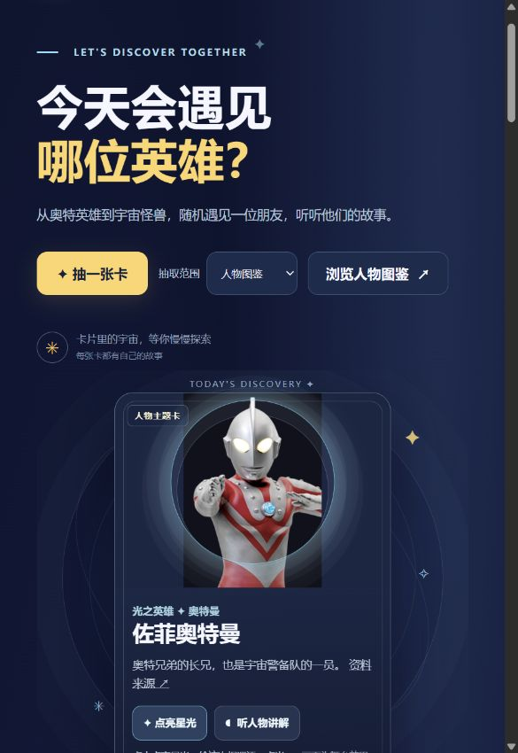
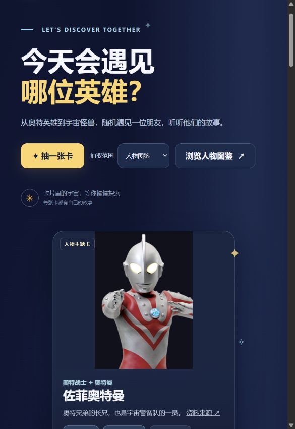
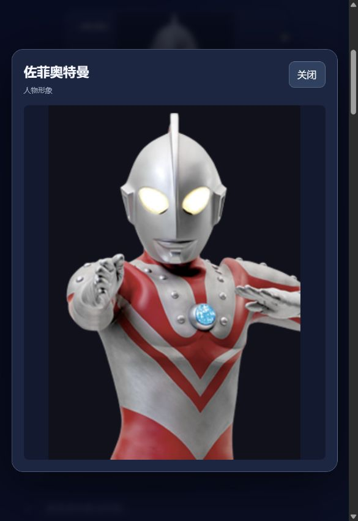
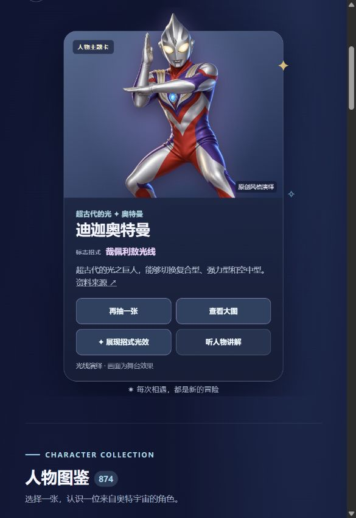

# 卡片显示与操作优化 · 2026-10-27

范围：现有抽卡展示、从图鉴选人、完整图片查看、讲解控制及失败回退。在本地隔离地址使用与正式页面相同的 HTML、CSS 和 JavaScript 检查，没有读取或改写用户原页面的收藏。

## 1. 人物卡面：已优化

优化前，环形装饰叠在原图之上，普通人物被圆圈穿过，竖图展示区域也偏小。

移除了卡面、缩略图和舞台上的描边圆环，保留背景柔光及主动触发的演出；增大人物展示区域，避免前景人物被内框描边覆盖。

## 2. 看清人物：已优化

增加“查看大图”。弹窗展示完整形象，支持关闭按钮和 Escape，关闭后焦点返回入口；前景图失败时，大图使用已回退的原人物图。个人收藏的图片失败也会显示提示。

放大不能增加原素材分辨率。部分官网图、书页照片仍不够清晰，需要后续逐项替换高质量对应素材。

## 3. 选人与抽卡：已优化

从图鉴选人后直接定位人物卡，并将键盘焦点移至卡片。卡面提供“再抽一张”，候选超过一条时避免立即重复上一条。空的个人收藏仍显示添加提示。长角色名允许两行展示；相同的资料与图片来源链接不再重复显示。

## 4. 讲解与光效：已检查

讲解优先选择设备中文声音，按钮同步播放/停止状态。切换人物、打开大图以及离开页面会取消讲解；隐藏页面时也调用停止逻辑。隔离测试验证了切卡和打开大图时取消语音，前景失败时恢复官网图，大图也能打开回退形象。通用怪兽标签由“宇宙来客”改为“怪兽档案”，避免将地球怪兽误标为来自宇宙。

## 后续仍可改进

- 部分来源图片是低分辨率头像、整张卡片或图鉴书页；优先替换常用人物的清晰独立图。
- 专属前景目前只有初代和迪迦，专属招式配置有四位英雄。更多专属形象和演出需要逐项制作、核实并接入配置。
- 图鉴数量较大，后续可增加可靠的作品分类、角色别名搜索和喜欢的人物入口。

## 验证边界

截图来自本轮实际页面，预览窗口约 585 像素宽；未在实体手机上测试。已检查上述流程和隔离失败场景，未宣称全面无障碍合规，也不能保证各设备的系统语音可用。外部图片仍受网络与来源服务影响。
