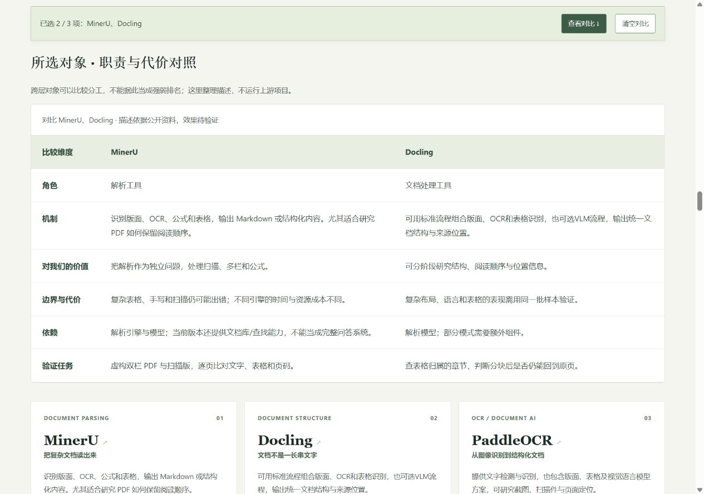
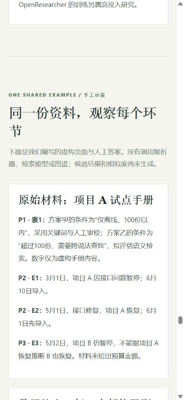

# 009 研究补全与第二轮发布验收

2026-10-28发布并核验：[正式网页](https://yydshly.github.io/1025_codex_project/009-knowledge-processing-atlas/)。

内容提交：`92fe87f6fadefe7dcf60ead62051fe5fe5a17d76`；[Pages运行40604179834](https://github.com/yydshly/1025_codex_project/actions/runs/40604179834)的build和deploy均成功。

## 摘要与研究范围

场景从DeepTutor/NotebookLM的教材问答、资料整理和建库成本出发；具体价值落到论文溯源、跨日回顾、案例复用、薄弱技能复习和多视角研究。底层库帮助保留结构、位置、时间和证据，提供可替换的表示/检索/关系/评估模块；数据库或模型名称不等于完整的可信知识能力。

目录统一26项：解析MinerU、Docling、PaddleOCR、olmOCR；表示/查询BGE-M3、ColBERT、Qdrant、OpenSearch、PageIndex；关系Graphiti、GraphRAG、LightRAG；完整应用/框架RAGFlow、DeepTutor、NotebookLM、LlamaIndex；教学OATutor、pyKT、pyBKT、Tutor MCP；研究评估STORM、OpenResearcher、Ragas、Pyserini、OmniDocBench；全文基线SQLite FTS5。对象角色不同，目录不是同类排名。

新增5个算法专题、可点击文字路线、场景选型表、6题虚构材料与人工参照，以及[实验协议](experiment-protocol.md)。原图v3保留，没有重新生成。我们的可复用资产是来源字段、模块边界、可重建索引、可审查生成记录和可复查评估；能力扩展仍是计划。

## 检查结果

- npm run check、check:pages四项隔离测试、009脚本语法检查通过；完整Pages构建214文件，保留原有6个公开项目范围。CI也完成既有工作流的检查和构建。
- HTML核对：26卡片、26对比选择框、68个唯一ID；本地文件链接与锚点有效。JSON含6题且experimentResults为null，CSV格式模板只有字段名。
- 本地浏览器：SQLite和NotebookLM均可搜到，空结果提示正常；两项/三项比较、第四项拒选、清空、过滤后的直接定位和键盘展开通过；应用/框架分类含RAGFlow、LlamaIndex、LightRAG、DeepTutor、NotebookLM。
- 正式浏览器：目录26项、摘要四部分、SQLite搜索、两项对比六个维度正常；没有记录到脚本错误。桌面1280px无文档级横向溢出；手机390px视口中文档宽375px，宽表在自己的337px容器中横向滚动。
- 正式总入口、009主页、JS、CSS、JSON、模板文本和原图均HTTP 200；总入口出现新摘要。文本按换行归一化与发布源一致，原图逐字节一致。
- CSV内容以.csv.txt进入既有发布白名单，网页download属性指定保存为experiment-record-template.csv，未扩大总库发布规则。初次发现的模板404已在正式发布前修复。

线上原图SHA-256：`efed8221e35e78e77dc9d9b8e1e54f3c0a34da6be37b34f70c132ce63d3faa3d`。

线上scenario-v1.json原始字节SHA-256：`bfc5dd527e0cda4909a19316f39c151d3773cc7d0e556e8f26417f878a3309b9`。Git文本换行归一化可能使本地工作副本字节哈希不同，数据内容已对照。

## 正式页面证据

本地预发布截图保留在同一目录，可能显示预发布阶段措辞；正式截图为最终发布内容。截图与研究记录保存在GitHub仓库，不进入app静态发布目录。

## 验证边界

这次完成的是研究内容、静态网站发布和交互验证。没有安装或运行上游库、下载模型、测量算法效果或接入正式个人资料。未进行完整无障碍审计或真实学习收益实验。
