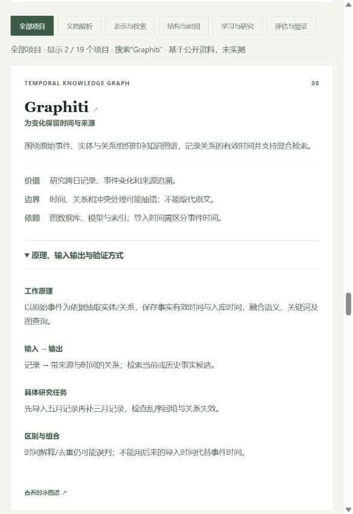
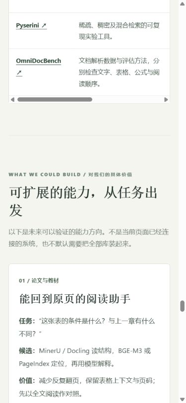

# 009 发布与验收

2026-10-28（北京时间）完成研究网页发布。

- 正式地址：[资料理解与检索研究](https://yydshly.github.io/1025_codex_project/009-knowledge-processing-atlas/)。
- 内容提交：`6c40aab5fc39d85b0dec45af8683669543217e7b`。
- GitHub Actions：[首次发布运行](https://github.com/yydshly/1025_codex_project/actions/runs/40559484575)，build / deploy 成功。
- 发布范围：009 的 app/ 静态网页、脚本、样式和第三版引导图；原始研究笔记、提示词及验收截图不打包进网站。GitHub 仓库仍保存这些研究文件。
- 总库封面与网页使用同一第三版图像，SHA-256：`efed8221e35e78e77dc9d9b8e1e54f3c0a34da6be37b34f70c132ce63d3faa3d`。线上下载内容与原图一致。

## 已核验

1. 本地 npm run check、check:pages、009 JavaScript 语法检查及图片/锚点/资源检查通过。
2. 已有站点项目的工作流检查和构建通过，完整发布产物包括001、003、004、005、008和009，未加入其他本地研究。
3. 正式总入口、009编号地址、CSS、JS、引导图均 HTTP 200；总入口包含009和新摘要。
4. 正式浏览器中搜索 Graphiti 并展开原理正常；搜索会匹配展开内容，因此关联项目也可能命中。评估分类及原理关键词 MaxSim 的本地发布预览验证通过。
5. 手机390px视口无文档级横向溢出，宽表使用自己的横向滚动容器。六类具体场景和19项展开说明可读；浏览器未记录脚本错误。

## 证据

## 研究与发布边界

这次验证的是研究网页的发布、路径、图片和交互，不是MinerU、BGE-M3、Graphiti等上游算法效果实验。底层演示仍未实施；未安装或运行研究对象，未将正式日记或编辑缓存作为样本。后续继续使用虚构/公开材料建立人工参照，先比较全文和关键词基线，再决定是否增加模型和服务。
