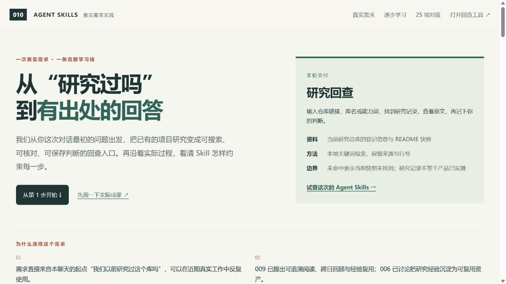
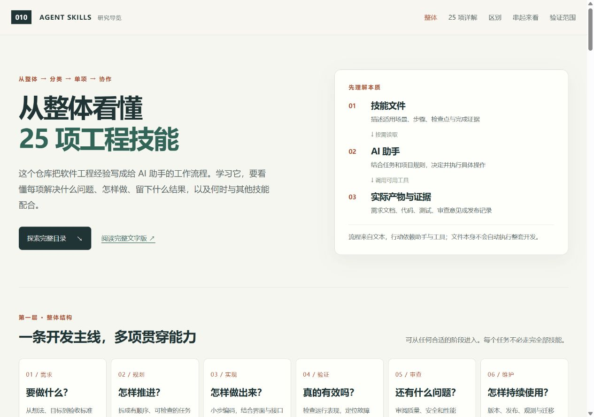
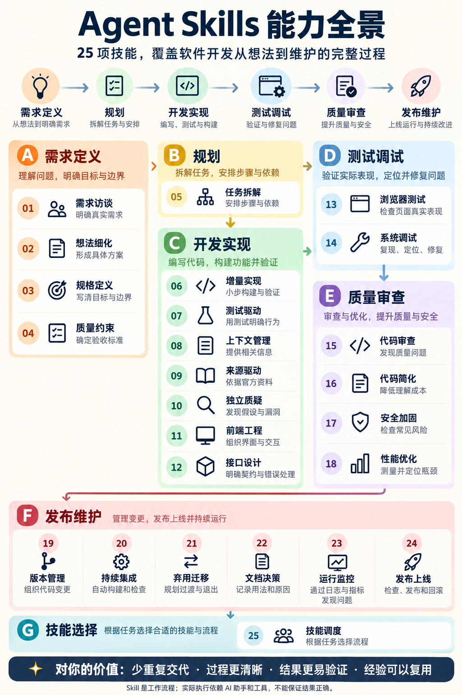

# 010 · Agent Skills · 全景理解与实践

[addyosmani/agent-skills](https://github.com/addyosmani/agent-skills) 提供 25 份工程 Skill，把需求、规格、规划、实现、验证与交付中的经验写成 AI 助手可以读取和遵循的工作规程。它的价值在于明确每类任务该如何推进、守住什么约束、留下什么产物，以及用什么证据判断完成；实际行动仍由助手结合项目和可用工具执行。

本项目把全部 25 项能力整理为七类工作：选择方法、明确目标与底线、准备执行、实现功能、验证纠错、改善质量、交付维护。通过一张入口总图，逐项解释做什么、什么时候用、怎么做、交付与检查、如何配合，并关联具体场景和固定版原文。

对我们的意义是建立一份按需查阅的工程方法库：以后从真实需求出发，选择相关 Skill 实际使用、核对效果，再分析其设计。学习重点是如何用步骤、约束、产物和检查控制落地，并把有效做法沉淀为自己的能力。25 项介绍与原理解读已覆盖；逐项完整实测尚未完成，固定源码、教学示例、有限实验与自建 Skill 的证据分别保留。

已上线：[统一入口](https://yydshly.github.io/1025_codex_project/010-agent-skills-engineering-lab/) · [完整汇总长图](https://yydshly.github.io/1025_codex_project/010-agent-skills-engineering-lab/app/overview-poster.html)。发布范围和线上验证见[发布记录](research/deployment.md)。

[入口总图：25个Skill与使用场景](app/overview.html) · [完整汇总长图](app/overview-poster.html) · [25项场景详解](app/scenarios.html) · [实现原理导览](app/index.html) · [真实需求实践](app/real-case.html) · [使用研究回查](app/recall.html) · [创建研究回查Skill实录](app/scenarios.html?lesson=1#build-skill) · [完整文字版](research/learning-guide.md) · [返回总索引](../../README.md#项目索引)

| 项目 | 内容 |
| --- | --- |
| 上游版本 | [`aeac41d4d005999432bb7312f7ff06383a91d59d`](https://github.com/addyosmani/agent-skills/tree/aeac41d4d005999432bb7312f7ff06383a91d59d)；2026-10-28 核对 |
| 上游许可 | MIT；原始版权与许可见[本地副本](research/upstream/LICENSE) |
| 已获取 | 25 个 `SKILL.md`、7 个技能内支持文件、7 份共享参考资料及许可证，共 40 文件 |
| 状态 | 25 项原文解读与教学示例、3 项有限实验；新增真实研究回查工具与六步实践导览，采用与未触发能力分别记录 |
| 安装状态 | 上游材料只读研究，未安装上游插件；本项目自建 research-recall 技能的安装与验证另见下方记录 |

## 统一查阅入口：25项能力与使用地图

[可点击总图](app/overview.html)按七类工作展示全部25项。每项统一回答五个问题：做什么、什么时候用、怎么做（含关键判断与约束）、交付什么与怎样检查、怎么配合。图中先看名称与用途，点击后查看完整说明，并可继续打开具体场景、实现原理与固定版原文。

[完整汇总长图](app/overview-poster.html)将25项与五问放在同一张图中，可按原尺寸放大阅读；保留 [PNG](assets/images/skills-field-guide.png) 与可搜索文字的 [SVG](assets/images/skills-field-guide.svg)。内容来自本项目固定版本原文和场景说明，使用项目已有的字体与色彩，场景保持条件式表述。生成命令为 `node scripts/build-overview.mjs`；检查命令加 `--check`。PNG通过本地浏览器从同一SVG导出，无新增第三方依赖。生成SVG后需同步重新导出PNG。

当前学习停留在全量理解和查阅；后续遇到真实需求，再选相关Skill实际使用、检查效果和分析实现。讲解覆盖25项不表示25项已经逐一完整实测。内容、交互与图片检查见[总图验证记录](research/overview-verification.json)。

[](app/overview.html)

## 需要更多细节：25项使用场景全景

[全量场景页](app/scenarios.html)承接总图的逐项阅读：以七类工作组织全部25项，每项提供触发条件、近期项目中的条件式例子、可以直接提出的任务、应得产物、验收方式、不适用情况、落地风险与技能衔接。支持展开全部案例和按技能直接定位。

学习顺序：**全部使用场景 → 单项实现原理 → 真实需求实践**。场景说明已覆盖25项，原文解读已覆盖25项；25项逐一完整实测尚未完成。研究回查案例采用部分相关方法，不能作为全部能力的独立实测证明。

场景结合现有项目构造，使用“当/如果/准备”等条件表达；不声称用户已提出这些新增需求、项目已出现这些故障，或已执行例子中的改动。来源与覆盖检查见[场景验证记录](research/scenarios-verification.md)。

## 从真实需求学习落地控制

本案例来自本聊天最初的真实问题：“这个库我们以前研究过吗？”用户选择以“跨项目检索、查看出处、保存判断”开展实际演示。现有 10 个研究项目的登记信息和 README 被保存为可核对的快照，形成一个可用的[研究回查入口](app/recall.html)。

- 按仓库链接、库名、关键词与研究阶段查询；结果带原文段落、行号、来源哈希。
- 展示当前总库快照的研究记录；未命中只表示此快照没找到，登记为已总结不代表上游已实测。
- 个人判断存于当前浏览器，可生成或下载 JSON 备份、粘贴备份合并；格式错误、未知版本和冲突拒绝写入。
- 草稿切换有保护；保存前检查其他页面是否已更新记录。它不是多人协作服务，没有跨设备同步。

[真实需求实践页](app/real-case.html)按六步组织需求、约束、任务、实现、修复和交付；每步关联 Skill、产物和回顾问题。25 项覆盖表区分采用的方法与未触发能力，不把完整覆盖讲解当成全部技能的实测证明。

已发生的行为失败和修复、浏览器使用流程与验证边界统一记录在[验收记录](research/real-case/verification.md)。核心逻辑有 18 项行为测试；此前三个有限实验继续保留，均无无技能独立对照，未量化技能收益。

使用笔记功能请通过 HTTP 打开：在本子项目目录运行 `node scripts/serve.mjs`，访问 <http://127.0.0.1:8010/app/real-case.html>。从实践页进入回查工具。浏览器的本地保存跟随访问地址；需要保留记录时导出备份。直接打开文件的存储行为未验收。

数据输入限总库登记和各项目 README，不扫描私人资料，也不连接 ReflectFlow。快照通过 `node scripts/build-recall.mjs` 更新；其他项目更新说明后需要重建。这个早期网页案例没有安装全局技能或增加模型服务；后续自建 Skill 见下面的独立章节。



## 创建真正可用的研究回查 Skill

[六步创建实录](app/scenarios.html?lesson=1#build-skill)从能力契约开始，逐步说明流程、技能规程、脚本、独立试用与安装调用。每步都有设计理由、实际产物、验收方法和证据。初始教学草案作为历史示例保留；正式入口是 [research-recall/SKILL.md](skill/research-recall/SKILL.md)。

该技能用 Python 3.10+ 标准库读取明确根目录的项目登记，以及登记项目的 README 和 research Markdown，排除上游副本和生成记录。提供 search、read、verify、save：返回带行号和哈希的原文，核对完整 GitHub 仓库身份，保存判断前重新验证证据，独占创建新文件。判断记录与浏览器笔记独立保存。

- [第一步能力契约](research/skill-creation/contract.md)
- [每一步设计与验证说明](research/skill-creation/walkthrough.md)
- [实际检查与安装记录](research/skill-creation/verification.json)
- [独立试用答复与证据](research/skill-creation/forward-test.json)
- [脚本行为测试](tests/skill-recall.test.py)

在研究总库根目录运行只读查询：

```powershell
python -X utf8 projects/010-agent-skills-engineering-lab/skill/research-recall/scripts/recall.py search --root . --query "https://github.com/addyosmani/agent-skills"
```

安装后，在助手中可提出：`$research-recall 在当前研究总库回查 Agent Skills 的用途和适用场景，给出原文出处，并区分已有研究与未实测判断。`

查询读取当前资料；它不是任意语义问答、联网搜索或私人日记接入。验证证明来源与引用一致，不自动证明解释正确。安装副本及测试覆盖以验证记录为准，尚未进行有／无 Skill 收益对照。

## 从整体到细节的阅读路径

1. **整体结构**：先理解技能文件、AI 助手、执行工具与实际产物的关系；再看需求、规划、实现、验证、审查和维护的主线，以及跨阶段能力。
2. **25 项完整目录**：按阶段或关键词查找。每项解释适用场景、所需输入、执行步骤、输出、为什么这样安排、相关技能和能力边界。
3. **相近技能区别**：对照需求访谈与想法细化；规格、质量约束与计划；测试、浏览器检查与调试等 8 组差异。
4. **共同案例串联**：用“虚构资料检索小工具”的发展过程串起全部技能，说明各项何时进入、怎样交接、哪些可并行。路径和单项示例均为教学解释，未据此实施完整产品。
5. **证据与原文**：每项可打开本地或固定版 GitHub 原文。已有三个实验放在独立证据区，不再用它们代替整个仓库的能力说明。

[学习导览](app/index.html)无需安装依赖，采用本地脚本数据，不请求模型或外部 API；可直接用浏览器打开该 HTML。需要 HTTP 预览时，在本子项目目录运行 `node scripts/serve.mjs`，访问 <http://127.0.0.1:8010/app/index.html>。页面提供搜索、阶段筛选、逐项阅读、技能关联跳转、相近能力对照及详情刷新恢复；没有执行技能的后台服务。



图：本轮实际浏览器截图。交互检查和边界见[导览验收记录](research/guide-verification.md)。



图：我们用 AI 制作的能力整理图，展示上游声明的用途，不是各项技能的实测结果。[价值与使用示意图](assets/images/value-and-use.png)同样为本研究整理。

## 场景实验

| 实验 | 真实执行的工作 | 观察和边界 |
| --- | --- | --- |
| [跨日搜索调试](experiment-batch/research/experiments/experiment-debug/README.md) | 用虚构记录和人为植入的索引故障，按调试技能复现、定位、修复及检查。 | 故障版 3/5 检查通过，修复版 5/5；这是最小模型，不是真实 ReflectFlow 故障。 |
| [检索需求规格](experiment-batch/research/experiments/experiment-spec/README.md) | 对虚构资料关键词检索场景，参照规格技能写出目标、边界及 5 条验收条件，并检查结构。 | 规格结构检查通过；未实现检索工具，检查不证明规格或功能正确。 |
| [卡片收藏备份审查](experiment-batch/research/experiments/experiment-review/README.md) | 只读审查 008 项目备份处理代码，用虚构输入和内存存储运行实际函数。 | 所选输入与存储失败检查通过；未做真实浏览器流程或全面安全审计。 |

这些实验是阅读技能后由助手实际执行或产出材料，并非插件自动执行。实验均没有无技能独立对照，不能量化它们是否更快或更准确。实验输入为虚构数据，不读取、连接或修改 ReflectFlow 正式库及编辑缓存；审查只读访问 008 源码，未接触真实浏览器收藏。详细输入、命令和限制见各实验说明。

## 本地复查

需要 Node.js 22+ 和 Python 3；无需安装第三方依赖。在本子项目目录执行：

```powershell
python scripts/verify-snapshot.py
python scripts/build-guide.py
node scripts/build-scenarios.mjs
node scripts/build-scenarios.mjs --check
node scripts/build-recall.mjs
node scripts/build-recall.mjs --check
node --test tests/recall.test.mjs
node scripts/verify-real-case.mjs
python -X utf8 -B tests/skill-recall.test.py
python experiment-batch/research/experiments/experiment-spec/check-spec.py
node experiment-batch/research/experiments/experiment-debug/verify.mjs before
node experiment-batch/research/experiments/experiment-debug/verify.mjs after
node experiment-batch/research/experiments/experiment-review/check-backup.cjs
```

调试实验的 `before` 因故障预期返回非零；`after` 应通过。快照校验只证明本地文件与本次保存的清单一致，不是独立上游真实性证明。需要重新获取时，可在**不存在 `research/upstream` 的新副本**运行 `python scripts/fetch-upstream.py`；脚本拒绝覆盖已有快照，不执行上游内容。

## 对我们的价值与取舍

用好这个库，从一个实际问题开始：先在总图中找到相关场景，读该 Skill 的步骤与边界，再把它用于当前项目，核对产物和失败证据。直接可借鉴的做法包括：将需求写成可验收的行为、调试前保留复现材料、让重要假设接受独立检查、交付前实际走通用户路径。

学习其优点，要追问每条要求如何影响执行：靠文字提醒、由工具检查，还是作为进入下一步的门槛。研究回查案例和自建 `research-recall` 用来观察这种落地控制；后续扩展以真实需要和实际结果为依据。技能指导不能替代运行工具或测试，也不自动保证质量。部分方法与现有 Codex 技能重叠，应按当前问题和风险选用；用户指令、本仓库约定和 ReflectFlow 保护要求始终优先。

上游内容和许可保留在 `research/upstream/`，文件清单见 [manifest.json](research/upstream/manifest.json)。三份 `app/data-*.json` 是我们的中文解读，`scripts/build-guide.py` 校验覆盖、字段和关联，并生成浏览器数据与完整文字版。页面和中文解读不属于上游原文；此前两张生成图片仅作概览。上游插件不安装到当前环境；后续用户明确要求创建可用 Skill，因此另行实现并部署自建 research-recall，具体文件与状态见安装记录。
