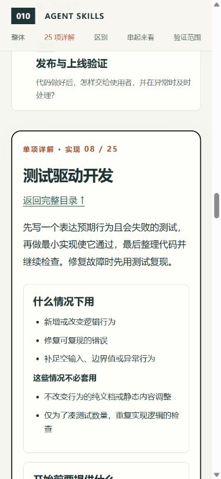

# 系统学习导览验收 · 2026-10-28

## 本轮目标与内容

目标是系统理解固定版本的全部25项技能，从整体到单项细节，再看差异与配合。此前三个局部实验保留为独立证据，不再作为全部研究内容的替代。

- 内容来源：本地固定快照 `aeac41d4d005999432bb7312f7ff06383a91d59d`，全部25份主技能分别阅读并整理。中文内容为研究解读，不是上游逐字翻译。
- 覆盖：25个唯一技能，每项包含问题、用途、适用/不适用场景、输入、执行步骤、产出、机制、教学例子、关联和限制。
- 整体：技能文件→AI助手→工具与产物；六阶段主线加跨阶段方法。分类用于阅读，并非强制执行顺序。
- 对照：8组相近能力差异；共同的虚构资料检索工具路径包含全部25项。
- 每项教学例子明确未执行，不将预期输出、指标或检查方案写成实测结果。

## 实际检查

1. `python scripts/build-guide.py`：25项数量、唯一性、与上游目录一一对应、字段、来源路径及关联校验通过，生成 `catalog.js` 和完整文字版。
2. `python scripts/verify-snapshot.py`：40个上游文件仍与保存的摘要清单一致。
3. `node --check app/guide.js`、`node --check scripts/serve.mjs` 通过。
4. 在本地HTTP服务与浏览器中逐项打开25项：均显示正确标题、7个内容区域和对应的本地源码链接。
5. 搜索“回滚”显示2项，虚构无匹配词显示空结果；“显示全部”恢复25项；需求阶段筛选显示4项。阶段控件可访问名称首次检查未精确匹配，补充明确标签后复查通过。
6. 规格技能详情刷新后恢复同一项；关联技能、下一项及浏览器后退均显示正确标题。键盘 Enter 可打开技能详情。
7. 页面共同案例路径有25个唯一技能入口；相关源路径和目录交叉链接完整。
8. 桌面1280×900视口，文档宽1265、滚动宽1265；窄屏390×844视口，文档宽375、滚动宽375。未见文档级横向溢出；窄屏详细内容按单列显示。临时视口覆盖已恢复。
9. 最终浏览器控制台检查未返回 error/warn。
10. 页面本地文件链接、25个源码路径和6个代表性HTTP资源检查通过；`npm run check` 通过，10个项目的编号、目录、配图与生成索引一致。

截图：

## 验证边界

这是静态学习页面和内容的验收，不是25项技能的效果测评。没有部署网站、安装插件或连接私人资料。没有真实手机硬件验收、完整读屏审计或跨浏览器兼容测试。本轮浏览器实测使用HTTP地址；页面使用普通本地脚本数据而非fetch，提供HTML文件入口，但未通过当前内置浏览器验证file协议打开。

源资料可从每项详情打开。浏览器预览服务只绑定127.0.0.1；需要再次预览时按项目README运行服务即可。
