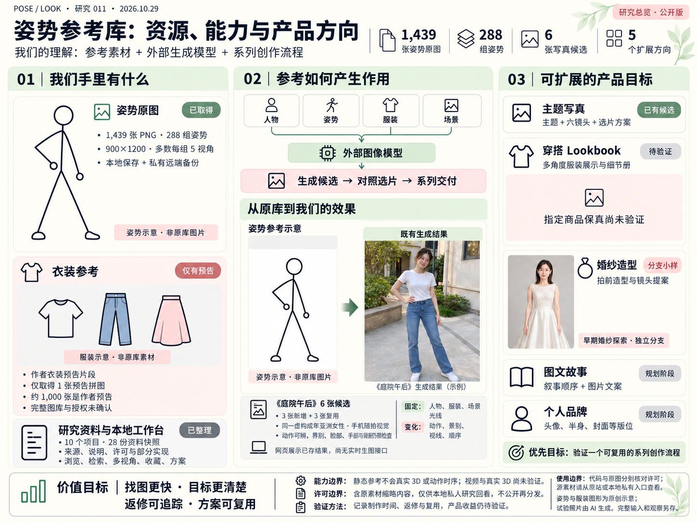
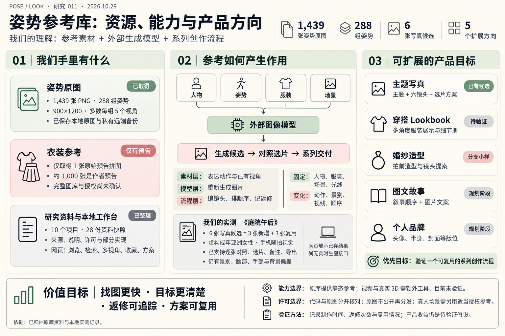
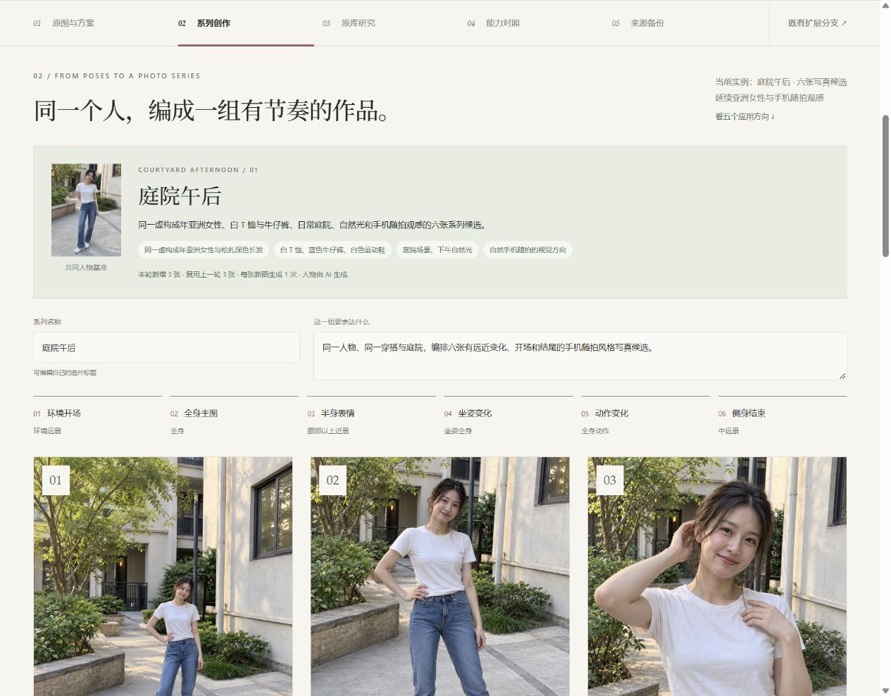
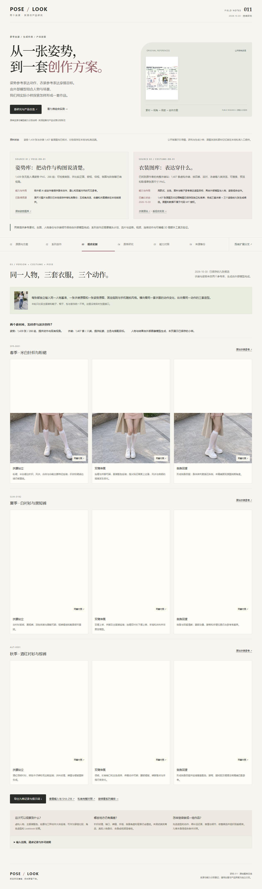

# 011 · 姿势与衣装参考 · 能力、作用与产品探索

> 两个来源分别承担“表达怎么摆姿势”和“表达穿什么”的作用。POSE-DB-01 提供 1,439 张静态姿势参考；COSTUME-DB-01 提供 1,407 套虚构衣装参考。两套原图分别在私有仓库备份，当前已用三套衣装与三个姿势完成同一虚构人物的九张组合候选。生成由外部模型完成，我们在网页中区分原库事实、实际小样和产品设想。

> **网页内容**：[研究总览](https://yydshly.github.io/1025_codex_project/011-pose-look-creation-atlas/#overview) · [九格衣装与姿势组合实测](https://yydshly.github.io/1025_codex_project/011-pose-look-creation-atlas/#matrix) · [系列写真与五个方向](https://yydshly.github.io/1025_codex_project/011-pose-look-creation-atlas/#series) · [两个来源的详细研究](https://yydshly.github.io/1025_codex_project/011-pose-look-creation-atlas/#understanding)。公开版保留生成小样、选片、备注和方案导出；[本地版](http://127.0.0.1:8011/app/#gallery)另提供原图浏览、五视角、收藏与私人素材记忆图。

[返回总索引](../../README.md#项目索引) · [在线原库研究](https://yydshly.github.io/1025_codex_project/011-pose-look-creation-atlas/) · [本地网页](app/index.html) · [研究笔记](research/notes.md) · [私有原图备份](https://github.com/yydshly/pose-look-reference-backup)

图：保留用户选定的 2026-10-29 引导图，不改写旧图。衣装“预告”是当时的状态，最新数量和组合实测以本页 2026-10-30 说明为准。沿用素材回忆图版式和已有探索效果。公开版将源库姿势线稿与衣装预告缩略换为原创几何示意；含原素材的完整记忆图继续放在本地私人入口。姿势与服装示意不是原库图片，精确输入以记录为准。[公开引导图编辑记录](app/media/research-overview-v3/manifest.json)。图中底部原图许可提醒适用于原库图像数据，当前公开图的源库图形已替换为示意。

| 来源 | 已确认能力 | 对创作的作用 | 资源状态 |
| --- | --- | --- | --- |
| POSE-DB-01 姿势图库 | 分类检索、静态 PNG、同组已有视角对照 | 将身体动作、重心和构图方向变成外部 AI 可参考的图片 | 1,439 张原图、288 组已保存到本地与私有备份；原图不公开再分发 |
| COSTUME-DB-01 衣装图库 | 1,407 套虚构衣装、八类检索、预览与单张原尺寸 PNG | 表达款式、主色与搭配目标，配合人物和姿势生成造型候选 | 1,407 张原图和对应缩略图已保存至独立私有库；未备份插件代码，原图不公开再分发 |

两者提供素材条件；它们自身不运行生图模型。人物身份、服装细节和姿势跟随取决于外部模型及流程。中文 GitHub 镜像增加汉化与检索，代码许可不自动覆盖原图。

| 项目 | 内容 |
| --- | --- |
| 编号 | 011 |
| 收录与核对日期 | 2026-10-29 收录；2026-10-30 更新衣装资源和组合实测，Asia/Shanghai |
| 当前阶段 | 两套原库已私有备份；六张写真、九张衣装组合候选及五个产品方向已接入，商品保真、稳定性与真人还原仍待验证 |
| 实现 | 无第三方依赖的 HTML / CSS / JavaScript；无需构建 |
| 上游研究版本 | 10 个项目固定 commit，见[快照清单](app/archive/manifest.json) |
| 原图资源 | 姿势 1,439 张 / 288 组；衣装 1,407 张原图及 1,407 张缩略图 / 八类；不放入公开研究库 |
| 源库资料 | 28 份说明、许可与少量导出实现，合计 530.2 KiB |
| 授权 | 代码、原图、模型和附加人物分别核对；保留原文许可 |
| 在线演示 | 已发布并核验：[原库研究主线](https://yydshly.github.io/1025_codex_project/011-pose-look-creation-atlas/) |

## 网页结构

**一图总览（#overview）**

[打开本地图解](http://127.0.0.1:8011/app/#overview) · [下载 PNG](app/media/research-overview-v1/overview.png) · [完整生成指令与资料依据](app/media/research-overview-v1/manifest.json)

以“资源 → 参考如何起作用 → 产品目标”汇总原库理解：区分当时已保存的姿势原图、当时仅有预告的服装资源、外部生成模型与工作流，以及五个方向的实际进度。图中说明价值目标、视频与真实 3D 的缺口、许可边界和验证方法。上图为 1536×1024 的文字总览 v1，图标为示意图形，未复制原库图片。

**本地默认新增「素材与效果版 v2」**：在图中嵌入 P015 扶腰原素材、衣装预告片段、对应庭院站姿结果和早期婚纱小样，便于回忆研究对象与探索。婚纱明确标为独立分支。该 v2 图记录 10 月 29 日衣装库尚未确认的状态；10 月 30 日已找到完整站并完成备份。AI 排版的缩略细节可能重绘，网页提供当前窗口切换查看各张原始资料与结果的入口。[本地查看](http://127.0.0.1:8011/app/#overview) · [输入、指令与哈希记录](app/media/research-overview-v2/manifest.json)。

含原素材的合成图仅保存于 Git 忽略的 `.local/research-overview-v2/overview.png`，不放入公开 app 或公开截图。只有本机专用路由 `/local-media/research-overview-v2.png` 可展示；路由逐次核对 PNG、字节、尺寸和 SHA-256。无私人本地文件时，网页显示公开版 v3 总览。网页均支持放大、滚动阅读与下载。v2 首次排版完成，第二次补坐姿因网络失败没有返回结果；交付图为 1448×1086，未包含坐姿补充。该段是 v2 制作时的历史记录；含原素材的图继续不进入公开远端。

**本地原图与创作方案（新增默认入口）**

- 通过本机服务只读挂载已保存的 1,439 张原图、288 组姿势；不重复复制图片，不下载新资源。
- 分类、中文与日文搜索、卡片内直接点选五视角、按需放大、原图另存、来源与哈希、收藏及五个自编专题。每张卡片独立切换，加入方案沿用当前视角；原站缺项会禁用标记。
- 98 组姿势提供人工中文译名；其他保留原名与中文分类。动作特征标签由原始名称规则整理，不是图像识别结果。
- 创作方案板支持按视角选图、排序、备注、草稿持久化、JSON 导出/合并导入和制作说明导出。
- 三个可操作的产品流程原型：创作参考方案包、角色系列图制作计划、分镜与机位方案板。方案板本身不调用模型；另有使用真实原库输入生成的三姿势小样，尚未验证真实用户效率或付费价值。
- 原库生成实测：默认亚洲女性手机随拍版，保留前两轮插画与摄影风格；可切换版本、放大人物基准/原姿势/结果，回查全部输入、指令、哈希和偏差。展示的是已保存结果，没有网页实时生图接口。

方案保存图片引用、出处、哈希与备注，不内嵌原图。完整源索引通过本地接口读取，不进入公开 app 目录。包含原图的本次本地截图位于 `assets/images/local-v5/`，已排除 Git 跟踪；后续远端处理需区分工具代码、方案元数据与原图资产。

**系列创作（#series）**

- 五个方向：主题写真、穿搭与 Lookbook、婚纱造型、生活方式图文故事、职业与个人品牌；分别说明价值假设、交付物、输入、固定条件、变化、缺口和验证任务。
- 《庭院午后》六镜头：环境开场、全身主图、半身表情、坐姿变化、动作变化、侧身结束。延续同一虚构成年亚洲女性、白 T 恤、牛仔裤、庭院与手机随拍视觉方向。
- 新增三次生成，另三张引用手机随拍 v3 的原有文件；未重复复制。保留全部结果，开场与结束景别偏近的问题明确列为返修项。
- 点击图片在当前窗口对照人物、原库姿势和结果，可连续切图，查看指令与来源；支持候选勾选、备注、浏览器保存、JSON 导出/导入和 Markdown 镜头说明导出。
- 当前网页展示已生成结果，未接入实时生图；穿搭商品保真、真人还原、视频与 3D 没有因此得到验证。

**主页面：原库研究**

- 原始对象：两条分享各自指向什么，日文原站、中文转述与镜像的关系。
- 保存状态：姿势与衣装全量原图、早期预告历史、本地路径与两个私有远端入口，以及保留原站关联的原因。
- 原库盘点与扩展研究：真实索引的分类、视角和尺寸统计；七个方向的交付、证据、缺口、验证方法与优先级。
- 作者演示：人物、服装与姿势参考分别发挥什么作用，生成由哪一层执行。
- 能力与价值：原库提供的素材/检索，外部模型和相关工具的边界，已确认事实和未验证效果。
- 来源与备份：原帖、原站、条款、固定版本资料和私人原图备份。

**独立分支：已有思路与实验**

- 思路理解：通用参考生图原理，以及图片、视频、3D 的交付区别。
- 自建实验：原有换装、庭院场景、姿势编辑对照，保留完整图片、指令、输入关联和偏差。
- 产品场景：婚纱、换装、摄影、衣橱与店铺等八类方案。

独立分支的交互脚本不在主页面加载；引导图用婚纱缩略效果记忆该分支，并明确标注。公开版默认进入研究总览，本地版默认 #gallery 展示原图与方案，#series 展示写真系列与五个应用方向，#matrix 展示九格衣装与姿势组合实测，#products 定位原有方案板方向。旧的 #effects 与 #scenarios 链接会跳转至 branch.html；#understanding 仍指向原库研究。

## 主线判断与证据边界

原始姿势库提供静态、多角度、可筛选的参考 PNG；中文镜像增加汉化和检索。服装帖是早期预告；2026-10-30 已确认完整衣装站，提供 1,407 套虚构衣装 PNG。作者演示与我们的九格实测都由外部图像模型组合多张参考图，原站本身不生成图片。

原库的价值应从找图效率、目标表达、多角度参考和素材复用来判断。姿势跟随、身份保持、服装保真与成功率属于外部模型及工作流程的结果。目前已完成同一虚构人物的三姿势小样、六张主题写真候选，以及三套衣装 × 三种动作的九张候选；尚未做纯文字对照、多次重复、数值身份相似度或真人身份还原验证，不能据此估计稳定成功率。

自建婚纱图片和产品方案是另一层探索。它们已移入分支，不能替代原库效果、资源可用性或授权的核对。

## 原库盘点与实际扩展研究

本次对已保存的索引、清单及原图目录做只读盘点，不安装检测器、不下载权重，也不重新生图。[资源盘点](research/resource-audit-v4.json)记录了字段、分组、视角、尺寸和清单哈希；[扩展研究](research/extension-directions-v4.json)记录每个方向的依据与验收方法。网页中可直接展开阅读，也可下载[汇总 JSON](app/resource-research.json)。

[保存状态的网页截图](assets/images/resources-status-v4.jpg) · [本次网页核验](research/resource-research-v4-checks.json)

- 1,439 张原图全部为 900×1200；288 组中，287 组有五个视角，一组有四个视角。缺项是原索引的“全身1人・セクシー系 / P018 / 下から”，不是下载遗漏。
- 1,439 个图像哈希各不相同，但同组的不同视角不等于不同姿势。
- 原索引八个字段提供分类、名称、视角与图片地址，没有关节点坐标、相机标定或动作时序。
- v4 为资源保存状态快照；当前本地版通过服务只读挂载原图，已经可直接浏览和做方案。原站链接继续用于溯源与核对条款。

| 优先级 | 方向 | 当前判断 |
| --- | --- | --- |
| P0 | 私有本地图册、项目收藏与备注 | 本地原型已实现；仍需比对现成镜像和文件夹的找图效率 |
| P1 | 原库参考效果对照评测 | 已做三姿势小样；保留全部输出与偏差，严格对照和多次重复未执行 |
| P1 | 姿势控制图和可复用模板 | 官方技术路线存在；灰色线稿、手部及双人检测质量未验证 |
| P1 | 虚构角色和插画构图方案 | 可利用多角度与标签；需验证能否减少选图和沟通成本 |
| P2 | 3D 摆姿、机位与跨软件交付 | 需要外部模型、骨架与导出流程；原库本身不含真实 3D |
| P2 | 分镜、关键画面与视频延伸 | 静态图能辅助规划；连续动作与视频需额外数据及验证 |
| 暂不推进 | 公开原图镜像、素材转售或训练包 | 图片再分发受限；训练用途未确认，不能从代码许可推断 |

这些是研究方向，不是已上线功能或已证明的商业机会。真人婚纱、换装等继续放在分支，并应更换为适当授权的参考素材。

## 来源与许可

起点是[中文姿势库转述](https://x.com/leo_xiaolei/status/2114971707962536302)与[原作者服装库预告](https://x.com/giaaibusi/status/2115431641766359244)。[日文姿势库原站](https://ai-pose-gallery.pages.dev/)提供原尺寸 PNG；[中文镜像](https://github.com/anhao/ai-pose-gallery-zh)主要增加中文检索和整理。

- 原站允许免费使用，允许符合条款的作品制作商用、编辑与参考；禁止图片数据本身的再分发、转载和转售，原尺寸及加工后图片都在其范围内。
- 原站另写有“不要用于表达实际人物或未成年人的用途”等限制。真人婚纱/换装应使用自己的或适当授权的姿势参考，不能自动套用这套图库。
- 中文镜像的 MIT 只适用于代码，明确排除图片和原始数据；镜像又声明素材不得商用。不能把仓库标签当作整包素材的授权。
- [衣装原站](https://ai-costume-gallery.pages.dev/)已确认为完整入口，现有 1,407 套；早期约 1,000 张只是制作预告。原作者允许在条款内参考创作和作品商用，但禁止原图及加工素材再分发，实际人物与未成年人用途受限制。第三方 [ComfyUI_Costume-Gallery_ZH](https://github.com/Stone-dielianhua/ComfyUI_Costume-Gallery_ZH) 的 MIT 明确排除图片及数据，不能据此认定衣装素材可任意商用。
- 源码许可不覆盖所有检查点、数据、人物资产、示例模型和服务。各上游原文随快照保留，快照不扩大授权。

原图只在本人可访问的私有仓库保存，不通过本研究库、GitHub Pages、Releases 或公开图库再次分发。个人备份不产生新的使用权。

## 原库三姿势实测 · 亚洲女性手机随拍版

[本地对照页](http://127.0.0.1:8011/app/#pilot) · [当前手机随拍版完整输入与指令](app/media/pose-pilot-v3/manifest.json) · [前轮摄影版](app/media/pose-pilot-v2/manifest.json) · [插画旧版记录](app/media/pose-pilot-v1/manifest.json) · [观察与范围](research/pose-pilot-review.md)

使用原库 `full_single_P015_front`、`full_single_P019_front`、`full_single_P012_front`，分别测试扶腰、双臂上伸和坐姿托腮。每一版生成一张人物基准，再各自从相同基准与对应原图生成三个结果；每个配置一次。按用户反馈，先后保留插画版、自然光摄影版，并新增成年亚洲女性的日常庭院手机随拍方向：白 T 恤、牛仔裤、普通光线和手持构图。三版共 12 次内置 ImageGen 调用、12 张 PNG；模型版本和随机种子未由工具报告。

定性目测：主要动作与支撑关系可辨，人物特征、衣服类型与主色延续；腰胯、脚尖、袖口、口袋、鞋形和面部细节仍有重绘。全部结果保留，不按三张小样推断稳定成功率。

人物基准和图片均由 AI 生成，没有真人照片，也不是实际手机拍摄。手机随拍是视觉方向；需要具体人物还原时，应准备其本人照片与适当授权的姿势素材，再独立检查身份与身体特征。本次没有生成视频、3D 或进行真实商品试穿验收。

## 六张《庭院午后》系列 · 2026-10-29

[本地展示](http://127.0.0.1:8011/app/#series) · [逐张输入、完整指令与哈希](app/media/courtyard-series-v1/manifest.json) · [研究与观察](research/courtyard-series-v1.md)

从手机随拍 v3 的三张动作结果向系列内容延伸，新增环境开场、半身表情、侧身结束三张。新增资产 3 张、3 次内置 ImageGen 调用；其余 3 张和人物基准直接引用 v3 文件。未生成视频或 3D；此次发布公开展示这些已保存结果。

这组支持“姿势参考 + 镜头目的 + 固定人物和场景”的流程探索；目前可见动作、景别和观看节奏的变化。开场人物约占画面一半，未达到约三分之一的目标；结束图也仍偏近。背景几何、面部、手指和服装细节没有逐点锁定，不能当作稳定身份保持、真实机位控制或商业成片质量的证明。

选片草稿使用独立浏览器存储，不改动原图库的创作方案。导出包含图片路径、姿势出处、哈希、指令和备注，不包含原图字节。各方向的收益仍是待验证假设。

## 三套衣装 × 三种动作 · 九格组合实测 · 2026-10-30

[在线九格展示](https://yydshly.github.io/1025_codex_project/011-pose-look-creation-atlas/#matrix) · [本地原图同窗对照](http://127.0.0.1:8011/app/#matrix) · [逐张提示词、输入编号与哈希](app/media/costume-matrix-v1/manifest.json) · [研究与扩展目标](research/pose-costume-matrix-v1.md) · [私有完整记录](https://github.com/yydshly/costume-reference-backup/tree/cfa78a98b97db97825382d92d2f34f12ba7675d3/experiments/pose-costume-matrix-v1)

沿用已生成的虚构成年亚洲女性基准、庭院与手机随拍方向；每张独立输入同一人物、一张衣装原图和一张姿势原图。衣装是 SPR-0001、SUM-0162、AUT-0001，动作是 P015 正面扶腰、P019 正面伸展、P017 侧身回望。帽子、包和首饰统一不带，只看主服装和鞋子。

内置 ImageGen 共 10 次请求、9 张保存结果；原计划短裙坐姿组合被平台拒绝一次，第三列对三套衣装统一换成侧身回望。每个最终配置仅一次，不据此计算稳定成功率。九张均 1086×1448，共 29,580,257 字节；未报告模型版本或随机种子。

人物特征、主服装色块和主要动作可以辨认；衣料纹理、手指、缝线与侧身角度仍有重绘。春装伸展图手指接近上边缘，侧身结果不等同于原图精确角度。适合作为穿搭比较、主题写真和 Lookbook 的候选素材，尚不能证明商品细节保真、实际合身或真人还原。

网页支持九格浏览、同窗逐张放大、前后切换、PNG 下载、完整提示词与 JSON 记录导出。公开版展示生成结果、人物基准及原图编号/链接；本地服务核验私有目录中的三张衣装原图，配合已挂载的姿势原图显示对照。没有实时生图接口。

## 备份与可恢复性

- 姿势本地原图：E:/PersonalBackups/PoseLookReferences/pose-db-20261029
- 衣装本地原图：E:/PersonalBackups/CostumeReferences/costume-db-20261030；[私有远端](https://github.com/yydshly/costume-reference-backup)，1,407 原图与 1,407 缩略图均逐文件匹配上游固定版本的大小、SHA-256 和 Git blob。[远端核验](https://github.com/yydshly/costume-reference-backup/actions/runs/41045762114)已成功。该备份不包含 ComfyUI 插件代码。
- 私有远端：[yydshly/pose-look-reference-backup](https://github.com/yydshly/pose-look-reference-backup)。需要仓库权限，无权限可能显示 404。
- [备份摘要](research/original-backup-summary.json)只含数量、来源、清单哈希、私有仓库链接及核验状态，没有原图。
- 私有目录含逐文件 SHA-256、大小、尺寸、原始 URL、日文索引、抓取时原站 HTML，以及服装预告拼图的来源与哈希。
- 私有仓库的 research-project/ 同时保存本研究网页、笔记、截图与脚本快照；research-project-snapshot.json 记录逐文件 SHA-256。网页展示的固定提交是原图核验版本，研究快照在 main 中继续保留。
- 资料快照按固定 commit 保存，文件追加 .txt 后缀供静态查看；内容字节不变，原路径和 SHA-256 在清单中。

校验全部本地原图：

~~~powershell
python -X utf8 scripts/verify-originals.py E:/PersonalBackups/PoseLookReferences/pose-db-20261029
~~~

核对远端私有 Git 树及每个 blob 与本地字节是否一致（需要已登录的 GitHub CLI，不下载另一份完整图片）：

~~~powershell
python -X utf8 scripts/verify-private-remote.py E:/PersonalBackups/PoseLookReferences/pose-db-20261029
~~~

恢复时从私有仓库克隆，再运行其中的 verify-originals.py。不要把它改为公开仓库或发布原图。备份脚本不安装/运行上游软件，不下载权重；抓取脚本只用于明确授权的私人备份，重复执行会复用已存在的有效 PNG。来源数量变化会停止抓取，需先核对。

## 本地使用与检查

原图工作台需要 Node.js 22+ 的本地服务；双击静态 HTML 无法访问原图目录。前台启动：

~~~powershell
cd E:/codex_project/1025_codex_project/projects/011-pose-look-creation-atlas
npm.cmd run dev
~~~

打开 http://127.0.0.1:8011/app/#gallery 。无需安装依赖，仅绑定 127.0.0.1。默认读取 E:/PersonalBackups/PoseLookReferences/pose-db-20261029，可在启动前设置 POSE_LOOK_LIBRARY 为另一份完整备份根目录；POSE_LOOK_PORT 可指定端口。九格对照另默认读取 E:/PersonalBackups/CostumeReferences/costume-db-20261030；可设置 POSE_LOOK_COSTUMES 指向另一份完整衣装备份。只挂载本次用到的三张衣装原图，每次加载核对记录、字节、尺寸和 SHA-256。

Windows 后台启动/停止（只管理本工作台进程，不注册系统自启动）：

~~~powershell
npm.cmd run start:local
npm.cmd run stop:local
~~~

启动脚本、日志和进程记录仅在本项目 `.local/`，此目录不进入 Git。重复启动会复用已有服务。其他机器需要先取得有权限的原图备份，再指定目录；公开静态站不会自动得到本机图片。

~~~powershell
npm.cmd run check
npm.cmd run archive:verify
npm.cmd run test:local
~~~

根目录另运行 npm.cmd run check。交互结果见[网页核验](research/web-verification.json)。本轮网页接入复用已经生成的九张输出，没有再次生图或安装模型/插件。

本轮本地工作台的目标和产品判断见[本地版记录](research/local-workspace-v5.md)，交互、实际导出文件及访问边界见[核验记录](research/local-workspace-v5-checks.json)。这是当时的本地阶段记录；当前已发布公开研究与生成候选，原图继续私有保存。

## 有限实测与限制

此前的[导出实验记录](app/evidence/export-experiment.json)：Mannequin GLB 为网格层级，0 蒙皮/动画/相机；MPFB + Blender 测试 GLB 含 1 蒙皮、1 动画、1 相机，回读得到 53 骨骼且顶点随动画变化。只证明同一 Blender 的有限回读。焦距数值变化，视场角是否等价尚未核对；未证明其他 DCC 或游戏引擎兼容。

其余工具主要是文档与选定代码调研。新增的小样本说明参考编辑可用于表达换装、场景与动作目标；不能据此推断真实商品还原率、稳定成功率或商业收益。

## 扩展分支

[思路理解、生图实验与产品场景](research/extension-branch.md)已单独保存，在[在线分支页](https://yydshly.github.io/1025_codex_project/011-pose-look-creation-atlas/branch.html#thinking)查看。既有 7 次 ImageGen 调用、8 张输入/结果图、自绘姿势源文件、完整提示词与偏差记录保持不变。

