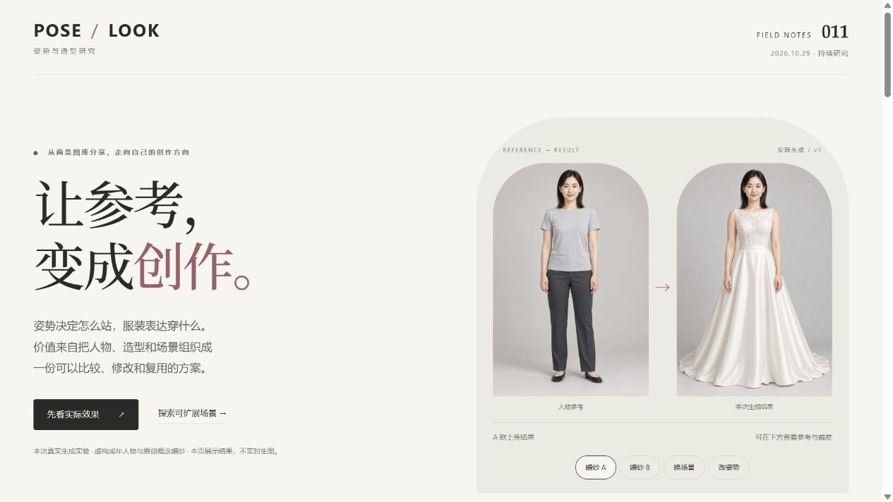

# 扩展分支 · 通用参考生图与产品思路

[返回原库研究](../README.md) · [在线扩展分支](https://yydshly.github.io/1025_codex_project/011-pose-look-creation-atlas/branch.html#thinking)

本分支完整保留已有思路、原创婚纱样例与产品方向。它们没有使用原图库图片，不作为原库控制效果、素材质量或商业价值的证明。

## 核心判断

参考图表达“是谁、穿什么、怎么站、在哪里”。生成模型决定能否把条件稳定合到新画面。图库能减少找图和描述，但产品价值还要靠真实任务验证。

优先验证婚纱选款：固定人物、体型、姿势、机位、背景和灯光，逐款换服装，检查身份和商品细节，再判断是否减少选择与沟通时间。完整造型和拍摄方案可以随后扩展。视觉预览不能推断真实尺码或合身度。

视频模仿、动作恢复、图片生成 3D 网格和自动绑定有独立用途，分别需要其他模型与流程。不能把静态参考图描述为已经具备这些能力。

现成图像工具已经能尝试多参考换装。新产品需要证明选款更快、商品还原更准、方案更容易复用；只是把图库与提示词放到一起，投入价值有限。

## 本次实际效果实验 v1

使用内置 ImageGen（非 CLI/API 回退；工具未返回具体模型版本）生成 3 张输入图，再完成 4 次参考编辑。每配置只生成 1 次，全部保留，不把单次结果扩写成成功率。另有 1 张本项目自绘 SVG 姿势图，使用环境已有 Sharp 栅格化；网页运行不需要 Sharp。

人物为虚构成年人；两款婚纱是原创概念服装，均非真实商品 SKU。没有使用原图库受限图片。页面是结果展示与方案工具，不是在线生图服务。

| 实验 | 实际输入 | 结果与可见限制 |
| --- | --- | --- |
| 同人换款 | 人物基准 + 婚纱 A / B | 人物主要面部特征和构图延续，服装轮廓区分明显；领口弧度、腰带与蕾丝位置有重绘 |
| 换场景 | 婚纱 A 上身图 | 转为虚构庭院，人物服装主要特征延续；光线和细节变化，不能当真实场地拍摄 |
| 姿势参考 | 婚纱 A 上身图 + 自绘姿势图 | 双手改为腰前轻合；腿部被裙遮挡，无法确认重心与关节角度 |

[全部图片、完整指令、输入关联与 SHA-256](../app/media/experiment-v1/manifest.json) · [原始实验描述](research/image-experiment-v1.json)

图片保存在 app/media/experiment-v1/。共 7 张 AI 图片及 1 张自绘姿势 PNG，约 13.0 MiB；源 SVG 同时保留。未做量化人脸相似度、服装还原率、真实尺码或合身测试。新娘整套造型、双人、真实商品和视频/3D 各有额外验证步骤，网页按证据程度分别说明。
