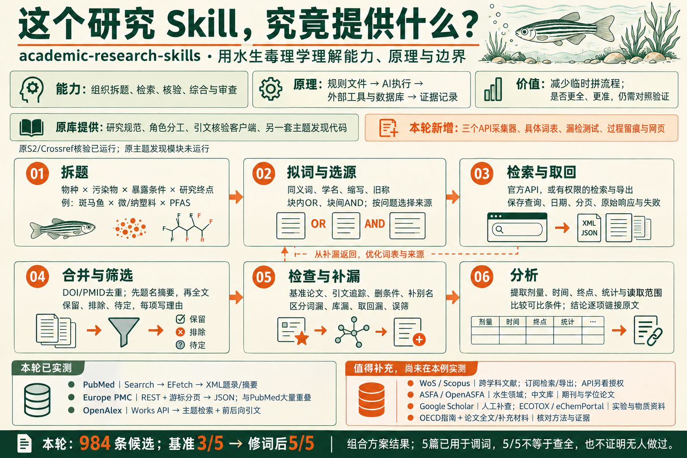
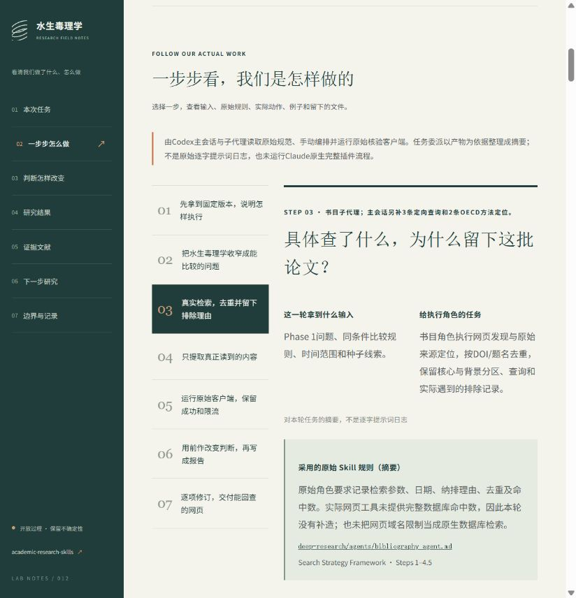
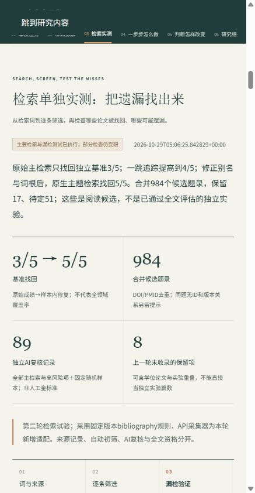

# 012 · 学术研究 Skill：能力、场景与水生毒理学实测

研究 [academic-research-skills](https://github.com/Imbad0202/academic-research-skills) 如何把拆题、检索、来源核验、综合、写作与审查组织成可执行流程。原理是规则文件与角色分工由AI结合外部工具落实；价值在于复用研究规范和检查要求，让过程与判断可追溯，尚未证明相对直接问AI的准确率、查全率或效率增益。

适用于选题探索、综述与前作调查、证据核验、已有材料整理成稿、论文修订、审稿准备和阶段交接。以“微/纳塑料—PFAS—斑马鱼共暴露”为适配案例展示完整过程；课题由AI从宽泛领域中收窄，尚非作者确认的论文题目，没有新增实验。

| Skill | 主要能力 | 本例采用程度 |
|---|---|---|
| deep-research | 拆题、方法、检索核验与证据综合 | 采用多个角色规范并适配，未完整执行原生流程 |
| sr-screener | 已有文献记录的题名摘要/全文筛选 | 未安装、未运行 |
| academic-paper | 依据证据组织论文和修订材料 | 已安装并选读规范，未完整运行 |
| academic-paper-reviewer | 稿件审查、修改建议与再审 | 已安装并选读准则，未运行完整面板 |
| academic-pipeline | 阶段判断、技能调度与交接检查 | 已安装，未运行原生完整调度 |

[总索引](../../README.md) · [本地研究网页](http://127.0.0.1:4332/) · [最终报告](research/phase6_final/report.md) · [实际过程](research/process.md)

## 我们的理解总览

[打开理解总览网页](http://127.0.0.1:4332/#understanding) · [总结说明](research/understanding-summary.md) · [结构化总结](research/understanding-summary.json) · [总览图 PNG](app/assets/understanding-map.png) · [生成及修订提示词](research/understanding-image-prompt.md)

总结库的能力、原理和价值主张，分清原库规则/代码、本轮新增采集器/测试与后续建议。按拆题、拟词选源、取回、筛选、补漏、分析六步解释输入、动作、产物和检查点；11类来源分别说明用途、获取权限、处理方式与实际使用状态。只有PubMed、Europe PMC、OpenAlex属于第二轮API实测；原文/OECD首轮部分阅读与其他来源建议分开标明。

信息图使用内置image_gen生成并修订，1536×1024；是本案例的理解说明，非原库官方架构图或科学可靠性认证。图中PubMed以Search概括，精确接口为ESearch→EFetch。984条与3/5→5/5仍为组合方案和已见样本修复，不证明原Skill单独增益。此轮只汇总既有研究和核对官方获取说明，没有重跑科研检索或新增全文审读。

## 检索单独实测（第二轮）

[打开检索实测网页](http://127.0.0.1:4332/#retrieval-trial) · [过程与验证报告](research/retrieval-trial/report.md) · [冻结方案](research/retrieval-trial/query-plan.json) · [实际请求与原始产物](research/retrieval-trial/)

沿用斑马鱼 × 微/纳塑料 × PFAS，按真实bibliography规范冻结概念块、检索式、筛选规则和验证方案，再用本轮新增API采集器执行。没有将新增适配器冒称原库自带功能。

**检索能力归属：三个采集脚本均为本案例新写。** 原库提供检索/筛选规范、引文身份核验客户端，以及本例未运行的另一套四源主题发现代码；本轮的领域词表、三源采集器、基准、漏检修复和网页为额外适配。第一轮实际调用了未改写的原S2/Crossref客户端；本轮OpenAlex采集器没有调用原OpenAlexClient。[归属逐项审计](research/retrieval-ownership-audit.md)附固定提交链接及ZIP比对证据。984条候选与3/5→5/5是组合结果，未证明原Skill单独贡献或相对直接问AI的增益。

| 来源/检查 | 实际结果 |
|---|---|
| PubMed原生E-utilities | 原式17/17；词汇修订19/19 |
| Europe PMC REST | 原式18/18；去物种块580/580；词汇修订20/20。与PubMed高度重叠 |
| OpenAlex主题检索 | V1 HTTP400；独立语法修订后32/32 |
| 4种子一跳引文追踪 | 6/8方向完整；一方向连接失败，另一后向35/36 |
| 独立综述派生基准 | 原生主检索3/5；加图4/5；词汇修订后5/5 |
| 筛选 | 合并984条，保留17、排除916、待定51；包括程序预筛、主代理定点判断、89条独立AI复核及243条新增OpenAlex候选定点筛选 |

检索遗漏实际来自F53B无连字符写法、Cl-PFAES、PFCs旧称和perfluoro*/polyfluoro*截断不当；原始成绩、诊断、修订和重跑分别留痕。5篇基准已用于修复，修订5/5不是新的未见验证或全领域召回率。保留17是阅读候选；其中8条上一轮未收录，含学位论文和潜在实验重叠，不等于8项独立新实验。

复核发现本轮新解析器误删数学比较号之间的文字，影响22条记录；从保留的原始JSON重建，保存前后版本/hash。另保留2项筛选分歧与裁决、多物种处理臂对应不足的待定项、无摘要项和引用访问盲区。年份/期刊分布按已知字段统计；方法与地域没有足够提取数据，未编造评估。

采集脚本为[scripts/retrieve-pubmed.py](scripts/retrieve-pubmed.py)、[retrieve-europepmc.py](scripts/retrieve-europepmc.py)、[retrieve-openalex.py](scripts/retrieve-openalex.py)。它们只有显式运行时才联网；`build:data`只读已保存产物。新一轮复跑请使用新的输出子目录/方案，保留本轮冻结快照。没有本轮新增核心全文审读、科学准确率测试或无Skill对照。

## 实际完成（第一轮历史记录）

10篇核心、2篇分开的背景、2份OECD方法资料；37条正式网页查询、5条主会话补查、15个实际遇到的排除候选。它们不是完整数据库命中数或系统筛选分母。原始客户端实时核验12篇：Crossref DOI/题名匹配12条；Semantic Scholar匹配P03/P09两条，10条429限流。

输出文献矩阵、6条判断及来源关联、3对待研究者确认的跨论文张力、3类待查方向。5项角色复核问题已修改并定点回查。

**首轮核心读取范围：8篇摘要、2篇章节片段、0篇全文审读。** 主要结论旁直接显示；不由摘要补造全文方法、统计、原始数据或创新性。

## 实质结果

[P03](https://doi.org/10.1016/j.watres.2025.124658)报告胚胎/仔鱼条件的不同方向，限制“一律增强”叙事，也使“首次研究阶段转换或TK/TD”不能直接作创新依据。[P05](https://doi.org/10.1016/j.etap.2025.104907)与[P09](https://doi.org/10.1016/j.aquatox.2025.107534)提供器官/时间相关标签，正式交互模型和队列独立性仍待核。[P10](https://doi.org/10.1016/j.envint.2026.110102)有功能干预线索，但鱼/细胞救援归属未明，不能转为整鱼因果证明。

下一步优先取得关键全文与补充材料，核对模型、对照、实验单位和队列，再结合实际污染物、物种、仪器与预算确定课题。候选方向未获原创认证，不合并效应量或推导人群风险。

## 技能来源、版本及执行环境

源库：[Imbad0202/academic-research-skills](https://github.com/Imbad0202/academic-research-skills)。固定提交：[b8d050f24f2e1c465c4410eace8634ea3af15930](https://github.com/Imbad0202/academic-research-skills/commit/b8d050f24f2e1c465c4410eace8634ea3af15930)；suite发布标识3.24.0，deep-research 2.12.1；2026-10-29获取。

使用系统 skill-installer 获取4个原始技能目录，补齐同提交 shared/scripts/docs 与许可，保留源ZIP和[1106份文件哈希](research/upstream-manifest.json)，没有嵌套.git。原始镜像与ZIP保留在本地；远端原文见[固定提交源码](https://github.com/Imbad0202/academic-research-skills/tree/b8d050f24f2e1c465c4410eace8634ea3af15930)。

主会话及子代理实际采用研究问题、方法、书目、核验、综合、报告、反方、编辑和诚信角色规范。[verify-citations.py](scripts/verify-citations.py)调用未改写的原始 SemanticScholarClient 与 CrossrefClient，不是匹配测试桩。

这是Codex分阶段适配，未运行Claude原生hooks/Task、完整Material Passport与机器诚信闸门，不声称原生full pipeline完整复现或PASS。角色分工不代表独立专家共识；没有同模型有/无技能对照，不能量化准确率或效率收益。详见[执行约定](research/execution-contract.md)。

## 先看我们的过程

本轮展示进一步改为过程主线：任务输入 → 采用规则 → 实际动作 → 真实例子 → 产物 → 判断变化 → 失败与处理。新增[过程导览](research/process-walkthrough.md)及[过程结构化数据](research/process-walkthrough.json)，区分Skill原始规范、AI/主会话适配与程序动作。任务委派仅是依据产物整理的摘要，不冒充逐字提示词日志；本轮展示调整未新增科学检索或重跑API。

## 网页与运行

新增[Skill拆解](http://127.0.0.1:4332/#skill-map)：固定版本5个顶层Skill、13个内部角色与工具/宿主分开解释；5个搜索步骤、6组来源和工具、8项漏检或误读检查、6种场景用法。每项区分原始规范、代码实现与本轮实际状态，并链接固定提交文件或执行记录。详见[拆解报告](research/skill-mechanism-audit.md)和[数据](research/skill-mechanism-audit.json)。

这轮补充仅审计固定源码和已有执行产物，没有新增科学检索、重跑API或执行未使用的Skill。目录清点包含保留ZIP中的sr-screener；本轮没有安装或运行它。原始目录审计与搜索审计分别见[skill-catalog-audit.json](research/skill-catalog-audit.json)、[search-mechanism-audit.json](research/search-mechanism-audit.json)。

静态HTML/CSS/JS，无第三方前端依赖。支持理解总览、来源使用状态筛选、信息图查看下载、Skill拆解标签页、检索归属对照、文献关键词/角色/读取深度筛选、论文详情、判断到来源、步骤展开、方向比较和42份文件下载（包括三个新增采集器源码）。

从总库根目录运行：

    npm.cmd --prefix projects/012-aquatic-toxicology-skill-lab run build:data
    npm.cmd --prefix projects/012-aquatic-toxicology-skill-lab run check
    npm.cmd --prefix projects/012-aquatic-toxicology-skill-lab run serve

访问 http://127.0.0.1:4332/ 。入口为[app/index.html](app/index.html)。离线JS与HTTP JSON保持一致；浏览器实测仅HTTP，内置浏览器不允许file协议，未声称离线浏览器已验证。未公开部署，不登记虚构demoUrl。

本地完整检查覆盖ID/DOI、来源角色/读取范围、证据关联、下载、12条核验记录、1106份上游哈希和JS语法/数据一致性。公开副本/CI运行 `npm run check:public`，只读已提交网页数据，检查归属、计数、资源、图片字节与语法。完整 `check` 与 `build:data` 需要本地保留的原始资料；公开仓库不含这些原始响应，不能声称克隆后能完整重建历史采集。检查不等于科学准确率验证。浏览器证据见[validation](research/validation)。

## 研究文件

| 阶段 | 文件 |
|---|---|
| 范围 | [问题](research/phase1_scoping/rq-brief.md)、[方法](research/phase1_scoping/methodology.md)、[范围审查](research/phase1_scoping/checkpoint1-review.md) |
| 调查 | [书目](research/phase2_investigation/bibliography.md)、[日志](research/phase2_investigation/search-log.json)、[来源](research/phase2_investigation/source-verification.md)、[最终API](research/phase2_investigation/programmatic-verification-summary.md) |
| 综合 | [矩阵与张力](research/phase3_analysis/synthesis.md) |
| 修订 | [草稿](research/phase4_draft/report.md)、[审查复核](research/phase5_review/review.md)、[最终报告](research/phase6_final/report.md) |
| 网页数据 | [JSON](app/data/research.json)、[CSV](app/data/evidence.csv) |

## 许可与图片

上游为[CC BY-NC 4.0](app/data/upstream-LICENSE.txt)，保留作者Cheng-I Wu署名，当前用于非商业研究。文献只展示题录、链接、短转述和定位，不批量镜像正文。配图见[图片说明](assets/images/README.md)。源码提交和站点只包含公开摘要、方案、筛选结果、哈希/请求回执、我们编写的代码与生成图；含完整论文摘要的原始批量响应、筛选输入以及上游镜像/ZIP保留在本地，不纳入提交。

本次按用户要求准备GitHub Pages部署与远端提交；真实地址将在上线验证后登记。没有清理磁盘或访问ReflectFlow数据。

