# 015 · 观象 · 地球过程与真实事件

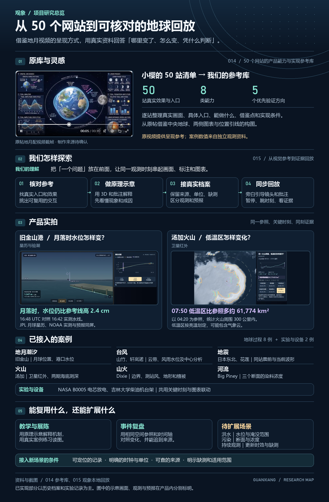

[线上研究总览](https://yydshly.github.io/1025_codex_project/015-process-visualization-lab/) · [地球实测回放](https://yydshly.github.io/1025_codex_project/015-process-visualization-lab/app/index.html) · [发布与验收记录](research/deployment.md)

本研究从 50 站参考库和[原帖地月视频](https://x.com/xiaoying_eth/status/2116389253060190271)出发，探索如何用固定空间参照、共同时间轴和可追溯证据解释变化。先看原理示意，再用真实资料定格比较。地球、位置批注、读数、曲线与讲解对应同一观测时刻，观测与预报分别标注。

**研究价值与边界。** 可复用于课堂、展陈和历史事件复盘。洪水、污染迁移和持续观测是延伸方向，依赖可定位、有时间和单位、可核查来源并标明缺测的资料。公开网页提供八个地球案例和 NASA B0005 电芯实验，柴油机案例保留论文和本地导入说明。总览图记录了包括本机柴油机实验在内的完整探索。

**复现资料。** 仓库保存运行文件、来源与处理记录。大型科学原件、部分历史帧和本机导入数据随各案例的复现说明获取。完整资料校验需要相应原档。公开构建执行 `npm run build:site`，校验运行资料及 68 段压缩旁白。

「地球过程」包含地月潮汐、台风、地震、火山、山火和河流。「实验与设备」直接打开设备近景，可在 B0005 电芯与吉林大学柴油机台架之间切换。两个入口各有场景目录，共用回放时间轴和图表联动。[地球过程](http://127.0.0.1:4175/app/index.html#dynamic-tide-san-francisco) · [实验与设备](http://127.0.0.1:4175/app/index.html#lab)

**首版功能验收（桌面本地）**。六类地球过程共八个实测案例，另有两个设备实验。十个案例均实机核对了关键时刻跳转、主画面和图表的时刻一致、来源入口，以及对应导览章节。地球案例使用 MiniMax 旁白，设备用同步字幕。另抽查了山竹播放暂停、潮汐暂停后跳时刻再续讲、官方目录搜索及地球与设备分区切换。

首版范围为已有资料的历史复盘。事件目录可搜索保存的官方快照，各案例展示各自的数据覆盖。真实洪水、实际污染事件和持续更新的观测流按新增能力另行验收。

手机触摸时间轴时，松手后加载目标时刻。慢网下画面和读数按观测时刻对齐，载入失败可按「重试观测加载」。小屏讲解为当前画面留出空间，播放期间可暂停、拖动并续讲。[手机端讲解实拍](assets/images/mobile-guided-playback.png)

手机回放按 390 × 844 的 Chromium 触屏模拟、约 1.5 Mbps 下行和 420 ms 延迟验收。另在 360 × 740、约 640 kbps 下行模拟潮汐讲解、触摸跳时刻后续讲，以及观测加载失败后的重试。手机真机与公开部署环境另行验收。

MiniMax 原始 WAV 用于核验，浏览器优先播放同源 MP3。重新生成原音轨后，运行 `node scripts/compress-narration.mjs` 更新压缩版（需要 FFmpeg），再运行 `npm run check:narration`。

**引导讲解。** 从一个能用观测回答的问题开始。先用动态示意说明现象与影响，再用真实案例回答“哪里变了、怎么变、用什么证据判断”。示意、观测、预报和解释分别标注。真实回放的镜头、批注和图表指向同一条记录，来源与缺测可查。新案例沿用这套顺序，场景目录同时提供「引导讲解」和直接回放。地球案例配 MiniMax 语音，设备使用同步字幕。

山竹和轩岚诺的「台风形成」开篇用侧视和俯视动画讲解雷雨扰动、暖湿空气上升、凝结放热、低层汇入与北半球的逆时针环流。四个阶段可直接跳转，也可进入各自的卫星回放。[台风形成导览实拍](assets/images/storm-formation-guide.png) · [NOAA 原理说明](https://oceanservice.noaa.gov/facts/how-hurricanes-form.html)

日本东北和花莲的「地震原理」开篇从断层锁住和应力积累讲到突然滑动，再同步推进纵波、横波与两条示意波形。[地震导览截图](assets/images/quake-formation-guide.png)

汤加导览从地球定位洪阿火山，再进入三维剖面。镜头和批注随 MiniMax 旁白依次聚焦板块俯冲、释水与部分熔融、岩浆上升、减压起泡和喷发。可暂停跳到某一步，也可切换剖面角度。原理段结束后直接接入 NIWA 实测海底地形，随后回放 Himawari-8 红外扫描。三维剖面标为原理示意，两期测绘日期与卫星观测时刻分别标注。[汤加三维导览截图](assets/images/volcano-3d-primer.png)

**在主画面看实测变化。** 点击「MiniMax 边播边讲」，两侧图表与主画面沿同一观测时钟推进。汤加、轩岚诺和山竹的关键扫描会放大并逐帧慢放，同一段保持固定地理取景。位置标注移到侧边，空间不足时移到画面下方。缩放、旋转或选测点时旁白继续，拖动时间轴可从新时刻继续。

**Dixie 山火边界复盘。** 同一地球播放器按档案日期切换九期航空红外边界。橙色显示本期新划入的范围，蓝色填充显示前一期划入而本期未划入的范围。地图、制图面积和 MiniMax 讲解随档案日期推进。附近测站风按当地小时核对，可切换高程阴影、火前燃料植被和地名地图。8 月 2 日与 3 日在所用档案中缺失。[打开 Dixie 复盘](http://127.0.0.1:4175/app/index.html#dynamic-wildfire-dixie) · [来源与复现](research/dynamics/dixie-fire/README.md)

**讲完后回看证据。** Dixie 在同一组航空红外边界上切换新增范围、测站风、坡度和火前植被。轩岚诺可以点回东海起点、缺档前后的两幅原始扫描和末帧的强度分析。点卡片时，主画面和两侧图表跟随对应记录；继续拖时间轴会保留回看面板。[Dixie 坡度回看实拍](assets/images/dixie-evidence-recap.png)

- [汤加火山](http://127.0.0.1:4175/app/index.html#dynamic-volcano)、[轩岚诺](http://127.0.0.1:4175/app/index.html#dynamic-storm)和[山竹](http://127.0.0.1:4175/app/index.html#typhoon-real)：当前真实红外云图上叠加上一幅的低温边缘（金色）和本幅新增的低温区（青色）。汤加使用亮温低于 220 K，两个台风使用亮温不高于 235 K。两幅扫描时刻在图例列出。缺帧断开比较；「原始亮温」可查看不含这层对照的当前扫描。亮温变化可由云带移动、扩展或冷却造成，不能反推云高或灰浓度。
- [日本东北地震](http://127.0.0.1:4175/app/index.html#dynamic-quake)和[花莲地震](http://127.0.0.1:4175/app/index.html#dynamic-quake-hualien)：台站旁的正负刻线显示当前一秒窗的范围，画面内的近 60 秒记录和峰值条把同站震前与当前放在固定刻度上比较。单位是原档仪器计数。
- [Big Piney 河](http://127.0.0.1:4175/app/index.html#dynamic-river-big-piney)：两岸实测点的浓度弧会随样本变大或缩小。画面内的三个断面依次显示首次持续信号及相对释放时刻，可直接点选断面。弧线大小只编码测点读数，测点之间没有推算染料分布。

**v22 · 吉林大学柴油机 ETC 台架。** [打开本地发动机回放](http://127.0.0.1:4175/app/index.html#dynamic-engine-jlu-diesel)

从「实验与设备」打开柴油机，即可观看通用共轨柴油机的单缸剖面。曲轴和活塞随实测转速做慢放示意。首播 30–90 秒：38.5 秒扭矩首笔为零，转速仍有 3,197 rpm；85.6 秒转速降至 753 rpm。左侧显示当前读数和附近 12 秒的变化，右侧给出整段工况与同刻游标。点击剖面旁的仪表可突出对应图表。

完整 18,000 笔记录可按 0.1 秒逐笔查看。转速和扭矩为台架实测，轨压显示原档 RP（hPa 换算为 MPa），档案未说明是传感器反馈还是控制设定。剖面只作结构示意。原档仅供本地研究回放；[来源、校验与导入步骤](research/dynamics/jlu-diesel/README.md)。

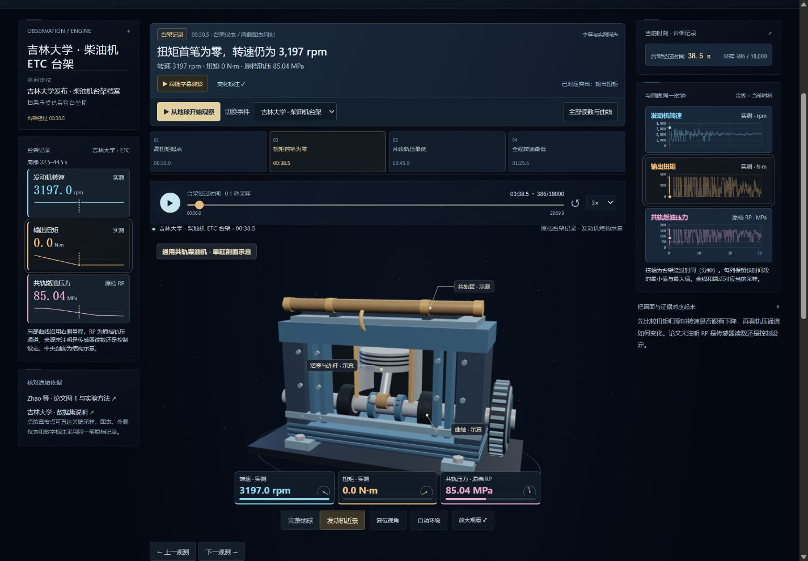

**v21 · NASA B0005 首次放电。** [打开 B0005 实测回放](http://127.0.0.1:4175/app/index.html#dynamic-battery-b0005)

打开 B0005 便进入电芯近景，外壳打开后露出典型圆柱电芯的卷绕结构示意。外部仪表、两侧读数和三条曲线使用同一笔 NASA 采样。电流保留原始符号，外部电流指示的亮度反映实测电流幅值，温度只对应实验记录的单点数值。

197 笔记录覆盖原档经过时间 00:00:00.000 至 01:01:30.234。关键时刻可直达约 −2 A 的首笔、端电压最低点、电流回近零和记录末点。原档缺少时区与实验台坐标，回放以原始经过时间为轴。[NASA 数据目录](https://data.nasa.gov/dataset/li-ion-battery-aging-datasets) · [原始档案与逐条复核](research/dynamics/b0005/README.md)

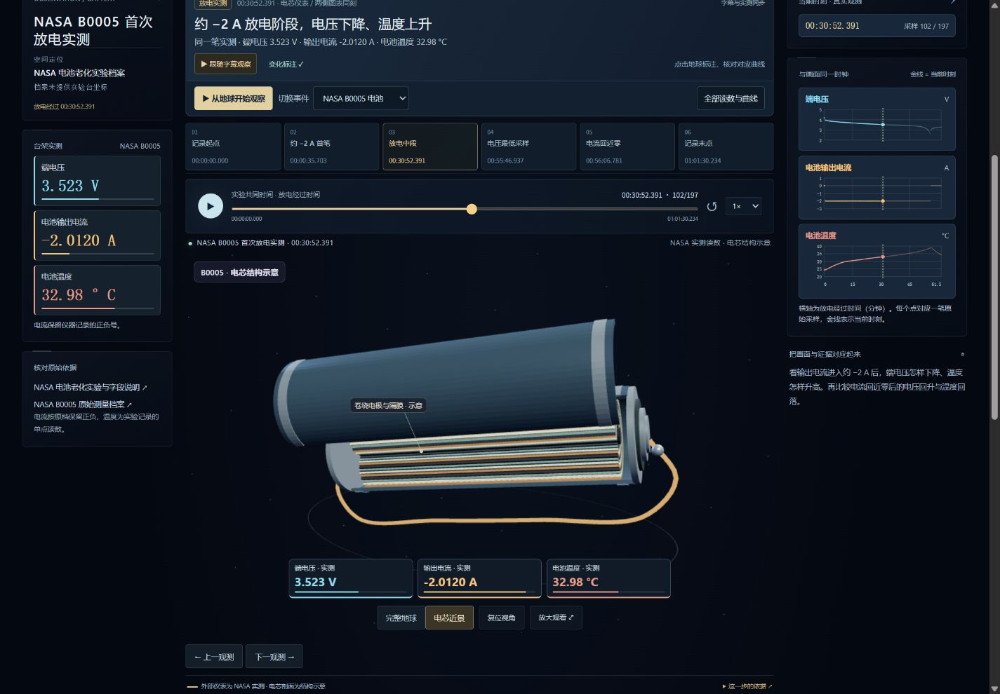

**v23 · 从地月全景飞到旧金山港。** [打开旧金山港回放](http://127.0.0.1:4175/app/index.html#dynamic-tide-san-francisco)

打开先看到完整地球、月球和 NOAA 9414290 验潮站。「在地球上看潮汐」在同一三维场景叠加理想海面的两处隆起。地球自转时，示意海岸点和旁边的相对水位曲线同步变化。随后在同一场景旁用海岸剖面对照浅滩和航道的涨落。月球大小、距离和海面高差均按教学比例放大。[NOAA 潮汐原理](https://oceanservice.noaa.gov/facts/moon-tide.html)

「直接看港口实测」从地月全景飞向旧金山，通过 USGS 港湾航拍定位，再淡入岸边视角。月升、月落时自动聚焦 0° 几何地平线，月面由地平线遮挡。月球图像、距离和近地平线的仰角变化采用显示比例。

码头、桩柱和水尺为固定示意，青色水线只随 NOAA 实测潮位升降，垂直变化放大。金色虚线预报保留在右侧图表，和实测共用 MLLW 基准。两组潮位记录与 JPL 月球星历各有 240 个六分钟采样，跟随同一 UTC 时间轴，另列港口当地时间。拖动时间轴或跳到关键时刻后，可从当前时刻继续讲解。[数据来源与逐条复核](research/dynamics/san-francisco-tide/README.md) · [USGS 航拍底图](https://basemap.nationalmap.gov/arcgis/rest/services/USGSImageryOnly/MapServer)

讲解播放时可以旋转地球、切换视角、缩放港口、点击标注或打开读数。手动操作镜头后，点播放器上的「回到讲解镜头」即可恢复自动取景。拖动潮汐时间轴时，松开会从对应章节和语音位置继续；原本暂停则继续保持暂停。

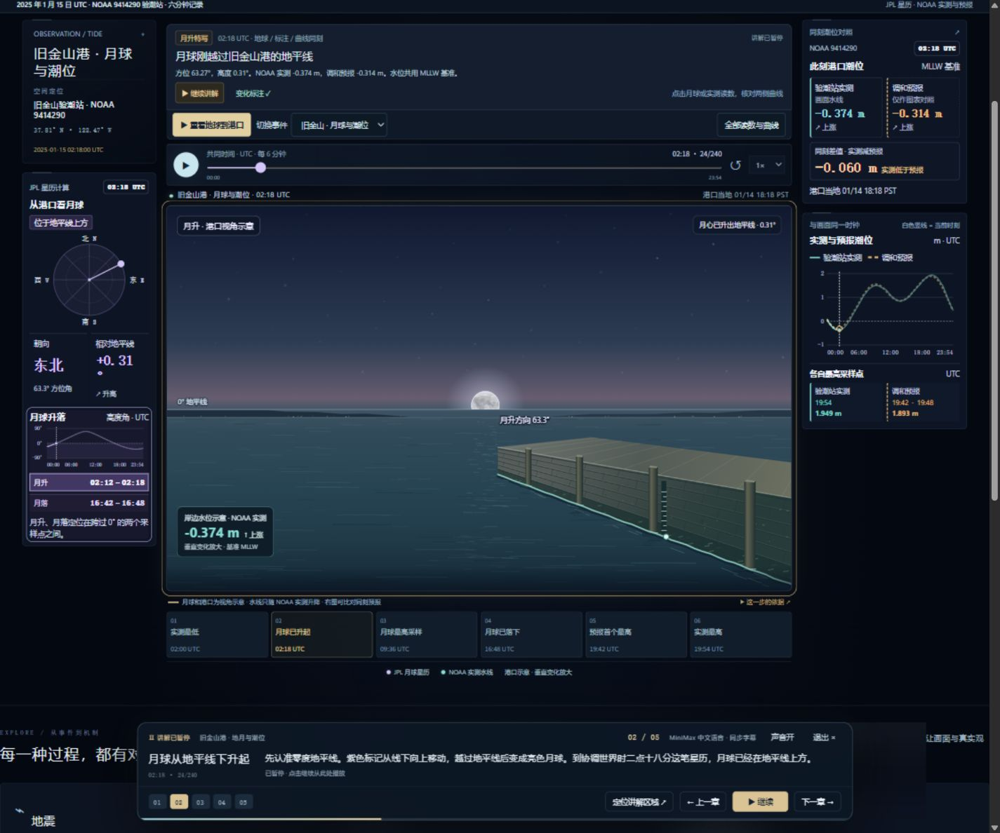

[潮峰实机截图：19:54 UTC，岸边水线达到当天最高采样](assets/images/san-francisco-tide-high-v23.jpg)

**v19 · Big Piney 河实地示踪。** [打开实测回放](http://127.0.0.1:4175/app/index.html#dynamic-river-big-piney)

镜头从完整地球飞入密苏里州 Big Piney 河段。航拍影像与 USGS 河道中心线提供定位，六个实测点上的浓度柱和光环随读数变化。左侧比较三个断面，右侧显示所选断面两岸的曲线。自动观察会随三个左岸持续信号切换断面。点击地图标注、左侧断面或关键时刻可以自己核对。

自动观察覆盖释放参考时刻前 10 分钟至后 6 小时，时间轴可拖至完整记录。左岸在三个断面的持续信号时刻为 +00:58:30、+02:07:30、+03:34:30。判据取连续三次达到 3 ppb 的首笔记录，峰值单独标明。档案保留相对时钟和本地钟，缺测留空。柱高使用统一平方根尺度，实际浓度读数和曲线保留 ppb。测点之间的河段只提供地理背景。[原始数据和逐行复核](research/dynamics/big-piney/README.md) · [航拍与河道来源](research/dynamics/big-piney/geography/README.md)

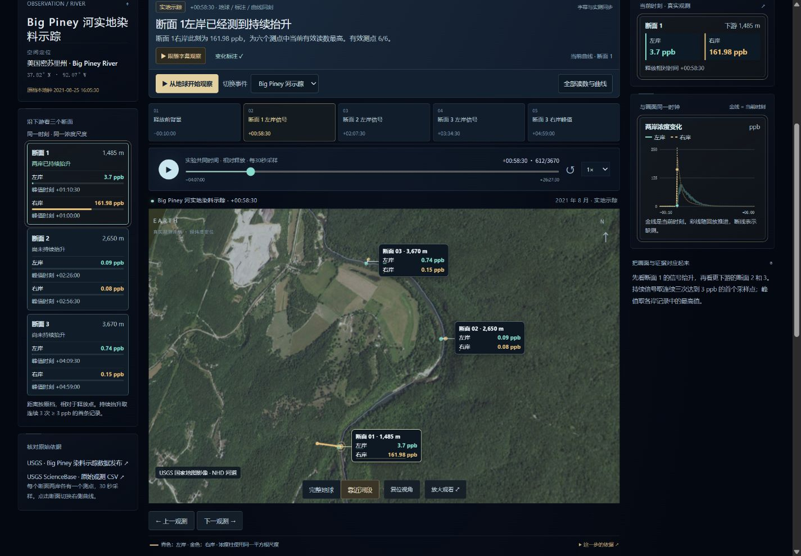

**v18 · 从地球定位进入实测回放。** [轩岚诺台风](http://127.0.0.1:4175/app/index.html#dynamic-storm) · [日本东北地震](http://127.0.0.1:4175/app/index.html#dynamic-quake) · [花莲地震](http://127.0.0.1:4175/app/index.html#dynamic-quake-hualien) · [山竹复盘](http://127.0.0.1:4175/app/index.html#typhoon-real)

轩岚诺和两个地震案例先展示完整地球，再靠近观测区域。可以暂停或点击关键时刻。台风默认对照固定窗口的低温面积和 JMA 最大持续风速，分别标注卫星扫描时间与分析时间。地震默认显示所选台站的波形，球面放大所选站最近 60 秒的轨迹。展开「全部读数与曲线」查看辅助指标。

轩岚诺的「开始台风导览」依次定位云系、观察北移、辨认缺档和核对强度。近景白线取自 Natural Earth 1:5000 万海岸线（4.1.0，公有领域），用济州岛和朝鲜半岛南岸作为固定参照。末帧实拍同时显示 13:30 UTC 红外扫描、12:00 UTC 的 JMA 事后中心分析和同一回放时钟下的曲线。[实拍](assets/images/hinnamnor-evidence.png) · [海岸线来源](https://www.naturalearthdata.com/downloads/50m-physical-vectors/50m-coastline/)

花莲与东北地震共用播放、台站切换、图表和导出。花莲三个 BHZ 垂直通道各有 480 个实测一秒窗，章节点是各站在该时段的峰值窗。两场地震均提供 MiniMax 旁白和同步字幕。[花莲来源与复核](research/dynamics/hualien/README.md)

汤加、轩岚诺、山竹香港同步观测、两场地震和 Big Piney 均可边听边查看画面、标注和图表。拖动时间轴后，讲解定位到对应章节的进度，画面与两侧图表一起提交该时刻。原本播放时松手续播，原本暂停时保持暂停。

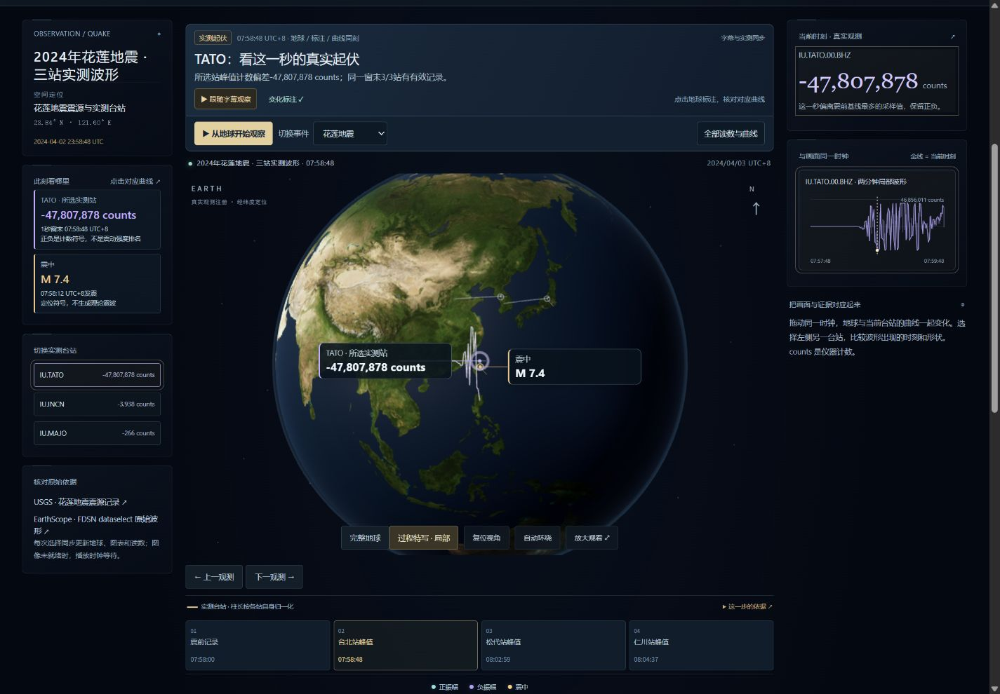

下一批场景已取回并核对官方数据样本，当前用于确定接入方式。

| 方向 | 已核对的记录与第一版呈现 |
| --- | --- |
| 地月与港口潮位 | 旧金山 9414290 站 2025-01-15 00:00–01:00 UTC 有 11 个与月球星历匹配的六分钟刻度。地球呈现站点视角下的月球方位和高度，侧边对照实测和预报潮位，单位 m、基准 MLLW。[NOAA 实测查询](https://api.tidesandcurrents.noaa.gov/api/prod/datagetter?begin_date=20250115&end_date=20250115&station=9414290&datum=MLLW&time_zone=gmt&units=metric&application=web_services&format=json&product=water_level) · [NOAA 预报查询](https://api.tidesandcurrents.noaa.gov/api/prod/datagetter?begin_date=20250115&end_date=20250115&station=9414290&datum=MLLW&time_zone=gmt&units=metric&application=web_services&format=json&product=predictions&interval=6) · [JPL 月球星历查询](https://ssd.jpl.nasa.gov/api/horizons.api?format=json&COMMAND=%27301%27&OBJ_DATA=%27NO%27&MAKE_EPHEM=%27YES%27&EPHEM_TYPE=%27OBSERVER%27&CENTER=%27coord%40399%27&COORD_TYPE=%27GEODETIC%27&SITE_COORD=%27-122.46589%2C37.806305%2C0.0%27&START_TIME=%272025-01-15%2000%3A00%27&STOP_TIME=%272025-01-15%2001%3A00%27&STEP_SIZE=%276%20m%27&QUANTITIES=%274%2C10%2C20%27&CSV_FORMAT=%27YES%27&TIME_TYPE=%27UT%27) |
| 河流迁移 | USGS Big Piney 河实地染料示踪。左岸在下游 1,485、2,650、3,670 米的浓度峰值，分别出现在释放后 1.17、2.43、4.16 小时。按释放后的时间播放三个断面的实测读数，可对照左右岸。现场试验的观测范围限于测点。[USGS 实验与原始数据](https://www.usgs.gov/data/situ-measurements-rhodamine-wt-dye-concentration-and-turbidity-made-during-a-tracer-experiment) |
| 发动机 | 吉林大学 2.7 L 四缸柴油机 ETC 台架：18,000 笔，0.1 秒采样。转速和扭矩为实测，轨压为原档 RP；本机研究回放。[论文及图 1](https://scis.scichina.com/en/2019/077201.pdf) |
| 电池 | NASA B0005 首次放电 197 条记录，包含端电压、电流和电池温度。相对起点约 1,796 秒的观测为 3.5299 V、−2.0148 A、32.87 °C。原始日期缺少时区，第一版使用放电经过时间。[NASA 档案](https://data.nasa.gov/dataset/li-ion-battery-aging-datasets) |

**v17：先修复失败状态与证据导出，再按七方向规格扩展。** [查看 v17 历史规划](http://127.0.0.1:4175/research/implementation-plan.html) · [打开真实过程](http://127.0.0.1:4175/app/index.html#dynamic-storm)。

本批修复末帧重播失败仍进入播放、失败提示被覆盖，以及语音清单首次失败无法重试的问题。参考轮廓加载失败时显示明确状态与重试入口；重试保持原观测时钟，轮廓按事件ID及真实帧时间对应。原36段MiniMax音轨与四个真实案例保留。

动态导出升级为schemaVersion 2，保留原有观测，同时记录请求、提交、实际显示时刻与加载状态。导出包括亮温显示、融合/光照、汤加空间聚焦和当前参考轮廓的来源版本、阈值、数值输入SHA及显示状态；影像失败时不把旧读数标成当前已显示画面。

七方向的用户问题、动态对象、镜头顺序、最多两项主指标、最终成果与完成分级已写入[场景规格](research/scenario-specifications.json)；时空、来源独立更新、派生版本与MiniMax讲解流程见[运行合同](research/operating-contracts.json)。规划改为各方向独立数据准入，共用呈现使用已有代表资料直接启动。新增真实场景仍待逐项接入，规格完成不计为能力完成。验收见[验证记录](research/verification-v17.json)。下方保留历次说明。

**v16：在地球上看变化，MiniMax讲解、关键位置和图表共用真实时钟。** [打开真实地球过程](http://127.0.0.1:4175/app/index.html#dynamic-volcano)，点击“MiniMax 边播边讲”。播放结束继续停留在地球，前后图片对照保留为手动核对入口。

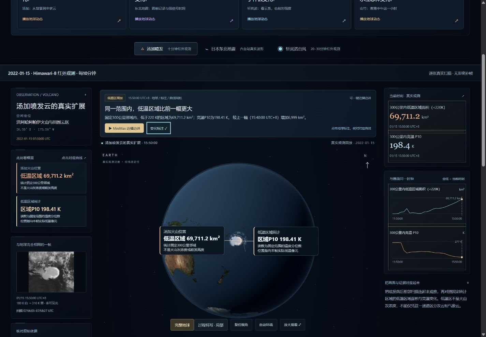

| 过程 | 地球上的动态与解读 |
| --- | --- |
| 汤加喷发 | 25次真实红外扫描逐帧变化；同帧数值亮温提取低温阈值参考轮廓，配合原固定300公里统计圈、面积与区域P10曲线。关键时刻可一键定位 |
| 东北地震 | 六台站实测针柱与波形继续由同秒记录驱动；标明所选台站和震中，点击台站标注对应当前真实计数与局部波形 |
| 轩岚诺 | 23次真实扫描与低温阈值参考轮廓随时钟更新；同时标明当前可用及上一次JMA分析位置，区分扫描时间与官方分析时间 |
| 山竹复盘 | 原72张云图、亮温变化、风、雨、海水位保留；机场与鲗鱼涌标注显示实际记录时刻，点击对应曲线，缺报不填零 |

标注直接注册到原有球面及相机。点击地球标注会突出对应读数和图表；MiniMax旁白沿真实观测时刻驱动过程。现有36段音频及脚本保持不变，未重复调用生成API。汤加融合显示在400—600公里间逐渐减弱周边图层，突出过程并减弱方形边缘；原始亮温模式保留完整资料窗口，原统计范围与数据不变。

轮廓来自原有48帧uint16数值亮温，每8×8格取实际中心样本后提取阈值边线；汤加220 K、轩岚诺235 K，与原统计口径对应。采样格最大对角约23.09／33.17公里，只用于粗略定位，未校正云视差，不是精确云边界、火山灰识别或云高。区域P10是整个固定区域的统计量，标注位置指向该帧实际低温像元，不把区域值冒充单点测温。台站counts未转换为位移；两次分析位置的连线不解释为实际行进路线或风场。

当前为本地产品，未部署公网。截图均取自实际网页；参考原视频的中央地球、两侧证据与位置引线表达，未取得原作源码，不声称复刻其渲染。验收见[验证记录](research/verification-v16.json)，轮廓与显示复现见[动态资料说明](research/dynamics/README.md)。下方保留历史版本说明。

**v15：四个真实事件配套演示，加入可操作的前后对照。** [打开产品](http://127.0.0.1:4175/app/index.html#overview)，在“选一个问题，直接看真实变化”中选择事件。约17秒沿真实记录推进，结束后自动切换前后对照；可以回到A、查看B、重播，或在原时间轴自己观察。

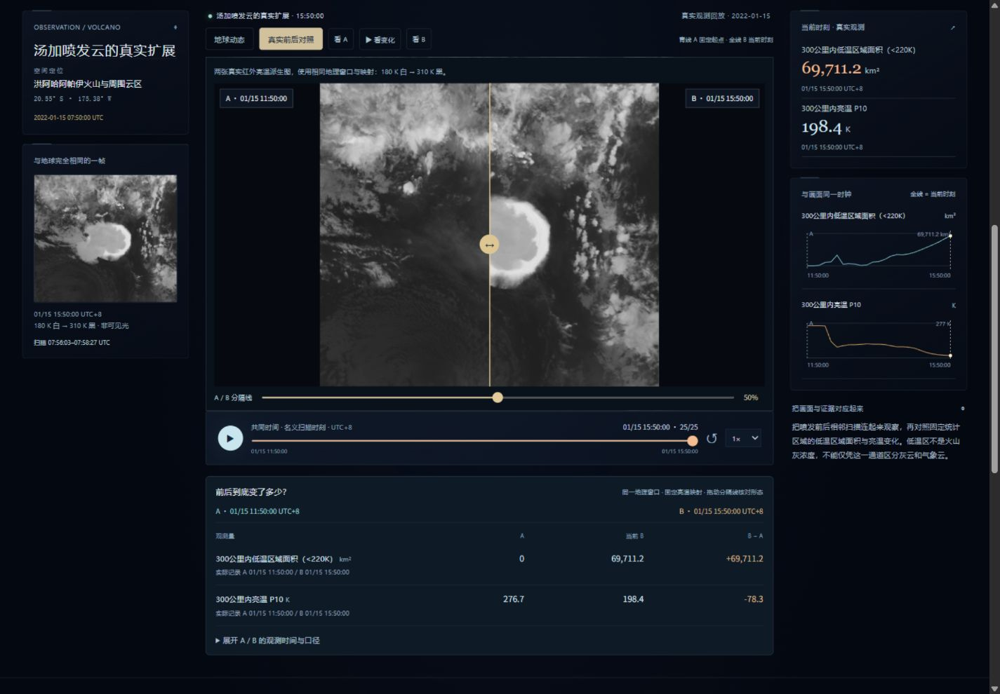

| 配套演示 | 看什么、怎样验证 |
| --- | --- |
| 汤加喷发 | 同一区域两张实际红外亮温派生图可拖动分隔线核对；固定300 km内低于220 K区域由0到约69711 km²，不解释为火山灰云或受灾面积 |
| 东北地震 | 松代台站震前05:46到05:49:20 UTC；前后各30秒实测计数记录用共同纵轴，保留窗内极值，不用符号反转解释强度增幅 |
| 轩岚诺 | 对照实际云系及风速、气压；13:30 UTC的B分别显示卫星扫描与12:00官方分析，分析亮点画在实际记录时刻 |
| 山竹 | 香港12:00到13:00；机场风79.636→111.12 km/h，站点海水位3.51→3.70 m，雨量保留两组地区范围及累计窗口 |

“地球动态”和“真实前后对照”在同一观察区切换，共用当前B时刻与原两侧图表。对照窗是实际记录的读图视图：卫星A/B沿同一地理窗口及180–310 K映射显示，地震使用同站同尺度的波形。不是另行播放的视频。图表中的青色A线固定起点，金色B线保留共同时间。

下方“前后到底变了多少”显示A、当前B及可比较数值的差；展开证据可核对真实扫描窗、实际分析时间、台站源行/峰值采样与雨量累计口径。雨量范围不取中点、不计算假单站增量；云图区缺帧时不沿用旧图。手动调到A以前，会清除旧比较依据并明确提示。切换台站重新比较同一台站的A/B，切换主题退出旧任务。

MiniMax原36段旁白、四类真实案例、官方事件目录、六类原理动画与山竹完整复盘继续可用。“听当前事件讲解”可进入已接入的中文语音导览。本轮没有生成新音轨或增加观测数据；重点改进演示组织、前后可见差别和证据验证。

`npm test`覆盖播放区间、慢帧等待、退出、手动时间漂移后重新定位、缺测断线及无效比较清理。验收与截图见[验证记录](research/verification-v15.json)。当前仍为本地产品，未部署公网；下方保留历史版本记录。


**v14：一键中文讲解，让地球、真实时间和证据一起讲清楚。** [打开产品](http://127.0.0.1:4175/app/index.html#overview)，点击右上角“▶ 一键讲解”，约3分钟自动走过总览、汤加喷发、日本东北地震、轩岚诺和山竹，再进入来源说明。“讲解当前内容”则讲当前事件或原理。

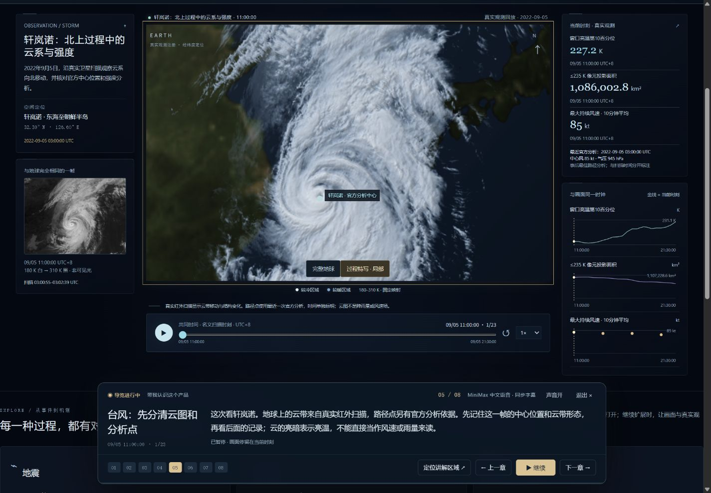

讲解直接操作现有地球与真实记录，逐章定位视角、推进观测时刻、高亮对应图表。8章总览之外，四个实测事件各有4章、六类原理各有2章，共11套导览、36段旁白。章节按钮、上一章、下一章、暂停、继续、声音开关和退出均可操作；用户手动拖动时间或切换内容即退出自动讲解。离开页面时暂停，失败观测可重试，不代入其他帧；慢帧期间语音与讲解计时一起等待。退出后保留当前观察位置供继续探索。

| 讲解流程 | 当前画面与内容 |
| --- | --- |
| 认识界面 | 完整地球定位、共同时间、两侧读图方式；明确总览是教学示意 |
| 汤加 | 较早红外扫描→四小时实际云团变化→同帧300 km邻域统计 |
| 东北地震 | 选松代实测台站，波形与同秒仪器counts一起起伏 |
| 轩岚诺 | 早期云系→实际扫描推进→区分卫星与官方分析时刻 |
| 山竹 | 香港12:00→13:00的云图、风、雨与海水位，保留各项实际时间与基准 |
| 自由探索 | 打开资料来源，继续选事件、拖时钟、核对观测 |

声音使用 **MiniMax speech-2.8-hd / 温柔学姐 / 0.95语速**，按本项目中文脚本预生成36个32 kHz单声道WAV。总览音轨149.60秒，另有章节停留与加载时间；全套旁白666.696秒。网页播放本地音频，不重复请求生成API。音频不可用时明确显示字幕模式。凭据只由生成脚本读取外部配置，不进入前端或交付文件。

前端文案与音轨通过文字、WAV结构、时长、非静音和SHA校验。`npm run check:narration`独立复核36段，`npm test`覆盖讲解切换、迟到异步结果、慢帧暂停、数据时刻及原有过程回归；具体交付验收见[验证记录](research/verification-v14.json)。音色、生成与复现说明见[MiniMax旁白资料](research/narration/README.md)。

讲解沿用已有实测数据与显示边界：红外亮温不等于云高/灰浓度，counts不等于地面位移，站点海水位不等于风暴潮增水。山竹复盘、四类实测事件和六类原理入口全部保留。本地运行，未发布公网。下方保留历次迭代记录。


**v13：三类真实动态过程已经进入同一地球。** [打开真实过程](http://127.0.0.1:4175/app/index.html#dynamic-volcano)，选择汤加喷发、日本东北地震或轩岚诺。默认完整地球，可切换“过程特写”；支持播放、逐帧、拖动、原始亮温核对及带来源导出。[山竹同步复盘](http://127.0.0.1:4175/app/index.html#typhoon-real)完整保留。

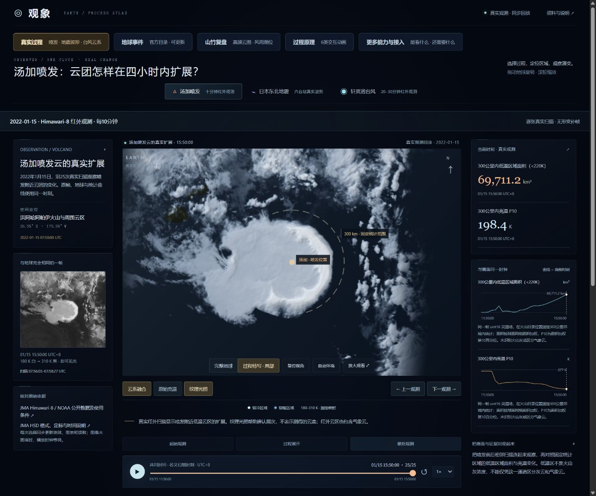

| 真实过程 | 接入资料与时窗（UTC） | 地球与两侧如何对应 |
| --- | --- | --- |
| 2022汤加喷发 | 2022-01-15 03:50—07:50，25次十分钟Himawari-8 B13扫描 | 实际亮温栅格注册到球面，逐次呈现喷发附近云团扩展；左侧同帧亮温图，右侧固定300km内低温区域面积与面积加权P10亮温 |
| 2011东北地震 | 2011-03-11 05:45—06:05原始20Hz波形，六站共144000样本，汇成7200个1秒窗 | 地球上的台站波形条带与针柱、左侧六站包络、右侧所选台站波形采用相同窗末时刻；保留窗内最大绝对振幅的实际样本、min/max与源行 |
| 2022轩岚诺 | 2022-09-05 03:00—13:30，23次20–30分钟扫描；4条三小时JMA分析 | 实际云系形态变化与固定区域亮温/低温像元面积曲线同帧；中心位置、风速、气压只引用当时或更早原始分析，另列实际分析时间 |

动态图层不是独立播放器：共用同一场景、相机和时间选择。影像就绪后才提交地球/读数/图表的共同时间；快速切换、迟到影像、失败帧和缺测有明确处理。卫星名义扫描时刻与实际所选分段扫描起止分别保留；非均匀帧间隔按UTC比例推进。统计曲线横轴使用真实时间，JMA稀疏分析画离散观测点。

显示边界：红外亮温不是云高、灰浓度、降雨量或风场；汤加低温区域未区分气象云与火山云。纹理光照仅改善同帧层次，可关闭或切回固定亮温映射。地震保留去震前基线的仪器counts，未校正响应，按各站自身峰值独立归一化；针柱和60秒波形条带的尺寸是读图排版，不是地面位移或台站之间的波前。

轩岚诺10:00扫描缺档，采用真实09:50/10:10扫描并保留20分钟间隔；14:00—15:00存在太阳杂散光/日食质量标记，因此本次展示止于13:30。原始文件、数值16bit亮温、统计方法、SHA256、实际扫描时窗、原始台站波形及独立核验结果保存在`research/dynamics/`。可运行`npm run check:dynamics`核对48张显示/数值图及同刻指标；各事件完整复现步骤见[动态资料说明](research/dynamics/README.md)。

本轮具体界面与回归验收见[验证记录](research/verification-v13.json)。当前为本地产品原型，未发布公网。以下保留v12及更早的阶段记录。


**v12：完整地球 + 可更新事件目录 + 六类过程入口。** 默认打开[地球事件](http://127.0.0.1:4175/app/index.html#events)，可筛选、检索 USGS 地震、USGS 火山状态通报与 NASA EONET 热带气旋报告；“更新官方资料”从公开接口获取最新目录并保留获取时间。默认视角和复位按窗口宽高显示完整球体，局部近看需单独选择。山竹同步回放与原有六类原理动画继续可用。

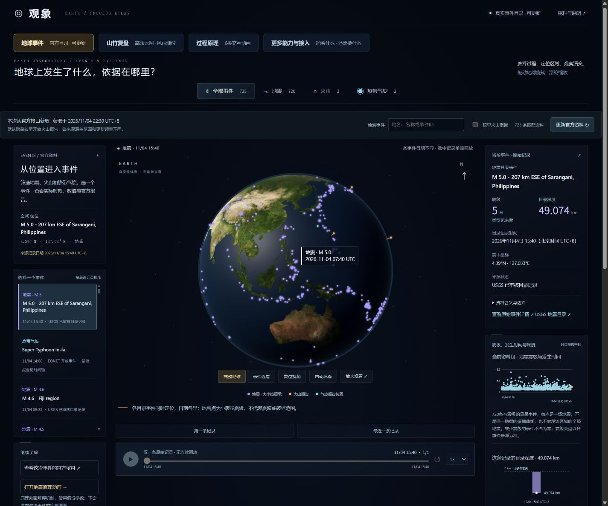

## v12：从可看的效果到可用的信息

| 入口 | 用户能做什么 | 当前边界 |
| --- | --- | --- |
| 地球事件 | 按类型、名称或事件ID找资料；定位真实坐标；查看时刻、震级／深度或火山通报状态；打开官方证据、导出记录 | 地震目录点与火山定位符号不是震波、喷发灰柱或影响范围 |
| 地震发生顺序 | 选“地震”后沿实际发生时刻回放，已发生点逐个出现，图表突出同一条记录 | 不生成观测之间的波形、震动动画或虚构零值 |
| 火山通报 | 查看 USGS 当前较高警戒级别目录中的官方状态、通报发布时间和火山目录位置 | 单次通报不是连续监测；较早 EONET 开放报告默认隐藏，可明确勾选查看；跨来源可能是同一火山的不同记录 |
| 气旋报告 | 回放 EONET 已报告坐标和日期，核对来源 | 不是当前高频云图、完整风场或预报；日期级记录不解释为精确仪器时刻 |
| 更多能力与接入 | 直接打开地月、火山、地震、台风、河流、电池原理动画；查看每个方向还需要哪些真实数据 | 已接入实地染料示踪、电芯放电和柴油机台架记录；模型只说明设备内部结构 |
| 山竹复盘 | 使用原72张云图、70组亮温变化、风雨潮位及A/B对比理解一次完整事件 | 历史案例用于复盘，不作为当前天气 |

本次保存的官方快照获取于 **2026-11-04 14:15:36 UTC**，包含720条地震、2个热带气旋、3条USGS火山通报，以及32条较早EONET开放火山记录。默认近期入口显示725条资料，较早火山记录需勾选；这些计数是来源记录数，不是全球灾害总数。网页按钮刷新只替换当前会话资料；持久更新项目快照运行`npm run data:update`。任一来源失败保留上次完整资料及其原获取时间，不把失败或空白当作平静无事。

资料获取与原始字节可追溯：共享浏览器/Node适配器在`app/live-event-feed.js`，更新器在`scripts/update-earth-events.mjs`，原始响应、SHA256、CORS验证与离线复现在`research/live-events/`。正式更新前不会混合不同尝试；本轮没有新增付费服务、密钥或后台定时任务。

扩展所需数据、模型边界和用户价值见[六类扩展方向](research/extension-directions-v12.md)。本轮验收和实际页面截图见[验证记录](research/verification-v12.json)。原始资料、云图与观测时序均保留；v11及更早说明如下。


用同一个地球组织过程原理与有出处的事件资料，帮助用户看懂“发生在哪里、怎样变化、判断依据是什么”。**v11 增加同帧纹理光照、云带特写视角，以及由相邻真实数值资料计算的“10分钟变化”叠加，让云系层次和变化更容易辨认**。山竹云图、香港机场风、东区小时降雨范围、鲗鱼涌海水位仍使用同一回放时钟。默认真实事件入口打开2018年9月16日08:00—20:00（北京时间）同步观测；全程路径对比与原理演示可在同页切换。原有六类效果、局部放大、A/B结论和补充资料均保留；其他五类尚未接入真实事件数据。

产品面向科普作者、教师、新闻解读与事件复盘。地球负责空间定位，时间线负责选取真实时刻，图表负责展示变化，原始资料负责核对结论。用户可以比较山竹穿越吕宋前后的中心强度，再查看香港天文台对强风和风暴潮的解释。仅凭中心路径与中心风速不能推出香港每个地点的实际受灾程度。

[地球过程全景 · 主入口](http://127.0.0.1:4175/app/index.html#overview) · [当前地球中的真实山竹](http://127.0.0.1:4175/app/index.html#typhoon-real) · [完整事件资料 · 补充页面](http://127.0.0.1:4175/app/real-event.html) · [事件扩展合同](research/real-events/extension-contract.md) · [返回研究总库](../../README.md#项目索引)

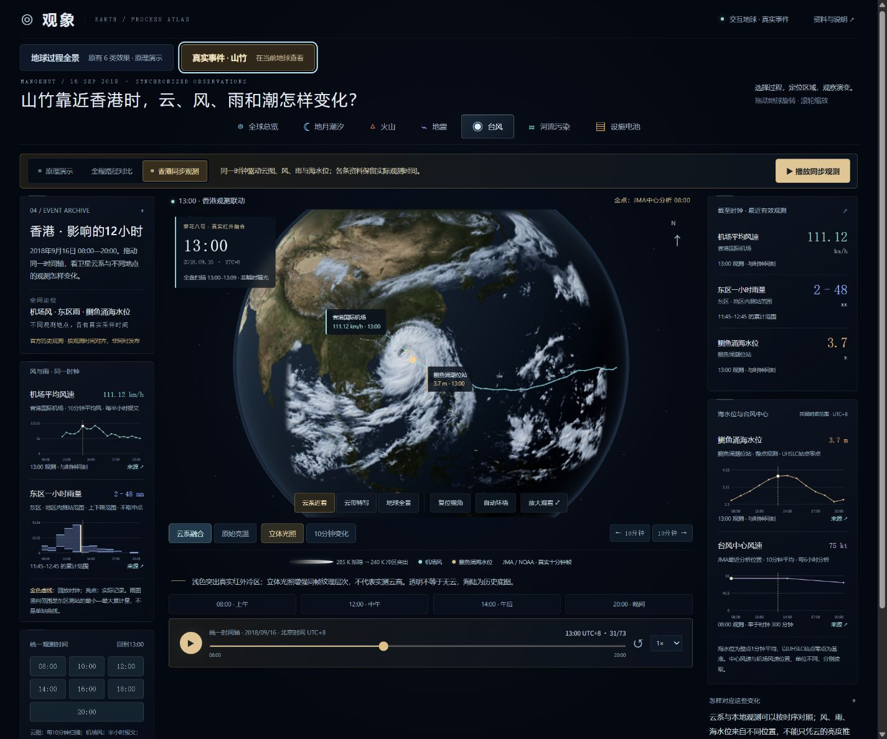

## v11：看清纹理与十分钟变化

融合模式默认开启“立体光照”，从当前同一帧的空间纹理生成显示用明暗层次，不位移球面像元、不增加时间帧。它不是云高反演、实测阴影或光学厚度，按钮可关闭。“云带特写”只改变观察距离与视角，便于查看已有影像细节，不增加数据分辨率。

“10分钟变化”默认关闭。开启后，在当前真实云图上叠加**同一地理格点亮温相对前十分钟的差值**：青色表示降低，金色表示升高。70组有效配对直接由保留的16位、0.01 K刻度亮温资料离线计算，没有从8位显示灰度反算；两份输入和结果各保留哈希与实际扫描时窗。仅在两帧均有效、任一帧低于265 K的位置呈现，差值绝对值超过4 K后逐渐显色，到12 K达到约0.65不透明度。这些阈值是显示选择，不是云分类或置信度。固定格点差值可以包含云体移入／移出等因素，不表示同一个云团的冷却、风向、风速或降雨变化。

08:00没有前帧、10:40当前帧缺档、10:50前帧缺档（北京时间），均不显示变化，不跨过缺档配对。“原始亮温”模式关闭纹理光照与变化叠加，便于核对同一张未融合显示图。自动播放准备真实云图及已开启的变化图后再提交共同时间；当前变化对的起止时刻、加载状态和方法随JSON导出。风、雨、海水位和JMA曲线继续使用原来的观测与分析记录、采样口径和缺测规则。

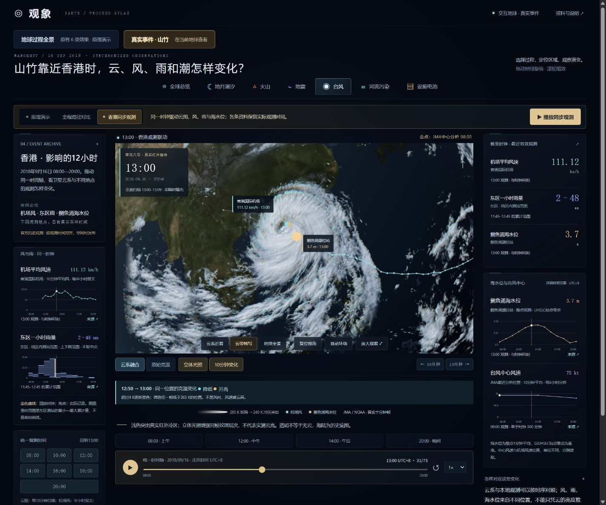

v11已通过88项自动化测试、资料完整性检查和实际浏览器验收；上图取自交付页面。桌面／小屏、缺帧、2×完整回放、原始模式、A/B与原理模式切换及导出均已核对。实施与测试边界见[迭代记录](research/iteration-v11.md)和[验收记录](research/verification-v11.json)；v10历史验收仍保留在[原记录](research/verification-v10.json)。

## v10：真实云系融入地球

默认“云系融合”采用固定亮温色表突出较冷区域，保留同一帧中的纹理层次；暖区逐渐透明，让历史海陆底图可见。285 K及以上不显示该层，从285 K降至240 K时逐渐增加展示不透明度，240 K及以下达到0.94的不透明度；覆盖边缘另按经纬度3°平滑减弱。这些是阅读用的显示参数，不是实测云量、云分类结果或光学厚度。扩大覆盖范围与边缘柔化共同弱化矩形贴片的硬边，不改变云的位置、高度或时间。

“原始亮温”关闭融合色表与边缘柔化，按180 K白、310 K黑显示同一张灰度图，保留覆盖边界和原有无效像元。这里的“原始”指未做融合的亮温显示图：它已经过HSD标定、区域重投影与8位灰度编码，不是未经处理的HSD文件，也不是完整精度的数值栅格。融合阈值由显示灰度近似反推亮温，仅用于呈现；原始HSD及独立的uint16厘开尔文亮温栅格仍保留用于数值核对。

新增前后10分钟按钮，可逐刻度检查同一真实扫描帧及对应读数。自动播放先准备下一张真实帧，准备期间保留当前画面、时钟和读数，准备好后一起切换；缓存命中时直接绑定，不先清空地球。手动选择尚未加载的帧会显示加载状态，旧帧不会冒充新时刻。预加载失败会在对应时刻隐藏云图并重试一次，再次失败则明确显示失败；已知缺档仍留空。没有时间插帧、跨帧混合、程序旋转云团或额外生成的云层。

## 同一地球、同一时钟的真实观测

进入“真实事件 · 山竹”后默认打开“香港同步观测”。时间轴包含73个十分钟刻度，云图、两侧四条图表和地球上的真实测站标记读取同一时钟。曲线的金色虚线表示回放时钟，亮点表示实际记录；没有新采样时明确显示原记录时间和时间差，不插出不存在的观测。默认13:00，可核对机场风111.12 km/h、东区11:45—12:45累计范围2—48 mm、鲗鱼涌13:00海水位3.70 m（UHSLC站点零点）。这是按观测时间进行的历史复盘，不是模拟当时已经发布的信息：上述雨量公报实际在13:02发布，报告另列发布时间。

| 资料 | 已接入的实际范围 | 时间与数值口径 |
| --- | --- | --- |
| 葵花八号 AHI B13 | 72张扩大范围的区域红外帧，2018-09-16 00:00—12:00 UTC，2048×1664；唯一缺档02:40 UTC | 复用同一批72个原始HSD对象，按EPSG:4326重投影至bbox=[85,-10,165,55]，没有增加观测时刻。10分钟名义扫描；每帧另保留实际扫描起止。未融合灰度图为180 K白、310 K黑；不是自然色或降雨图 |
| 香港国际机场风 | 三天存档128条常规METAR；主窗20条半小时记录 | 原生kt按1.852换算km/h；通常10分钟平均风，半小时是报文间隔。主窗08:00—10:00缺报，不沿用07:00读数 |
| 东区一小时雨量 | 92份官方历史RSS，41个原始小时窗口；主窗12个窗口 | 地区内测站最小—最大累计量，保留上下限，不取中点。17:45—18:45窗口未列东区，显示缺测。发布时间、归档时间另存，不称即时发布 |
| 鲗鱼涌海水位 | UHSLC研究质量329B序列，271条原始整点记录；主窗13条 | 整点1分钟平均，每小时一条，单位m·UHSLC站点零点。没有施加海图基准面换算，不是风暴潮增水 |

卫星缺档10:40（北京时间）显示历史底图和缺帧说明，其他观测继续按自身时间读取。现用72张显示PNG合计208,624,292字节；浏览器只缓存最多4张纹理，并预加载最多3张邻帧。快速拖动或切模式时，过期请求失效。v9的1024×878、bbox=[105,5,140,35]影像保留归档；v10当前显示使用扩大范围的新影像，两个版本来自同一批原始观测，不能合计成更多扫描帧。

观测取时采用“该时刻或更早的最近原始记录”，风最多30分钟、雨窗结束最多60分钟、海水位最多60分钟；超出或遇到明确缺测记录就留空。雨图每个块的横向长度是累计窗口、纵向范围是地区测站上下限。JMA中心点及中心风曲线仍是6小时事后分析，注明最近分析时刻，不画成十分钟实测中心。

同步JSON导出包含共同时间、卫星选择/实际显示状态、融合或原始亮温模式、影像覆盖范围、各观测原始字段、缺测时的最近源记录、站点、垂直基准和来源；TXT/复制结论附实际观测窗和可核对的历史公报链接。原来的“全程路径对比”继续提供A/B比较。

来源：[NOAA/JMA Himawari开放档案](https://registry.opendata.aws/noaa-himawari/)、[NOAA NCEI机场原报文](https://www.ncei.noaa.gov/access/services/data/v1?dataset=global-hourly&stations=45007099999&startDate=2018-09-14T16:00:00Z&endDate=2018-09-17T15:59:59Z&format=json&includeAttributes=true)、[香港政府原始天气公报快照示例](https://app.data.gov.hk/v1/historical-archive/get-file?url=https%3A%2F%2Frss.weather.gov.hk%2Frss%2FCurrentWeather.xml&time=20180916-1315)、[UHSLC鲗鱼涌329B](https://uhslc.soest.hawaii.edu/data/csv/rqds/pacific/hourly/h329b.csv)。署名JMA/NOAA、香港天文台／香港特区政府、DATA.GOV.HK、UHSLC/JASL。

云图标定与导航经过独立像元重算核验；这不等于外部地理定位精度认证，高云视差未校正。B13图显示区域内的红外亮温，有云时主要反映云顶，晴空像元也包含地表或海面信息；有效像元不等于云掩膜。UHSLC同站同版本的另一接口有一条1 mm数值差异，原因未确认，保留主CSV并记录差异，未混补。整点采样最大3.73 m（UHSLC站点零点）与天文台报告的事件最高海水位3.88 m（海图基准面以上）在采样与基准说明上不同，不能直接互相替换。

## 保留的事件比较与解读

在“全程路径对比”中，点击“对比9/14→9/16”可比较山竹2018年9月14日14:00与9月16日14:00（北京时间）：中心最大持续风速110→75 kt、中心气压905→960 hPa。A、B同时显示在地球与两条曲线上，用户可固定当前记录为A，再移动时间轴选择B。从同步观测切到路径对比时，B沿用同步时钟选中的最近一次JMA分析，不一定是该预设终点。预设两条中心坐标距香港参照点约1358.4→96.5 km，这一距离由坐标计算，不是当地测站风速、实测影响范围，也不能用来验证香港天文台报告的精确最接近时间。

“开始事件解读”按抵近吕宋、靠近香港、进入内陆三个问题回放真实记录，每段到关键时刻自动停下，用户阅读对比后再继续。手动选择记录会退出引导；过程中不补造缺测数据。导出结论包含原始值、差值、时区、源行号、修订日期、方法与官方链接，可用于科普备稿、课堂讨论和事件复盘。倒序选择只比较数值，同一记录提示另选时刻。

“看真实动态影像”提供NASA SVS官方山竹视频：2018年9月12–13日IMERG降水估计与GPM雷达三维结构。原生播放器读取NASA远程媒体，需联网，不与地球所选六小时时刻同步；播放失败时保留官方页面入口。另提供CIRA增强红外高频档案的官方Loop入口；高频区域影像在同步观测页签中直接贴到地球，这些独立视频仅作为补充来源。

动态资料出处：[NASA SVS 4682](https://svs.gsfc.nasa.gov/4682)，署名NASA Scientific Visualization Studio，数据NASA/JAXA GPM；[CIRA/RAMMB 4 km Mercator增强红外档案](https://rammb-data.cira.colostate.edu/tc_realtime/archive.asp?product=4kmirimg&storm_identifier=wp262018)。CIRA仅保留外部核对入口；同步观测实际使用有完整导航与扫描时间头的NOAA/JMA原始HSD文件。

## 保留的同地球双模式

台风的“原理演示”允许改变假设参数，查看理想云系与模型指标；“真实山竹”使用实际记录、单位与资料时间，不开放假设参数。切换后，中央地球、左侧解释、右侧读数与曲线、时间轴及来源说明一起变化。通过模式按钮返回原理演示时恢复之前保存的台风参数与进度。

真实事件内有“香港同步观测”和“全程路径对比”两个页签。同步观测按十分钟共同回放时钟选取各自最近的有效原始资料；路径对比可选记录点、阶段或卫星日期，NASA日合成按可用日期加载，路径与风压按每六小时原始分析记录选择。NASA 原图、香港风速与潮位峰值、官方雷达链接可在当前页面的证据窗口查看。

`index.html` 与 `globe.html` 是内容一致的统一入口；`real-event.html` 保留完整来源和独立阅读布局，属于补充资料页，主要操作不需要离开当前地球。真实资料缺失或加载失败时显示状态，不拿模拟值补作观测。

## 路径对比与补充资料

| 内容 | 实际范围 | 可以怎样使用 |
| --- | --- | --- |
| JMA 山竹最佳路径 | 46 条原始记录，每 6 小时一条；2018-09-06 12:00 UTC 至 2018-09-17 18:00 UTC | 按实际记录定位台风中心，对比中心气压、最大持续风速；图表与地球读取同一条记录 |
| 中心强度 | 风速单位 kt，10 分钟平均；气压单位 hPa；39 条有数值风速、7 条风速留空 | 解释记录中的加强与减弱；110 kt 为本资料峰值，905 hPa 为最低中心气压 |
| NASA 真实影像 | 2018-09-14 的官方局部影像；2018-09-12—17 共 6 幅 GIBS 全球日合成，每幅 4096×2048；来源和 SHA-256 见媒体清单 | 查看真实云系与地理背景；日合成影像不代表某一个瞬间，不能与 6 小时路径声称同刻采集 |
| 官方效果入口 | 香港天文台山竹专题中的卫星、雷达动画及事件图表链接 | 查阅真实雷达回波、站点风、潮位和风暴潮资料 |
| 来源与原始行 | 原始固定列文本、解析 JSON、字段说明、修订日期、下载时间、SHA-256 | 核对数值出处，复现解析，区分来源版本 |

记录范围包括热带低压阶段，早于部分以命名风暴为起点的专题日期。JMA 的 `000` 风速保守留为 `null`，保留原 token，不解释为静风、不填成零、不生成补点。显示时间转换为北京时间 UTC+8，保存值继续使用 UTC。风速换算为 km/h 时采用 `1 kt = 1.852 km/h`，并注明换算。

**真实资料也有类型区别：JMA 数据是官方事后分析，不是每个路径点上的仪器直接测量，也不是当时发布的预报。** 来源机构之间的估计与风速平均时长可能不同，不能将 JMA、香港天文台和 JTWC 的风速混成同一条曲线。

## 画面与数据的边界

- 全程路径对比按原始六小时分析记录逐条播放；同步观测按十分钟回放时钟选取资料，JMA中心仍只使用最近一次原始分析。记录间连线用于阅读路径或曲线，不代表期间新增观测，也不赋予线段之间的每一像素观测含义。
- 地球表面的 NASA Blue Marble 素材是已有地理底图，不能当作 2018 年山竹同期卫星画面。观察角度、光照与标记大小服务于阅读，不是事件观测量。
- 融合层的暖区透明、冷区色表和3°覆盖边缘柔化均是展示处理，不是实测云掩膜或新增观测。切换原始亮温模式不更换帧或时间；数值核对使用独立亮温数据和来源，不从融合后的颜色反求精确温度。
- 全程路径对比页签中的 GIBS 日合成展示一天内获得的影像拼接，不能当作连续瞬时云图。路径每 6 小时一条与影像逐日更新属于不同时间分辨率；缺少日期影像时回到地理底图，不补帧。
- NASA 局部图片保持原图查看入口；没有全球投影信息的裁切图片不能直接贴满地球。官方雷达／卫星视频是独立资料，未声称与本地时间线逐帧同步。
- 同步观测已接入机场风、东区小时雨量范围和鲗鱼涌海水位；不是全香港完整观测网，没有从图片估读数值或提供风暴潮残差曲线。
- JMA 最长／最短风圈半径只描述风圈摘要，不能据此冒充完整观测风场、云层厚度、降雨分布或城市受灾范围。
- 当前用于历史事件解读和产品研究，不提供实时告警、灾害预测或设备运行决策。尚未验证用户理解收益与商业需求。

## 保留的原理实验室

`app/index.html` 与 `app/globe.html` 提供地月、火山、地震、理想台风和河流输运五类地球原理，并可切换到山竹实测档案。`app/detail.html` 保留局部过程视图与电池放电教学模型。教学场景使用可调参数，结果由模型计算。

旧模型有明确显示缩放和假设：地震波、理想台风风场及路径曾作 8 倍表现性放大；2 km 河段约放大 1000 倍；设施中的电池为假想 2 Ah 单体。真实山竹档案不把这些模型输出带入记录曲线。旧模型细节和历史验收见 [模型说明](research/notes.md)、[v5 验收](research/verification-v5.json) 与 [v5 迭代记录](research/iteration-v5.md)。

## 本地运行与检查

Node.js 22 及以上。浏览器渲染使用仓库内的 Three.js 0.180.0，无需安装第三方依赖。

```powershell
cd E:\codex_project\1025_codex_project\projects\015-process-visualization-lab
npm.cmd run preview
```

默认首页从完整地球和月球开始，随后靠近旧金山港并回放同刻星历、验潮站实测和调和预报。潮汐讲解按五段 MiniMax 旁白推进，拖动时间轴后可从新的位置继续。页顶「地球事件」打开官方事件目录，「实验与设备」直接进入设备回放。浏览器访问 `http://127.0.0.1:4175/app/index.html`。服务只监听 `127.0.0.1`；按 Ctrl+C 停止。ES 模块需要 HTTP 预览。已归档的数据与地理底图可离线读取，外部官方入口需要联网；无法访问时展示失败状态和来源链接。

```powershell
npm.cmd run check
npm.cmd test
```

检查脚本覆盖统一入口内容一致、原有50个控件与新增模式入口保留、新旧模块语法、事件 JSON 与 JMA 原始行和应用副本对应关系、6 幅日合成影像的实际尺寸／字节数／SHA-256 及源 WMS 参数，以及72张B13显示帧的尺寸／SHA-256／扫描时窗、73个时钟刻度、缺帧和三类地面序列数量。测试保留旧模型与事件对比回归，覆盖同步取时与缺测、地区累计范围、共同图表时钟、云图UV与异步竞争、纹理缓存和测站标记；v10增加灰度映射、地理羽化宽度、原图模式、切换不改变源帧和缓存同步绑定检查。完整模式切换和参数恢复需另做浏览器验收；这些检查不等于卫星配准精度认证或专业科学验证。

## 文件与实现

- `app/globe-app.js`：统一地球的原理／真实事件模式、时间、面板、参数快照与证据窗口；同步播放先准备下一帧，再统一提交时钟、画面和读数。
- `app/globe-engine.js` 与 `app/archive-globe-layer.js`：复用同一渲染器，在原理效果与官方记录路径、真实影像之间切换。
- `app/typhoon-archive.js`：真实档案加载校验、阶段说明、读数／图表模板与 `historical-event-archive` 导出。
- `app/sync-timeline.js`：共同UTC时钟、原始记录取时、有效时限、缺测和资料包校验。
- `app/sync-cloud-layer.js`与`sync-station-layer.js`：球面区域云图、融合／原图呈现、同帧纹理光照、地理边缘柔化、4帧缓存和真实测站标记。
- `app/sync-change-data.js`与`sync-change-layer.js`：完整十分钟配对、网格和来源哈希校验，以及独立RGBA变化叠加；变化图另保留最多2帧缓存，原始亮温模式不显示。
- `research/high-frequency-clouds/change-v11/`：由原16位亮温生成70张派生变化图的处理器、清单、方法说明和逐像元验证记录；应用读取`app/data/mangkhut-cloud-changes.json`。
- `app/sync-observation-view.js`与`sync-observations.css`：四条共同时间轴曲线、地区雨量范围、读数与同步报告。
- `app/data/mangkhut-synchronized.json`：卫星与地面观测的可追溯接入包；`scripts/build-sync-bundle.py`可从研究资料重建。
- `research/high-frequency-clouds/`：HSD转换器、原始对象清单、处理参数和校验记录；`wide-v10/`保存扩大范围的处理配置、清单和数值亮温。大型原始HSD下载留在D盘工作区，项目不重复复制约1.75GB源档，URL及SHA完整保留。
- `app/assets/events/himawari8-b13-wide/`：v10的2048×1664显示PNG；v9的1024×878显示PNG继续保留在`app/assets/events/himawari8-b13/`，对应原研究目录中的数值亮温与清单。
- `research/hko-mangkhut-observations/`与`research/real-events/hong-kong-sea-level/`：原始报文、CSV、解析器、逐条来源及口径说明。
- `app/archive-mode.css`：同地球模式切换、影像日期与证据窗口样式。
- `app/event-comparison.js`、`comparison-report.js`与`comparison-view.js`：原始记录比较、可追溯结论和A/B表格。
- `app/event-analysis.css`、`real-motion.js`与`real-motion.css`：解读流程、结论窗口与官方动态媒体播放。
- `app/real-event-app.js` 与 `app/real-event-earth.js`：补充资料页的独立阅读布局和地球视图。
- `app/real-event-data.js`：无补点的数据校验、真实记录选择、指标序列及 UTC+8 时间格式。
- `research/real-events/mangkhut-jma-source.txt`：JMA 原始单事件固定列记录，保留头部与全部 46 行。
- `research/real-events/mangkhut-jma.json`：数据、单位、下载及修订信息、来源和解释边界。
- `app/data/imagery-manifest.json`：2018-09-12—17 六幅全球影像的日期、投影、获取 URL、尺寸、字节数与 SHA-256；原始覆盖缺口保留。
- `research/real-events/parse-mangkhut-jma.mjs`：从已提取单事件文本重新生成 JSON，不需要重新下载历史总档。
- `research/real-events/extension-contract.md`：新增真实事件包的字段、证据、缺失值和媒体验收规则；为扩展设计，不表示各类数据源已经接通。

## 如何继续扩展

先在已接入的半日同步回放上补充更多日期和香港观测地点，再复用相同资料包接入更多台风。之后接入地震目录与测站波形、火山报告与卫星观测、河流水质站与流量，最后加入获得授权的设备遥测。每一步先定义用户问题、时间范围与证据，再选画面。设备从地球上的设施入口进入局部视图，不把内部机理画成全球自然过程。

事件包必须声明几何与坐标系、时间和时区、指标与单位、媒体时间与投影、来源和许可、缺测与修订，以及哪些值来自观测、事后分析或计算。完整约定见 [事件扩展合同](research/real-events/extension-contract.md)。

## 来源与权利

JMA 数据从 [RSMC 最佳路径下载页](https://www.jma.go.jp/jma/jma-eng/jma-center/rsmc-hp-pub-eg/besttrack.html) 提取；[固定列格式](https://www.jma.go.jp/jma/jma-eng/jma-center/rsmc-hp-pub-eg/Besttracks/e_format_bst.html) 定义 UTC、经纬度、气压、风速及风圈半径；[气旋信息说明](https://www.jma.go.jp/jma/jma-eng/jma-center/rsmc-hp-pub-eg/advisory.html) 说明 10 分钟平均风速。读取的单事件修订日期为 2018-10-26，下载于 2026-11-04。

JMA 网站 [使用条款](https://www.jma.go.jp/jma/en/copyright.html) 要求来源署名和加工说明；有特别权利说明的内容按特别说明处理。本产品对原始数据进行了提取、解析、换算与可视化，不是 JMA 官方产品。香港天文台的 [山竹专题](https://www.hko.gov.hk/en/informtc/mangkhut18/mangkhut.htm) 以官方入口呈现，未宣称获得其中第三方卫星图像或视频的再分发授权。

应用和教学模型由本库独立实现；Three.js 使用 MIT 许可，副本见 `app/vendor`。已有 NASA 地理底图、地球模型和月面素材来源见 `research/asset-sources.json`；事件影像按新增媒体清单记录来源、日期与处理。原始呈现启发来自 [原帖地月视频](https://x.com/xiaoying_eth/status/2116389253060190271)，原视频制作来源仍未确认，不能将本产品归属于原作者。本项目没有新增统一商业许可声明。

当前为 **12.0 本地研究原型，未公开部署**。

